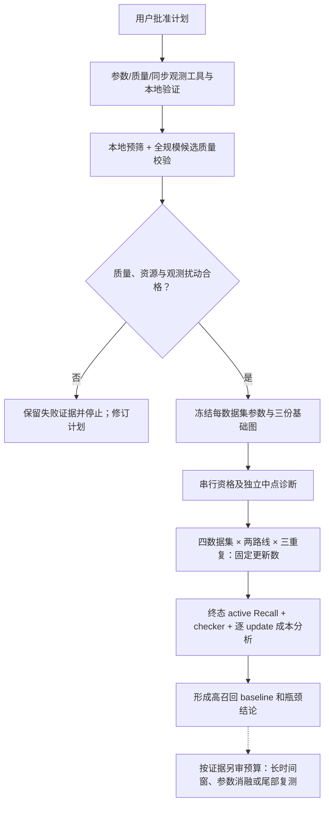

# 高召回 Compute / OSD baseline 重测执行计划

日期：2026-11-17；恢复说明更新于 2026-11-18。状态：**用户已批准继续首批准备与资格试验；正式 24-case 尚未启动**。

最初版本为待审批计划。用户随后明确授权启动试验，并要求确认后台启动后结束跟踪，
约 12 小时后再查看。当前首先实施本计划中的工具准备、基础图质量筛选和导入提速资格；
阶段进度以运行目录的 `status.json` 为准。启动脚本不部署 CLS、不重启服务。

## 1. 目标、范围与必须先澄清的参数

目标是在相同质量要求下，重新测量传统 Compute 路线和未开启后续优化的 OSD baseline，
确认独立查询 Recall@10 至少达到 0.90，再分析高质量要求是否改变 OSD 的瓶颈。

本计划按以下理解编写：**M=8、ef=32 是需要重新调整的旧设置，允许提高 M 和 ef；
frontier window 始终保持 1**。若 M 或 ef 必须固定，需要先修改计划；不能承诺旧参数
必然达到 90%。参数最终值由测量决定，本计划中的候选值不是已经达标的结果。

| 路线 | 定义 | 实验资格 |
| --- | --- | --- |
| Compute | 全更新链路使用原生 librados，取回候选向量并在客户端算距 | `storage_access_mode=raw_rados`；CLS 调用严格为 0；raw 调用大于 0 |
| OSD baseline | 当前 M2 同步执行路径，CLS 在对象内读向量、算距和执行对象局部操作 | CLS 调用大于 0；禁止启用阶段 3、5A、6 的优化 |

共同固定：单 Coordinator、5 个 OSD、更新并发 4、现有 owner/object 布局与每对象点数、
同一提交和二进制；`frontier_window=1`、`frontier_adaptive=false`、
`distance_microbatch=false`、`distance_target_max_inflight=0`。执行器不创建，
线程数配置不构成另一项实验变量。实验池继续采用历史单副本研究配置。
RADOS 操作超时先沿用 45 s、重试上限 3，但正式资格要求无超时/重试；若高召回下
确有合法长操作超过此界限，先保存失败再统一修订两路超时，不能只给其中一路放宽。

这次是**高召回要求下重新建立基线**。新参数相对旧参数更慢不等于优化失败，
OSD 相对同期 Compute 的差异也不能全部归因为算距下沉：两路完整存储操作实现不同。

## 2. 已核实的事实及当前缺口

### 2.1 旧实验可以提供哪些依据

| 数据集 | 旧严格 Compute 平均延迟 ms | 阶段 2 OSD 平均延迟 ms | 阶段 2 旧静态 Recall@10 |
| --- | ---: | ---: | ---: |
| GIST1M | 441.180 | 350.664 | 0.3697 |
| Text2Image10M | 495.994 | 403.281 | 0.4273 |
| Deep100M | 579.801 | 523.354 | 0.4836 |
| SIFT100M | 661.780 | 504.720 | 0.4943 |

Compute 来自阶段 1，OSD 来自阶段 2，属于不同批次，只作历史背景。
旧 OSD 的距离阶段约占完整更新时间的 67%–70%，批次约 418–588 次/update，
候选/批次约 1.009–1.114；主要成本是往返/排队残差和 payload 读取。
这些是待重新检验的旧结论，不能预先认定高召回实验仍具有相同瓶颈。

本轮保持的数据规模与导入配置如下，只有本地预筛允许使用明示的子集：

| 数据集 | 实际 base N | 维度/类型 | 距离 | 构图线程 | points/object |
| --- | ---: | --- | --- | ---: | ---: |
| GIST1M | 1,000,000 | 960 / F32 | L2 | 32 | 16,000 |
| Text2Image10M | 10,000,000 | 200 / F32 | IP | 48 | 60,000 |
| Deep100M | 100,000,000 | 96 / F32 | L2 | 64 | 160,000 |
| SIFT100M | 100,000,000 | 128 / U8 | L2 | 64 | 250,000 |

沿用 meta/owner0 落 OSD0、owner1–4 分别落 OSD1–4 的实验布局；执行时核对全部
实际 PG/OSD 映射并保留 OSDMap epoch，不只保存每池 `.0` 后假定其他 PG 相同。

### 2.2 不能直接改一个 ef 就开跑

| 源码核实结果 | 对执行计划的影响 |
| --- | --- |
| 导入器 `--ef` 传给 hnswlib 构造器，是 efConstruction | 单独记录为 `ef_construction`，控制基础图构建质量 |
| Coordinator `--ef` 用于插入时的 `SearchLayer` | 单独记录为 `ef_update`，控制在线插入候选搜索宽度 |
| 当前没有独立只读查询评估入口 | 新增只读评估，参数记为 `ef_query`；正式质量验证固定 `ef_query=ef_update` |
| 当前 runner 没有显式传递 `--M/--ef` | 批准后补参数透传、合法性检查及实际生效值；不能只设置未被读取的环境变量 |
| cache 加载主要检查 N、M、向量字节数 | 增加 efConstruction、metric、数据身份及 cache 哈希核验 |
| 现有 Recall 对比插入前候选 global ID 与原始 base GT | 保留为历史兼容诊断，不用它宣布更新后 active 语料达到 90% |
| 5A 的 per-target 时延指标只在执行器路径记录 | 为同步 baseline 单独补观测，不能开启 5A 借用指标 |

源码依据：[导入与构图](../src/importer/base_index_importer.cc#L407)、
[在线插入搜索](../src/coordinator/update_coordinator.cc#L3863)、
[旧 Recall 计分](../src/coordinator/update_coordinator.cc#L3915)、
[当前 runner 调用](../scripts/run-phase1-ab.sh#L444)。

还有一项质量限制：[在线邻居选择](../src/coordinator/update_coordinator.cc#L4128)
直接截取最近邻，反向边超限时删除旧边，未完整复现 hnswlib 的邻居多样性维护。
因此提高 M、ef 也可能无法维持更新后 90%；若发生，应报告失败并停止，不能把新的
图维护算法悄悄加入本次 baseline。

### 2.3 2026-11-17 只读环境快照

- Git：`main`，核对起点 `d55d7a1`，编写计划前工作区干净。
- 未发现运行中的 NSVU importer、Coordinator、checker 或实验 runner。
- FSID 为 `c83da116-1e8b-11f1-933d-cd48aa44d216`；5/5 OSD up/in，33/33 PG active+clean，
  当前仅有 `.mgr`、`rbd`，没有 `nsvu_*` 池。
- 当前健康项是 `devicehealth` 模块 disk I/O error，集群仍为 HEALTH_ERR；本次查询
  未列出旧报告中的 BlueStore slow-op 项。执行前必须重新保存健康详情，不能直接沿用快照。
- 本机可用内存约 860 GiB，本地文件系统剩余约 1.2 TiB；Ceph 汇总剩余约 1.3 TiB。
  仍须逐 OSD 检查容量和设备状态。
- 阶段 6 冻结 cache 继续保留，不覆盖、不清理；新图使用独立目录。

## 3. 90% 召回率如何定义和验收

### 3.1 主质量指标

对预先固定的独立查询集合 Q，计算：

```text
Recall@10 = sum_q |returned_active_labels(q) ∩ exact_active_top10(q)| / (10 × |Q|)
```

每条查询最终返回最多 10 个不同的 active external label；缺少的结果仍计入分母。
允许 stale 节点作为图遍历的导航节点，但最终结果必须符合 label 的当前有效映射。
不通过删除难查询、缩小分母或计入旧版本来提高分数。

**每个数据集、每条路线、每个正式重复分别要求初始图及终态 Recall@10 ≥0.90。**
调参目标为 ≥0.92，给独立图和并发变化留余量；报告按 query 重采样的 95% bootstrap CI
及每 query Recall 分布。0.90 是集合均值门槛，不表示每条 query 都命中 9/10；
CI 单独展示，不把未预设的 CI 下界事后改成新的门槛。

预检诊断轮额外检查更新至 50% 时的 active Recall。正式计时轮只在运行结束后评估，
避免中途查询、暂停或 GT 计算改变缓存与调度。故正式结论只覆盖已测快照，
不声称证明任意更新时间点都 ≥90%。

两条路线必须各自满足绝对门槛，并在同一 held-out query 清单上报告配对差值；
质量差值建议要求绝对值 ≤0.005（0.5 个百分点）。串行资格检查另外核对实际轨迹。
旧比较器只有单向相对门槛，需要增加绝对门槛、固定 query ID 集合和快照身份检查。

### 3.2 查询与更新分离，防止自匹配

在调参前用固定种子打乱 query ID，冻结并保存清单、文件哈希与原始行号映射：

| 数据集 | 调参 query | 最终独立验证 query | 更新向量来源 | 主实验固定更新数 |
| --- | ---: | ---: | --- | ---: |
| GIST1M | 200 | 400 | 其余 400 条 | 400 |
| Text2Image10M | 1,000 | 1,000 | 其余 query | 2,000 |
| Deep100M | 1,000 | 1,000 | 其余 query | 2,000 |
| SIFT100M | 1,000 | 1,000 | 其余 query | 2,000 |

三集合互不相交，验证 query 不作为新向量插入，防止查询找到自己造成虚高。
参数选择只使用调参集合，最终验证集合在参数冻结后才使用；若验证失败，不反复
用同一验证集选参数并继续声称它独立，应报告失败和下一轮数据划分方案。

这是对旧“按原 query 前缀更新”工作负载的明确改变，必须记录并在两路一致使用。
新 runner 要支持 query/update ID 清单或预生成的紧凑文件与 GT 行重排，不能继续
硬编码 offset=0 后口头宣称数据已隔离。

### 3.3 GT 的正确性与动态快照

先校验 base 的实际 N、维度、类型、度量与 GT 来源、ID 范围；Deep/T2I 截取文件
保留 1B header，实际只含 100M/10M，工具不能按 header 读取不存在的数据。
L2 与 IP 沿用现有定义，不通过归一化或改变距离度量提高 Recall。距离并列时预先
固定 label tie 规则，并报告严格 ID 计分及必要的并列敏感性检查。

初始图使用经核验的原始 base GT，抽取少量 query 做全库精确距离扫描复核。
更新停止并排空全部在途操作后，保存提交轨迹及 active label→当前向量映射。
动态 GT 基于完整 active 语料：原始 base 减去被替换 label 的旧向量，再加入每个
label 最后一次成功提交的替换向量；不能简单给原 GT 过滤 stale 后直接作为 top10。

推荐先实现可验证的精确增量 GT：从原 base 的精确 top-L 中去掉被替换 label，
对当前替换向量精确算距并合并。**只有剩余 base 候选至少有 10 个时**，这份已知
精确前缀才足以确定幸存 base 的 top10；不足时对该 query 执行全库精确扫描。
边界并列按前述规则处理。用小型可穷举样例和少量全库扫描核对增量结果；若无法
验证等价，则直接采用分块流式全库精确扫描。所有 GT 计算在性能计时以外进行。

新增查询入口复用既有搜索语义，分别用 raw / CLS 路径读同类数据；独立评估中的
active 结果过滤不修改插入算法。只读查询耗时另存，不混入更新延迟。
旧 `precommit_static_recall_at_k` 继续保存并明确标注其静态、插入前候选含义。

## 4. 有界参数筛选，而不是直接指定一个“必达 90%”的配置

参数分成四项：图出度 M、基础构图 efConstruction、插入搜索 efUpdate、只读评估
efQuery。正式评估固定 `efQuery=efUpdate`，避免仅增加评估搜索预算掩盖更新代价。
同一数据集的两条路线使用完全相同的四项参数；允许不同数据集选不同达标组合。

| 步骤 | 候选或操作 | 进入下一步的条件 |
| --- | --- | --- |
| 旧设置校准 | M8 / efC32 / efU32，使用小样本或身份已核验的历史图 | 验证新旧计分、搜索及字段口径，标成低质量诊断锚 |
| 本地预筛 | M∈{8,16,32}，efC∈{200,400}；efU/efQ∈{64,128,256,512} | 先筛质量明显不足或资源代价过大的组合 |
| 全规模首选 | 优先测试 M16 / efC200；在同一图上扫描 efU | 调参集合达到 0.92，且更新后调参质量和资源可接受 |
| 有界升级 | 根据预筛选择 M8 / efC200 或 M32 / efC200，必要时 M32 / efC400 | 每数据集最多 3 份全规模筛选图，efU 上限 512 |
| 参数冻结 | 选通过质量门槛且资源/搜索工作量较低的组合 | 冻结后执行独立验证，失败则停，不换路线参数补救 |

本地预筛可用 100K–1M base 子集减少构图成本；子集 GT 必须重新精确计算，不能使用
全库 GT 直接评价子集索引。本地 hnswlib 搜索只能筛选候选，最终必须使用本项目
实际搜索和更新路径验证，不能把本地搜索结果替代远端 baseline 的质量证据。
只读 efQuery 扫描可以复用未修改的同一图；每个 efUpdate 的实际更新试验必须重新
从冻结基础图导入，不能在前一档已经更新的图上继续测试下一档。

提高 M 会改变图出度、层数分布、邻接及 patch 工作；提高 efC 主要改变基础图质量；
提高 efU 会增加插入搜索工作。比较表同时列参数、Recall、访问候选、构图时间、
峰值 RSS、cache 大小和在线更新成本，不以“维度更高”单独解释收益。

每数据集最多 3 份全规模**候选**构图；胜出图可作为正式 rep1，再独立建图生成
rep2、rep3，因此最多 5 份全规模构图。多线程构图即使固定种子也不保证图相同，
配对一致性依据冻结 cache 哈希。所有候选失败则提交失败分析，扩大 M/ef 上限或
改图维护算法都需另行修订计划。

## 5. 批准后需要完成的实现工作

以下为实施清单；当前首批已补充 importer build-only/owner 并行/批次字节上限、独立查询、
质量工具与同步观测。未通过真实数据资格的能力不能视为正式实验已通过：

| 工作 | 具体边界与交付 |
| --- | --- |
| 参数与 cache 身份 | runner 透传 M、efC、efU；输出实际值；核验导入图与在线 M 一致；cache manifest 记录数据 hash、N、metric、M、efC、种子、构图线程、版本与 cache hash |
| 构图与实验解耦 | 支持离线 build/cache-only；同一 pair 两路都从该 cache load，再分别导入空池，避免第一路构图而第二路仅加载的过程不对称 |
| 新 baseline wrapper | 按 dataset/rep/工作负载选择独立 cache 和输出目录；固定所有优化开关；预生成并记录 AB/BA 顺序；可恢复运行但不覆盖已完成工件 |
| 查询/轨迹清单 | 支持 query ID 与 update ID 映射；保存目标 label、向量来源、提交序号和版本；固定数量模式禁止无意循环 |
| 质量评估 | 新增只读查询、active-label 计分、快照 GT、绝对 0.90 与配对差值门槛；初始/中间/终态可追溯 |
| 同步路径观测 | 按第 7 章补逐 update 阶段、RPC 直方图与关联轨迹；覆盖 raw 和 CLS，保持协议和算法语义 |
| 汇总与绘图 | 区分质量诊断/正式固定数/可选时间窗；生成路径资格、参数、质量、性能与瓶颈表及可复现图 |

不能直接把 `HNSW_INDEX_CACHE_MODE=build` 配上 `MODES="compute osd"` 使用现有脚本：
其 cache 参数为全局单值，第一路保存后第二路会拒绝覆盖，多个数据集也不能共用该路径。
新 wrapper 必须管理每 dataset/rep 的身份；复用冻结图是实验控制，不是启用阶段 5A。

优先只改客户端、工具和观测，利用现有 CLS 距离服务分项。若必须改变 CLS 回复结构
或新增服务端追踪，先列出额外修改与部署影响再审阅；本计划不默认要求重启 OSD。

### 5.1 优先缩短索引准备时间：本地构图与 Ceph 导入分别处理

补充依据：2026-11-17 重新读取阶段 1 的 24 份 `import.json` 和阶段 5A 的
cache build/load 导入记录。下表为阶段 1 六次导入的均值，单位分钟；这些是历史
M8/ef32 数据，不是新参数的预测。

| 数据集 | 整次导入 | 本地 build 分支 | 向量/VectorRef/label 持久化 | 邻接持久化 | 两项持久化占比 |
| --- | ---: | ---: | ---: | ---: | ---: |
| GIST1M | 2.93 | 0.35 | 2.32 | 0.18 | 85.15% |
| Text2Image10M | 10.08 | 1.16 | 6.70 | 2.04 | 86.77% |
| Deep100M | 82.49 | 10.04 | 45.96 | 25.39 | 86.49% |
| SIFT100M | 76.18 | 11.67 | 35.12 | 28.56 | 83.59% |

`build_seconds` 包括转换、构图及该分支的保存等时间，`convert_seconds` 是其中的
子项，不能再相加。已有 hnswlib cache 可以跳过重建图，却仍需导入全部数据；
阶段 5A 的 cache-load 三轮均值中，Deep 导入仍为 **75.25 分钟**，SIFT 为
**65.69 分钟**，约 97% 时间在持久化。后续优化组的在线更新性能不参与这里的
baseline 比较；这里只用其导入准备阶段的数据判断 cache 实际省去了什么。

当前写入形态：虽然每个 owner 有缓冲，向量与邻接两段仍由单一循环同步调用
`write`/`omap_set` 并等待；`--threads` 仅配置本地 OpenMP 构图，不会并行导入五个
owner。定位见[向量持久化循环](../src/importer/base_index_importer.cc#L487)和
[邻接持久化循环](../src/importer/base_index_importer.cc#L575)。
实施时先细分数据读取/转换、纯构图、cache 保存/加载、编码 CPU、flush RPC 次数/
字节/等待、各 owner 完成时间和最终排空时间；并行后以阶段墙钟衡量准备耗时，
各 worker 的累计 I/O 时间另列，不能相加后冒充总运行时间。

批准后的优化顺序如下，先做准备阶段提速，不改变在线 baseline：

| 优先级 | 措施 | 为什么可能有效 | 不变条件/验收 |
| --- | --- | --- | --- |
| P0 | 每份冻结图只构建一次，同图各 case 复用；增加独立 build-only 入口 | 避免在参数复测、两路恢复时重复构图，所有正式导入都 load | 仍保留三个独立正式基础图；核验完整 cache 身份，不把同图重跑当独立构图 |
| P1 | 按 owner 分区并行导入，先测并发 1/2，再测最多 5 | 当前不同 owner 的 I/O 等待全部串行，存在重叠不同 OSD 写入的机会 | 每 worker 独立 IoCtx/缓冲；同对象有序；最终 payload、offset、VectorRef、邻接、label、global meta 一致 |
| P1 | OMAP 条数从 2048 扫描 4096/8192，同时设编码字节上限 | 减少约十万级小批次的同步往返，限制高 M 时单请求大小 | 条数和字节双门槛，按实际 Ceph 请求限制校验；无超时、错误或新增 slow-op；不修改在线 batch 参数 |
| P2 | 对冻结图预生成可重放的导入批次文件 | 多次恢复时省去逐节点编码、重复邻接转换或部分图加载工作 | 单独 manifest 绑定图/data/layout/编码版本；验证全部数据等价；新增磁盘成本纳入预算，先测编码占比再决定 |
| P2 | 优化本地构图的连续内存、线程/NUMA及 importer 专用编译选项 | 高 efC 后本地构图可能显著增重；当前逐向量 string、浮点副本增加内存与遍历 | 固定 M/efC；验证质量；构图结果重新冻结，两路共用；不全局更改 Coordinator/CLS 编译参数 |

第一版按 owner 并行即可，不同时引入复杂的无限异步队列。对每个 owner 按其原有
ID/offset 顺序写入；reset 先完成，随后写 payload/对应 OMAP/邻接，全部 worker
成功完成后才发布 global meta。任何失败停止发布，排空/回收已发请求，报告导入
失败；现有空池重导入流程处理残留，不声称新增了可恢复在线事务。
统计采用线程局部累计并归并，进度文件由单一写入者输出。

批次机会可以从布局静态估算：Deep100M 的 VectorRef、label、邻接三类 OMAP 写，
按当前代码和布局，2048 条批次约 **147,580 次**；8192 条且暂不触发字节上限时约
**37,210 次**，减少约 74.8%。这是调用次数估算，不是已经测出的时间收益。
高 M 会增加邻接值大小，因此需要额外的字节上限，实际次数可能高于该估算。

不优先增大 payload batch：四数据集的完整对象 payload 约为
58.59/45.78/58.59/30.52 MiB，已经小于默认 64 MiB，多数对象只在换 chunk 时写一次。
继续调大阈值难以减少这些写调用。也不通过降低 M/ef、减少 base N、放弃 checker
或只做抽样正确性检查来缩短正式实验。

本地构图目前已使用 32/48/64 个 OpenMP 线程；主机为 52 个物理核、104 个逻辑
线程、2 个 NUMA 节点，不能简单把线程加倍当作收益保证。可以针对新参数测试
16/32/52/64 线程与绑定策略。当前 Makefile 默认 `-O2`，hnswlib 已有 SSE 路径，
并非完全标量；AVX 编译选项仅作为 importer 的候选，不启用 `-ffast-math`，也不把
`-march=native` 直接加到所有 OSD/Coordinator 产物。不同构图调度和浮点累加可能
改变图，依然必须重验质量和冻结新图。

优化验证先用同一小型冻结图核对单线程旧导入和并行导入的最终逻辑内容：对象数、
payload 字节/hash、所有 OMAP key/value、VectorRef offset、level、邻接、label、
global meta；排除对象时间戳等非内容字段。覆盖 owner/chunk 边界、尾批、批次
字节上限及中途失败；随后全量 checker 和初始独立 Recall 都必须通过。
再用 GIST 与一个 100M 数据集测 1/2/5 导入并发及 OMAP 批次，分步升级，不一次
启动完整笛卡尔积。真实导入与性能验证仍等待用户批准。

导入更快可能改变 BlueStore 后台工作和缓存热度；两条路线统一使用同一版本的
导入器、并发、批次、导入后等待政策，并记录实际系统负载。保存逻辑内容相同的
证据不能替代运行时缓存条件说明。整个实验同时只运行一个 runner。

**收益如何预估：** 若两项持久化实际都加速 2 倍、其余不变，旧 Deep 单次导入静态
估算为约 **46.8 分钟**，SIFT 约 **44.3 分钟**；若只把本地 build 理想化全部消除，
旧总导入也仅分别减少约 12.2%/15.3%。这些用于确定优化优先级，不是测速结果。
新 M/efC 可能改变阶段占比，首轮高参数 pilot 后应重新判断。

验证包括参数透传/拒绝非法组合、错误 cache 被拒绝、query 清单无交集、精确 GT 与
active 映射、raw 路径 0 CLS、时间分解闭合及计数完整性。使用现有构建与测试入口：

```bash
CEPH_SRC=/home/hhf/ceph/src \
HNSWLIB_INCLUDE=/home/hhf/motivation_test/hnsw_test/include \
make -j2 all check
python3 -m unittest discover -s tests -p 'test_*.py'
bash -n scripts/*.sh
```

新增工具针对以上真实风险补测试；正式 Ceph smoke、构图与运行仍属于批准后的步骤。

## 6. 实验顺序、矩阵与公平性



### 6.1 准备与首轮资格

1. 重新检查进程、FSID、OSD/PG、池、设备与容量；记录当前健康项及基线系统负载。
2. 校验四数据集、GT、query 分组；完成工具测试、参数筛选及初始图质量资格。
3. 每数据集运行一对并发 1 的短 trace（默认 100 次更新），核对 label、新 ID、
   层数、候选及距离、提交结果；排除路径实现差异。浮点差异使用预设容差并检查
   排名影响，不为追求哈希一致改变 baseline 的 tie 规则。
4. 在独立的并发 4 质量诊断 pair 中执行完整固定更新数，于 0%、50%、100% 排空
   在途任务后评价调参 query 的 active Recall；参数冻结后验收 held-out query。
   这些暂停诊断不进入正式性能均值，最多四数据集各一对。
5. 先用 GIST 做观测开销校准，再检查一个 100M 数据集的完整导入/检查成本，更新预算。

若串行路径不等价、任何质量门槛失败或观测改变结果过多，停止进入正式批次。
冻结参数后的失败图不能被静默丢弃并换图；所有失败必须进入结果清单。

### 6.2 主正式批次：固定更新数

| 项目 | 默认安排 |
| --- | --- |
| 数据集与重复 | 四数据集 × Compute/OSD × 3 次独立图，共 24 case |
| 固定数量 | GIST 400；其他各 2,000；无时间截断，不重复 update 清单 |
| 并发与路径 | update parallelism=4；frontier=1；后续优化全部关闭 |
| 配对方式 | 同一 rep 共用同一新图 cache，分别空池导入；两路均 load；更新向量、目标 label、随机种子相同 |
| 顺序 | 预先固定并交替 AB/BA；3 次有一档顺序多一次，在结果中展示；不同时运行两条路线 |
| 缓存条件 | 统一导入批次、导入后等待与轻量预热政策；正式 case 不额外先跑质量查询；称“导入预热后”，不称冷缓存 |
| 性能时间 | 仅更新阶段；记录排队到完成定义、完整 `graph_seconds`、成功数和每 update 延迟；排除构图、导入、GT、离线检查 |
| 终态验收 | 全部更新结束后做 active Recall、结构/label/语义 checker；不再继续沿用该索引跑另一组 |

初始质量证据来自该冻结图的资格评估和导入一致性核验，不在每个计时 case 前执行
大批查询预热。并发 4 不能固定全部提交交错：两路初始图相同，但终态图可能不同。
因此每个 case 都按其实际有效映射评价质量，不声称并发轨迹逐条完全一致。

固定数批次同时报告 `成功更新数 / graph_seconds`，称为该固定任务的完成吞吐。
不把它直接称为长时间稳态容量。GIST 400 次只有约 4 条最慢 1% 样本，P99 仅作
探索性结果；更大样本不足时不能宣称稳定改善长尾。

### 6.3 可选第二批：固定时间窗与定向诊断

主批次合格并完成预算复核后，才另行确定是否运行 300 s 时间窗、并发消融、
probe-on 或旧参数同期锚点。若四数据集两路线三重复全做时间窗，将增加 24 case，
不包含在主批次中。若只需要补 GIST 尾部，优先做该数据集的定向重复。

时间窗必须明确是否循环 update/label、实际完成数、索引增长及 stale 比例；现有
实现会循环 query，不能沿用一次性固定数的工作量解释。窗口末停止新请求后排空，
报告实测时间及 drain 时间，不只用“300 s”名义分母。质量在对应终态重新验收。

若要证明“新参数导致瓶颈迁移”，需在同期环境增加低参数锚点或一次只改变 M/ef 的
对照；旧历史图表只能支持“观测构成不同”，不能确立变化原因。本计划的主批次先
回答高召回两路线的表现与当下主要成本，不预先把额外消融全部启动。

## 7. 必须测什么，才能发现 OSD 新瓶颈

### 7.1 最小观测包及现有能力边界

| 观测层 | 每次测试必须保存 | 现状与批准后补充 |
| --- | --- | --- |
| 运行身份/质量 | 提交、二进制/CLS hash、实际 M/efC/efU/efQ、数据/GT/query/cache hash、路径开关、有效快照、逐 query hits/结果 label | 版本和旧静态 Recall 已有；实际参数、独立查询及动态 GT 需补 |
| 更新总体 | 每 update ID/序号、worker、目标 label、新 ID/level、开始/结束、延迟、成功/失败、retry、候选和调用数 | 总体均值/分位已有；JSON 未导出完整逐 update 延迟与阶段，需要补 |
| 互斥阶段 | label 查找、ID 预留/读取、写向量、搜索控制、距离等待、写新邻接、patch 准备/应用、meta、label CAS、stale、锁等待及残差 | 累计阶段已有一部分；逐 update 和不重叠边界需补齐 |
| 搜索工作量 | 分层展开数、候选去重前后、实际评分数、邻接读次数/字节、visited/堆工作、锁等待、CPU 时间 | 候选/调用已有；分层、CPU/锁、细分图控制需补 |
| 同步距离 | RPC 起止、候选/批次直方图、CLS 总服务和 VectorRef/payload/compute、raw 拉向量耗时/字节、本地算距 | 累计分项已有；同步 RPC 分布与逐 update 关联需补 |
| 请求形态/布局 | 每操作 CLS/raw 次数、应用请求/回复字节、query/payload/邻接字节、同 update 唯一距离对象、PG/OSD 扇出、重复对象访问、实际 batch 大小 | 多项已有；实际映射、跨调用完整性及各类字节定义要校验 |
| 写放大/图质量 | 新旧邻接长度、patch 目标和次数/字节、裁剪边数、跨 owner 边、stale/active 数量、label/meta 重试与锁等待 | 邻接/patch 总量已有；裁剪、锁和独立有效质量需补 |
| 客户端/OSD/设备 | CPU/线程占用、RSS、上下文切换、NIC 吞吐/重传、OSD ops/latency、队列可用项、设备吞吐/IOPS/await、缓存及 RocksDB/BlueStore 活动可用项 | 新采集器按本机 Ceph 17.2.9 实际 perf schema 选择字段，缺失就标缺失 |

发现一处需要修正的**观测漏项**：OSD `ReserveInsert` 在 CLS 调用后直接读取
reservation 的 raw OMAP 操作，当前未完整进入 raw profile，且 meta 计时此前已结束。
需在不改变存储协议的前提下补调用数、字节、时间和所属 update；同时审计所有
librados 入口，不把现有 CLS calls 当成完整物理请求总数。
见[对应读取](../src/coordinator/update_coordinator.cc#L1472)。

### 7.2 逐 update 尾部关联与采集扰动

每个 update 保存一行轻量数值记录；同步 CLS/raw 操作维护统一直方图。对完整 RPC
轨迹按确定规则抽样（起始建议 1/64 的 update），另以每 worker 有界内存记录当前
update 的 RPC，保留慢更新样本及丢弃/截断计数。RPC 记录关联 update、请求、
opcode、owner/chunk、PG/OSD、起止、请求/回复字节及可用 CLS 分项。
不要依赖当前距离信封中为 0 的 update ID，客户端需要显式传递关联上下文。

不记录向量正文或凭据；采用缓冲批量落盘，禁止每个 RPC 同步打印日志。诊断 trace
有数量与磁盘预算，超限标记而不是静默缺失。主机采样建议 1 s，Ceph perf 5–10 s；
保留节点时钟偏差，跨机不以未经校准的绝对时间相减。NIC 流量含共享业务，不能全
归因于实验；应用计数字节也不是 TCP/以太网实际线上字节。

正式主性能关闭主动 noop probe。现有 1000 ms 限频按 target 而非全局，增加扇出后
可能额外产生大量同步探针。现有 runner 强制打开 probe，批准后要改为可配置并写入
manifest。probe-on 仅用于独立诊断，并加全局速率限制与扰动记录。

在同图同 trace 上做观测关闭/轻量观测开启对照，至少 3 对短运行。建议开销门槛：
平均延迟变化绝对值 ≤5%，P99 ≤10%；若样本太少不能判定 P99，则报告不确定并先降
采集量。详细 trace 与 probe-on 结果不混入主性能表；观测不合格先调整采样再正式跑。

### 7.3 正确的时间核算

```text
加权完整延迟 ms/update = 所有成功 update 的端到端时长之和（毫秒）/ 成功数
阶段 ms/update = 同一成功 update 集合的该互斥阶段时间之和（毫秒）/ 成功数
其余 ms/update = 加权完整延迟 - 上述互斥阶段之和
```

排队/持锁时间必须归入一次且边界明确；同 update 嵌套的距离时间从搜索和 patch
总时间中扣除，不能重复相加。跨 worker 时间之和可超过墙钟，不能用墙钟减累计
worker 阶段来闭合；旧 `other_update_seconds` 不直接作为新分析残差。

同步路径的 `RPC RTT - CLS service` 只能叫**往返/排队残差**，包含网络、librados、
OSD 排队及调度；payload 读取计时不等于物理盘服务。不要把不同分布的 P99 相减，
也不要用距离 P99 + patch P99 推算 update P99。尾部解释必须回到同一条慢 update。

## 8. 如何根据结果判断瓶颈是否改变

| 待检验情况 | 所需证据 | 能形成的结论及边界 |
| --- | --- | --- |
| ef 提高主要增加串行细粒度访问 | 候选、批次、邻接访问及 RPC 总时长增多，单 RPC 时延接近，距离仍占主导 | 旧 RPC/依赖等待瓶颈增强；未必出现新瓶颈 |
| M 提高增加邻接与 patch 代价 | 度数/邻接字节、patch 次数与裁剪、写时延及锁等待上升，慢 update 在该路径停留 | 支持图维护或写路径成为重要限制；需同参/单变量对照才能归因于 M |
| Coordinator 搜索控制变重要 | 排除远端等待后 CPU、visited/堆、内存分配或锁等待占比与绝对量上升 | 支持客户端控制瓶颈，不能把含邻接读取的“搜索控制”全部称 CPU |
| payload/OMAP 读取变重要 | CLS 分项增大，与对应 OSD/设备时序和慢 RPC 目标一致 | 支持对象访问成本上升；没有块层证据时不直接归因于磁盘 |
| target/OSD 热点或排队 | 慢 update 的 RPC 集中于相同目标/OSD，并伴随对应并发与系统压力 | 可以定位候选热点；仅聚合残差高不足以证明拥塞根因 |
| 元数据/锁成为限制 | reserve/finalize/CAS/锁等待绝对成本、重试及慢 update 关联显著 | 支持协调瓶颈；不能仅凭占比变化就决定拆元数据 |
| 图维护质量下降 | 初始达到 90%，中点/终态跌破；stale、裁剪与搜索工作增长 | 本轮高召回 baseline 不合格；保留结果，另拟算法验证 |

每项结论同时看绝对 ms/update、百分比、调用次数和单位调用成本。
某阶段占比变大可能只是其他阶段下降，不能单凭占比宣布瓶颈迁移。
允许结论是“没有新瓶颈”或“当前证据不能区分根因”，不预设 OSD 必须变快。

## 9. 资源、耗时、停止条件与现场操作范围

旧 M8/ef32 四数据集 24 case 约用时 29.95 h，阶段 2 的 12 case 约 14.79 h。
旧每 case 导入均值约为 GIST 176 s、Text 605 s、Deep 4949 s、SIFT 4571 s，
大型 checker 同样需要较长时间。不能用 `24 × 300 s` 估算完整成本。

本计划核心包含 8 个短串行资格 case、最多 8 个中点质量诊断 case、24 个正式 case，
最多 **40 次全量导入/检查**，不含有界筛选中的额外验证。按旧流程规模已是多日工作；
新 M/ef、精确 GT 和 cache 复用会分别增加或减少部分成本，不能把旧比例外推当承诺。
首个 GIST pair 与首个 100M pair 后给出逐阶段实测预算，再决定是否继续完整批次。
可选 24 个时间窗 case 另外列预算、另行确认。

总日程也要依据导入优化实测更新。旧 24-case 流程的全部 importer 时间合计约
17.17 h；若**总导入时间**实际减半，其余不变，旧全流程可由约 29.95 h 静态估算为
21.37 h，节省约 8.58 h。检查器、更新和质量评估仍有成本，不能将 importer 的
倍数直接套到整个 4–7 天的初步日程。检查器目前也有按 owner 串行扫描，待第一轮
导入优化完成后再按实测决定是否另做有界并行；保持完整检查覆盖，不减少验收。

默认资源边界建议：单个大型构图/GT 作业串行执行；任务峰值 RSS 预算 750 GiB，
新增本机工件预算 700 GiB且文件系统始终保留至少 250 GiB；逐 OSD 使用率达到 80%
前停止新导入。启动前用实测图大小、并发副本数及 GT 缓冲重新核算，任何预算不满足
则停，不自动删除历史 cache。完整实施阶段的额外时间上限以 pilot 预算审阅为准。

以下任一项触发停止并保存现场：

- 参数上限内无法达到 90%，初始或更新后质量失败、配对质量越界。
- 路径门禁失败、更新失败、超时/重试、checker error 或未解释 warning。
- cache/数据/二进制身份不一致、实际参数与计划不符、计数或阶段时间无法闭合。
- OSD 不齐、PG 非 active+clean、新增 slow-op/设备 I/O 错误或容量、内存、工件超预算。
- 观测扰动未通过，或运行时环境变化使 A/B 不再可比。

既有 devicehealth 告警单独登记，不靠屏蔽告警满足门槛；新增设备问题不能简单
归入“历史告警”。异常 case 不静默剔除，补测必须保留原始记录、原因与顺序。

用户批准实施后，池操作仍使用精确白名单 `nsvu_meta`、`nsvu_owner_0`–`4` 和 FSID
保护；不触碰 `.mgr`、`rbd`。只在无其他实验时重建实验池。需要管理员权限使用
`sudo -n`；不更改 sudoers。不通过重启 OSD、强制压缩或清缓存来隐藏问题。
完成并核验工件后，按带 FSID 的 dry-run/确认清理流程收尾，并再次记录集群状态。

## 10. 交付、统计与可视化

每个运行目录保存：manifest、命令与环境白名单、cache/数据身份、实际 placement、
导入/更新/检查 JSON、逐 update 记录、RPC 采样及截断计数、系统时序、质量快照/GT
身份、自动 gate 结果、失败和补测清单。原始数据、cache、日志留本机，不提交 Git。
代码、计划、正式报告和绘图程序按仓库规则分清提交；图只展示实测数据。

主报告至少包括以下图表：

1. **参数—质量—代价曲线**：M/efC/efU 与独立 Recall、构图 RSS/时间、更新工作量；
   画出 0.90 门槛，标注筛选/验收集合，失败点同样展示。
2. **两路线正式比较**：各数据集平均延迟、固定任务吞吐、P50/P95/P99、逐 rep 配对
   变化与 95% 区间，附每组 Recall；GIST 小样本尾部明确标注。
3. **完整时间分解**：同口径 ms/update 堆叠图及占比，显示绝对值与残差。
4. **距离内部与调用形态**：compute 拉取/本地算距、OSD 残差/VectorRef/payload/算距，
   配 RPC/update、候选/批次、扇出、字节和邻接/patch 成本。
5. **慢 update 关联时间线**：同一更新的搜索、距离 RPC、patch、锁和对应系统时序，
   只对有 trace 覆盖的样本定位；注明缺失信息。
6. **质量稳定性**：初始/诊断中点/各终态 active Recall、每 query 分布、stale/裁剪量；
   不把不同 case 的点连成同一条连续轨迹。

正式独立重复是统计单位：主表报告各 rep 和三轮均值/区间，同时展示配对变化；
三轮只是最低配置，宽区间如实报告。阶段成本按成功更新加权，另外说明其与三轮
等权均值的区别。不把几十万个 RPC 当成独立实验重复，也不混合主批次、诊断轮
和可选时间窗。历史旧参数只作背景，除非新增同期对照，否则不报严格因果加速。

## 11. 本次审阅要决定的执行边界

建议批准的核心是：**允许调 M/ef，frontier=1；先补质量和同步观测，再做有界筛选；
每数据集两路线均达到 90% 后，进行固定数量三轮同图配对 A/B，并给出瓶颈证据。**

尚未确定的最终 M/ef 不在本轮凭经验填死。时间窗扩展、扩大参数搜索上限、修改
邻居维护算法、CLS 协议改动或服务重启均不默认为本次核心实施的一部分。
pilot 预算复核是明确的检查点；本计划已获用户批准，首批按下面的范围运行。

## 12. 本次无人值守首批的实际范围与查看方式

入口：`scripts/run-high-recall-preparation.py --confirm-reset --run-root <新目录>`。
默认依次处理 GIST1M、Text2Image10M、Deep100M、SIFT100M：

1. 冻结调参/验证/更新清单并核验数据身份，取两条调参 query 做全库精确 GT 抽查。
2. 从 M16/efC200 开始，在有界候选中扫描 ef=64/128/256/512 的本地 HNSW Recall；
   调参达 0.92 后仅作一次独立验证。该分数明确标记 `local_hnsw_screen_only`。
3. 在 GIST 同图上交替测试导入 `(workers, OMAP batch)` 的 `(1,2048)`、`(2,2048)`、
   `(5,2048)`、`(5,8192)`，各三轮；每轮全量 checker，并读取六池全部对象正文和
   OMAP 内容计算逻辑摘要，确认并行和批次没有改变索引内容。
4. 在 Deep100M 上做原设置与 GIST 候选导入设置的一对规模验证，保留完整 checker；
   若候选就是原设置，去重为一次，明确没有已证实的加速。
5. 完成后按白名单 dry-run/确认清理实验池；遇失败保留现场和完整原因，不继续推进。

这是准备/资格批次，**不冒充正式 24-case Compute/OSD 重测**。新 query 与 active-GT
工具先通过小图真实 Ceph smoke，后续正式实验还需认证远端/动态质量和每轮路径门禁。
启动前只核验到本机 osd.2 已部署 CLS hash 与保存的二进制一致；远端节点当前账号的
SSH 不能访问，其他 OSD 的文件 hash 尚未重新核验。脚本如实记录这个缺口，不能
把历史部署记录或本地 hnswlib Recall 当作完整正式资格。

本次 `ceph versions` 实测所有 daemon 为 **17.2.8**，与旧文档中的 17.2.9 标记区分；
运行保存实际 daemon versions，不更换服务版本。源代码/二进制/脚本在启动时冻结到
运行目录，避免之后仓库改动影响后台任务。

后台每步保存 `logs/`、导入 `progress.json`、质量结果、hash 与 `status.json`，
每分钟检查 OSD/PG、健康项和资源；不需要对话持续运行。首批上限 36 小时，
仍保留 250 GiB 本地空间、新工件最多 700 GiB、子进程 RSS 最多 750 GiB。
此上限仅是防止无人值守无限运行，不代表预计首批必定需要 36 小时。

状态 `running` 表示进行中；`first_batch_complete` 表示首批完成并给出下一步；
`stopped` 会包含失败原因和具体步骤日志。原始记录只存本机 `results/`，不提交 Git。

## 13. 2026-11-18 恢复步骤与保留告警的事件监测

首批原目录为 `results/high-recall-preparation-20261117T162632Z/`。该批于
2026-11-17 19:32:31 UTC 在 Deep100M 串行导入时触发新增 BlueStore 慢操作警告，
按计划停止。GIST 的 12 次导入、完整 checker/内容摘要及前三个数据集本地质量结果
均保留；不完整的 Deep 导入不能当作成功结果，恢复时从新空池重新导入。

只读诊断定位到 osd.2 的两笔事务：19:31:42 和 19:32:00 UTC 的 AIO/commit
完成分别约 9.00 s、5.65 s。运行配置为警告保留 86400 s、阈值 1。此后到恢复前
未找到新增慢记录；三次静默采样的在途请求/事务/finisher 队列均为 0，累计计数不变，
`read_eio=0`，内核日志未匹配到 I/O 错误。这些证据支持“既有事件提示仍留存”的
判断，未证明重负载下不会复发，也未定位介质层根因。

恢复入口为 `scripts/continue-high-recall-preparation.py`，采用两个独立子目录：

1. 先 `--resume-from <原目录> --datasets sift100m --offline-only`，核验并引用已有
   split、图 cache/sidecar/hash 与完整 GIST 结果，仅补 SIFT 本地构图和质量筛选；
   不修改或清理旧失败池。
2. 再从这个完整引用链恢复剩余导入资格。已完成的 GIST 12 轮不重跑；Deep 失败
   case 在新目录、重建空池后重跑，原半成品与旧日志仍保留，旧数据不冒充断点续写。

`--retained-slow-evidence` 只接受已诊断 osd.2 的机读证据。现有健康告警保持可见，
不改变 Ceph 阈值、保留时间、不 mute、不重启、不强制压缩。新增保护包括：

- 从已核验 journald cursor 读取并验证连续记录；每次同时核验 boot/daemon invocation。
- 再出现 slow operation、slow aio_wait、I/O error、进程重启，立即停止并保存事件。
- 日志读取/游标失效、日志窗口超限都停止，不能当作“没有新事件”。
- 集群慢告警受影响 OSD 只能是已取证的 osd.2；新增其他 OSD、OSD/PG 降级或其他
  新健康问题仍停止。不能仅比较健康项名称，因为相同名称可能包含后续新事件。

由于这次资格恢复带有明确记录的历史告警，后续性能报告必须注明背景及事件观察覆盖，
不把本轮视为已经证明存储稳定。单副本告警只允许来自明确的六个实验池。

此前的远端 CLS 文件核验缺口已于 2026-11-18 补齐：5/5 OSD 文件 SHA-256 均为
`1721ad9ba8fc633f34b9e2a4aed3a8f0060cb9e0cdba2baecbb74d2eab4f6106`，
与本地保存的二进制一致。核验记录与历史慢事件证据随恢复运行保存，凭据不进入
输出或工件。只读核验未部署 CLS、未修改认证或服务。

恢复控制器的 `status.json` 记录当前阶段及子运行状态；各子目录继续保存原有详细
日志、质量/导入结果和事件监测状态。控制器在后台衔接两个阶段，用户无需维持对话。

### 13.1 SIFT 完成与导入启动故障修复

`results/high-recall-continuation-20261118T041552Z/offline-sift/` 已完成四数据集
引用链核验和 SIFT100M 本地筛选。SIFT 采用 `M=16`、`efConstruction=200`，
纯构图约 4877.92 s；搜索宽度 128 时 calibration Recall@10=93.41%，独立
validation 的 1000 条查询 Recall@10=92.98%。这是本地静态质量，仍不代表远端
查询或更新后 active Recall 已获认证。

后续 `remaining-imports` 于 2026-11-18 05:49:40 UTC 在生成运行 manifest 时停止：
加载事件监测模块产生的 `bin/__pycache__` 目录被当作文件计算哈希，触发
`IsADirectoryError`。此前只完成启动只读检查，未执行池重置或 Deep 导入，不能把
本次故障记作新的存储慢事件。修复后 manifest 仅哈希实际文件，保留所有复制工具
的内容身份；回归测试通过真实 Python import 生成 bytecode 目录复现并验证此路径。

此次重试直接在新目录运行 `run-high-recall-preparation.py --confirm-reset
--resume-from <上述 offline-sift 目录>`，继续传入原有慢事件证据及五 OSD CLS
核验记录。核验后复用四个合格图和 GIST 完整 12 轮结果，不再构图；Deep 仍从
空池执行原设置与候选设置的一对完整导入、checker。原失败目录与日志保留，
新增事件停止保护、资源预算及正式实验资格要求保持有效。

### 13.2 2026-11-19 停止原因核验

修复后的恢复目录 `results/high-recall-preparation-resume-20261118T075859Z/`
于 11 月 18 日 08:05:15 UTC 再次停止。这次完成了六个实验池重置，随后检查
发现慢告警扩展至 osd.1；实际 Deep importer 尚未启动。远端日志确认重置期间
发生大量 OMAP 删除和 RocksDB flush/compaction，四组 KV 提交约 6.25–10.65 s，
超过运行时 5 s 阈值。

只读设备诊断进一步确认 n118 的 osd.1 对应 `/dev/sdd` 当前 SMART 总体健康
失败，属性 202 `Exception_Mode_Status` 越过阈值。同机同型号 `/dev/sdc`
对照健康通过。具体厂商故障含义及其对本次延迟的贡献程度尚未完全定位，不能
将这次结果解释为 CLS/HNSW 性能问题。保持任务停止，先处理异常 SSD，再验证
存储资格，之后恢复；不以放宽告警规则继续实验。完整时间线、口径和证据见
[停止诊断记录](reports/baseline-preparation-stop-diagnosis-2026-11-19.md)。

用户随后授权修复排查；03:11–03:13 UTC 的非破坏性短自检返回
`Completed: unknown failure`，关闭型号数据库预设后设备仍返回总体健康失败。
现在按 SSD 内部设备/固件故障处理，尚无经适配核验的官方软件修复方法。
`nsvu_owner_1` 的空初始化池已导出备份；当前 `ok-to-stop=false`，不得直接
拔盘或销毁 OSD。需先完成数据保护与受控维护，再由供应商诊断或现场更换 SSD。

### 13.3 2026-11-19 数据迁移与故障 OSD 停用完成

用户随后明确授权停用并迁移。03:47:21 UTC 已完成验收：osd.1 为 down/out，
服务停止且禁用自启，其他四个 OSD up/in，39 PG 全部 clean。8 个池的迁移前后
原生导出文件 SHA-256 均一致，1009 个逻辑对象、3015 个活动副本完整。
没有销毁 OSD 身份或擦除 SSD，也没有降低副本数。

当前 owner1 和 owner2 均放置在 osd.4；旧五 OSD 布局不再成立，不能运行旧实验
runner 或将四 OSD 下的数据并入原对照。换盘并恢复布局后重新认证，或另拟四 OSD
方案。完整授权范围、时间线、校验与工件见
[迁移与停用记录](reports/osd1-data-evacuation-report-2026-11-19.md)。

## 14. 2026-11-19 四 OSD 恢复批次

用户在故障盘迁移停用后明确要求继续未完成任务。本轮采用新的四 OSD 实验组：
四个逻辑 owner 依次映射物理 OSD `0,2,3,4`，meta 放在 osd.0；osd.1 必须持续
down/out，服务保持 disabled。该组不与旧五 OSD 组的远端性能数字合并。

### 14.1 可复用与必须重测的内容

原四份 HNSW cache、数据切分、GT 和本地质量筛选结果可以复用：cache identity
不依赖 owner 数，重新导入时才按 `--owners 4` 分片；每份 cache/sidecar、原始
数据、split/GT 和本地质量证据仍须通过完整哈希与格式核验，不重新构图。

恢复显式使用 `--resume-local-only`。它不复制任何旧导入结果或 selected-settings，
即使旧 GIST 12 轮曾完整通过；仅在所有远端证据均弃用时允许存储摘要脚本的
哈希变化，构图/质量工具和 importer/checker/CLS 二进制身份继续严格匹配。
同 owner 数但物理 OSD ID 不同，也算布局变化，不能隐式复用旧远端结果。

GIST 在本轮冻结图上重新执行 `(workers, OMAP batch)`：`(1,2048)`、`(2,2048)`、
`(4,2048)`、`(4,8192)`，交替三轮，共 12 次。每轮完整 checker 和五个当前实验
池的逻辑内容摘要均须通过；本轮重新选出的设置用于 Deep100M 的原设置/候选
设置规模验证。SIFT 与 Text2Image 的合格本地图也保留引用，仍未冒充远端资格。

### 14.2 实现与现场资格

初始化脚本支持 `OWNERS=4 OWNER_OSDS=0,2,3,4`，在任何删建池前核验目标均为
up/in。旧五盘默认映射因此也会在尝试使用 down/out 的 osd.1 时拒绝，不能误将
故障盘重新加入。importer、checker、digest 和 smoke 的 query/update 均显式传
owner 数；每次 reset 后另外核对 meta/owner PG 的 up、acting 与声明映射一致。

runner 和 cleanup 声明 active `0,2,3,4`、excluded `1`，检查精确 ID 集合和状态；
没有简单地跳过旧的“全部 up/in”门禁。cleanup 保留默认严格行为，显式布局需要
FSID 保护；启动时先对原六个实验池 dry-run/确认清理，以去除旧 owner4，结束
时同样按六池白名单清理。仅本轮五个实验池参与导入与摘要，`.mgr`、`rbd` 不改。

新只读资格记录为 `results/four-osd-qualification-20261119T035644Z/`：四块活动
SSD 的 SMART 均通过，序列号匹配，无失败属性；四份实际部署 CLS 的 SHA-256
均与本地一致。排除设备的运行要求这些新证据，启动时再次匹配活动 OSD 的
实际主机、设备和序列号。SMART 通过不代替负载资格或后续健康监测。

先在 500 点合成图上验证四 owner 路由、w1/w4 导入内容一致、两路查询只读性、
严格 raw-RADOS/CLS 计数、20 次串行更新、active-GT Recall 和 checker。通过后
启动上述首批准备/导入资格任务，继续使用 36 小时、700 GiB 工件、250 GiB
本地剩余空间及 750 GiB 子进程 RSS 预算。新增慢告警、其他健康变化、活动 OSD
失效、排除 OSD 重新上线、PG 异常或资源超限均停止并保留现场。

上述真实 smoke 已在 `results/four-osd-smoke-20261119T041100Z/` 通过：w1/w4
导入摘要一致，Compute/OSD 初始与更新后 Recall@10 均为 1.0，各 20 次更新
零失败，串行轨迹身份及 active-GT 一致；只读查询前后摘要不变，checker 均零
error/warning。Compute 更新的 CLS 调用为 0、raw 调用为 20201；OSD 更新
CLS 调用为 11553。这里只认证合成小图功能，不作为全规模质量或性能数据。

本轮入口示例（其余路径以实际 launch manifest 为准）：

```bash
python3 scripts/run-high-recall-preparation.py --confirm-reset \
  --owner-osds 0,2,3,4 --excluded-osds 1 --cohort-id four-osd-20261119 \
  --resume-from results/high-recall-continuation-20261118T041552Z/offline-sift \
  --resume-local-only --run-root results/high-recall-four-osd-YYYYMMDDTHHMMSSZ \
  --deployed-cls-evidence results/four-osd-qualification-20261119T035644Z/deployed-cls-verification.json \
  --device-qualification results/four-osd-qualification-20261119T035644Z/device-qualification.json
```

这仍是准备/资格批次，正式 24-case 尚需完成本组的远端/动态质量、同步观测及
pilot 预算验收。不能将旧五盘的收益百分比或本地静态 Recall 直接作为本组结论。

## 参考依据

- [实验手册](experiment-runbook.md)
- [阶段与计时口径](stage-profiling.md)
- [当前优化实施方案及阶段边界](optimization-implementation-plan.md)
- [严格 Compute/OSD 历史 A/B](reports/phase1-strict-raw-vs-osd-report-2026-09-30.md)
- [阶段 2 OSD 主基线](reports/phase2-osd-full-regression-report-2026-10-10.md)
- [冻结图与固定轨迹的已有方法](reports/phase5a-fixed-trace-validation-report-2026-10-15.md)
