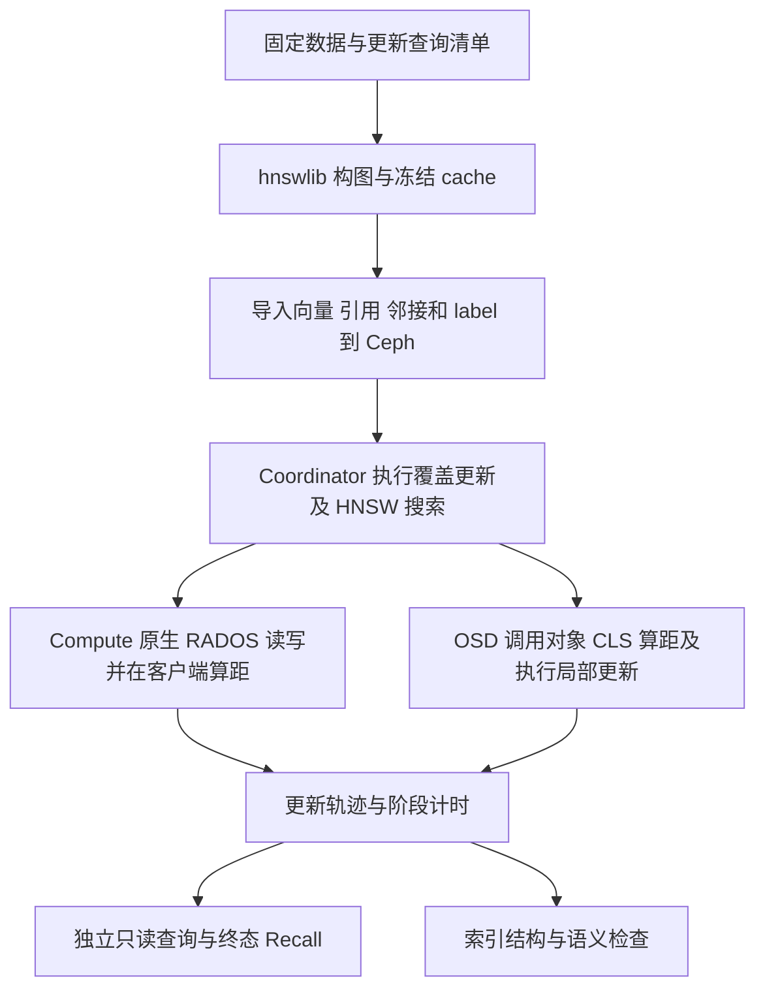
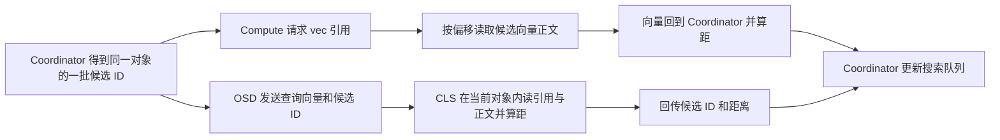

# Compute 与 OSD/CLS Baseline 实现对照报告

当前两条 baseline 共享一套 HNSW 图、Ceph 对象布局和在线更新逻辑。Coordinator 在两路都选择搜索入口、维护候选队列、决定连哪些边和何时切换 label。**Compute 把候选向量读回 Coordinator 算距。OSD/CLS 把查询向量和候选 ID 发给数据对象，由对象所在的 OSD 算距并返回结果。** 写路径也有差异。Compute 使用原生 RADOS 读写，OSD 路线把多项对象内读改写交给 `hnsw_global` CLS。 [Coordinator 分派](../../src/coordinator/update_coordinator.cc#L3336) · [距离计算分支](../../src/coordinator/update_coordinator.cc#L1270) · [CLS 方法注册](../../src/cls/hnsw_cls.cc#L1021)

## 1. 当前 baseline 的定义与配置

本报告以高召回正式重测使用的源码提交 `f38821d` 为基准。Compute 延续阶段 1 的严格原生 RADOS 定义，运行时禁止调用项目 CLS。OSD baseline 延续阶段 2 的同步执行方式，使用统一对象路由和 CLS 协议信封。阶段 3 的多节点 frontier 聚合、阶段 5A 的异步执行器与跨更新微批、阶段 6 的 per-target inflight 限流均关闭。阶段 4 的全局元数据拆分与 Saga 是后续设计。 [基线定义](../optimization-implementation-plan.md#1-修订依据与核心判断) · [阶段 2 验收](phase2-protocol-routing-validation-2026-09-30.md#结论) · [Compute 路线门禁](../../src/coordinator/update_coordinator.cc#L988)

| 正式重测项 | 两路共用的设置 |
|---|---|
| 数据集与重复 | Deep100M、GIST1M、Text2Image10M、SIFT100M。每个数据集计划三轮配对，共 24 个 case，每个 case 对应单数据集、单轮次、单路线。 |
| HNSW | `M=16`，离线构图 `efConstruction=200`，在线更新 `efUpdate=256`，终态只读查询 `efQuery=256`。 |
| 搜索与并发 | `frontier_window=1`。一个 Coordinator 进程中运行 4 个更新 worker。每个 worker 同步发起各对象组请求。 |
| 更新负载 | GIST1M 固定 400 次，其余每组固定 2,000 次。两路使用相同更新向量与目标 label，按固定次数完成。 |
| Ceph | OSD 运行 Quincy `17.2.8`。四个 owner 池分别落到 `osd.0/2/3/4`，全局元数据池落到 `osd.0`。各实验池单副本、单 PG。 |
| 配对控制 | 同一轮加载同一份冻结图 cache，以相同布局各自导入到新建池。计划按 Compute→OSD、OSD→Compute、Compute→OSD 运行三轮。 |

上述是本轮 `manifest.json` 和 `case.json` 的参数。历史阶段 2 报告采用当时的实验设置。配对共享初始图和更新任务，4 个 worker 的执行交错仍可改变新 ID 的分配顺序、采样层级及后续候选访问量。 [高召回实验设计](../high-recall-baseline-execution-plan-2026-11-17.md#62-主正式批次固定更新数) · [四 OSD 布局](metadata-management-and-crush-placement-2026-11-23.md#deep100m-的实际对象映射) · [worker 调度](../../src/coordinator/update_coordinator.cc#L3593)

## 2. 两条路线共用的模块

### 2.1 输入准备、离线构图与导入

- **数据准备**。`baseline-quality.py` 检查向量文件的头部和规格，按固定种子划分调参、验证和更新向量，保存身份与内容哈希。两条路线沿用同一份验证查询和更新输入，独立查询向量来自与更新向量互斥的划分。 [输入与划分](../../scripts/baseline-quality.py#L129)
- **离线构图**。`nsvu-base-index-importer` 用 hnswlib 构建基础图，并保存可复用的图 cache 与 sidecar。`--build-only` 在连接 Ceph 前结束。正式 case 以 `load` 模式读取已冻结的 cache，检查维度、点数、类型、数据集哈希和图参数，导出邻接表时把 hnswlib 内部节点编号转换回项目使用的全局 ID。 [cache 校验与构图](../../src/importer/base_index_importer.cc#L692) · [邻居 ID 转换](../../src/importer/base_index_importer.cc#L306)
- **导入 Ceph**。导入器先写向量正文、`VectorRef` 与初始 label 映射，再写各层邻接，最后发布全局入口点和图参数。本轮固定使用 `nsvu-round-robin-importer`，一个导入 worker 轮转写各 owner 的向量阶段，邻接仍按 owner 顺序写。这个变体的对象格式、路由公式、偏移定义和导入阶段边界沿用公共导入器。运行产物 `manifest.json` 记录 OMAP 批次 2,048 条与正文批次 64 MiB 等参数。 [向量导入与邻接阶段](../../src/importer/base_index_importer.cc#L835) · [全局发布](../../src/importer/base_index_importer.cc#L935)

### 2.2 对象路由与元数据

`PlacementResolver` 根据 `global_id % owner_count` 选 owner，再将 `global_id / owner_count` 整除每对象点数得到 chunk。Coordinator 使用 `(owner, chunk)` 将访问归到具体的 RADOS 池和对象。Ceph 再把对象映射到 PG 和 serving OSD。两路的 `vec/<id>` 和 `node/<id>` 均与向量正文同属一个数据对象。`label/<label>` 由 `external_label % owner_count` 选择各 owner 的 `hnsw.owner.meta`。`hnsw.global.meta` 保存入口点、最高层、ID 分配和图计数，每次插入都要在这里预留和收尾。 [分片公式](../../include/nsvu/placement.hpp#L39) · [候选分组](../../src/coordinator/update_coordinator.cc#L2635) · [对象布局与落点报告](metadata-management-and-crush-placement-2026-11-23.md)

### 2.3 覆盖更新和结果可见性

1. Coordinator worker 领取一条更新，按外部 label 加进程内锁，并查出它当前指向的旧节点 ID。 [更新入口](../../src/coordinator/update_coordinator.cc#L3593) · [label 锁与查旧点](../../src/coordinator/update_coordinator.cc#L3666)
2. 向全局对象预留新的 `global_id` 并获取搜索所需的入口状态，抽样新节点层级，把新向量追加到数据对象并写入其引用。这个步骤暂时保留旧 label 指向。 [预留和数据写入](../../src/coordinator/update_coordinator.cc#L4142)
3. 从入口点逐层搜索，生成新节点邻接表，写入新边。Coordinator 把连向新节点的反向边按目标对象提交，完成后推进全局计数和版本，必要时更新入口点。 [选邻与图收尾](../../src/coordinator/update_coordinator.cc#L4186)
4. 比较并交换（CAS）label 当前指向，成功后标记旧节点 stale。旧向量正文和邻接仍可供遍历。若 label CAS 冲突，代码把尚未成为当前版本的新节点置为 stale 并报错。 [版本切换](../../src/coordinator/update_coordinator.cc#L3679) · [查询可见性](../../include/nsvu/baseline_observation.hpp#L20)

对象内操作可根据 `reservation/<update_id>`、`finalized/<update_id>` 和 `patch/<update_id>` 判断相关步骤是否已执行，支持有界超时重放。一次完整更新按多个对象请求推进，后续步骤失败时，已完成的步骤可能留在索引里。跨对象过程的自动恢复属于阶段 4 设计。 [重放语义](../correctness-observability-baseline.md#新增观测字段) · [阶段 4 状态机](../optimization-implementation-plan.md#72-saga-状态机)

## 3. Coordinator 如何执行 HNSW 搜索

**高层定位。** 插入从全局 `enterpoint` 开始，在新节点层级以上逐层使用 `GreedySearch`。它读取当前节点的该层邻接并给邻居算距，只在存在更近邻居时继续移动。进入新节点参与的层后，使用 `SearchLayer(efUpdate)` 逐层找候选，直到第 0 层，并把本层最近的入选点传为下一层入口。只读查询的高层均用贪心，第 0 层使用 `efQuery`。 [贪心搜索](../../src/coordinator/update_coordinator.cc#L3987) · [插入逐层控制](../../src/coordinator/update_coordinator.cc#L4171) · [查询逐层控制](../../src/coordinator/update_coordinator.cc#L3469)

**第 0 层候选管理。** `candidates` 是按距离取最近待展开点的最小堆，`top` 是最多保留 `ef` 个当前最佳点的最大堆，`visited` 对本层相同 ID 去重。每轮从 `candidates` 展开一个点，读取它的邻接，把尚未访问的邻居按对象分组算距，并用更好的结果更新两个堆。当没有待展开点，或最近待展开点的距离超过 `top` 中最远点的距离时，结束本层。`W=1` 限制的是每轮展开的节点数。一轮仍可有多个邻居归入同一个对象批次，`ef=256` 控制保留结果的上限，四个 worker 则可以并行执行四条更新。 [窗口选择](../../src/coordinator/update_coordinator.cc#L3871) · [双堆循环](../../src/coordinator/update_coordinator.cc#L4018) · [距离终止条件](../../include/nsvu/frontier.hpp#L14)

**选邻与写回。** 在线插入从按距离排序的结果中取前若干个，第 0 层最多 `2M=32` 条出边，上层最多 `M=16` 条。对已有节点的反向边修补会在持有对应写保护时读取当前邻接，追加去重，超过度数上限时从列表前端裁剪。选定新节点邻居和合并已有节点的反向边是两个操作，且在线选邻采用直接截取，与离线 hnswlib 构图各走自己的实现。 [在线选邻](../../src/coordinator/update_coordinator.cc#L4455) · [反向边裁剪](../../src/cls/hnsw_cls.cc#L789) · [离线构图](../../src/importer/base_index_importer.cc#L692)

## 4. Compute 与 OSD/CLS 的存储接口和计算分工

### 4.1 Compute baseline

`--distance-mode compute` 走 `CephFacade` 的 `Raw*` 分支。一批同对象候选通常先发一次 OMAP 读取取得各 `VectorRef`，再组织一次 `ObjectReadOperation`，按各偏移和长度读取对象正文。Coordinator 对回传的向量做距离计算。邻接和 label 映射也以原生 OMAP 方式读写。写向量时，正文追加和 `vec/<id>` 更新组合成一次对象写操作。反向边和 label 等读改写用进程内对象锁保护，全局预留和收尾用进程内全局元数据锁。这与正式实验的单 Coordinator、多 worker 范围相匹配。 [原生向量读](../../src/coordinator/update_coordinator.cc#L1890) · [写向量组合操作](../../src/coordinator/update_coordinator.cc#L2067) · [原生邻接修补](../../src/coordinator/update_coordinator.cc#L2305) · [全局元数据锁](../../src/coordinator/update_coordinator.cc#L2440)

### 4.2 OSD/CLS baseline

`--distance-mode osd` 对每个目标对象调用 `ioctx.exec(oid, "hnsw_global", method, ...)`。`distance_to_local_batch` 在对象内按 ID 依次找 `vec/<id>`，读取正文并算距，返回 `(候选 ID, 距离)` 与阶段计时。读取邻接用 `get_node_adjacency_batch`，Coordinator 拿到邻居 ID 后继续搜索，再为下一批候选分别路由。单次 CLS 操作的作用域是该次 `exec` 的对象，跨对象搜索和多对象写入仍由 Coordinator 组织。OSD 路线预留 ID 后还用原生 OMAP 读回已持久化的预留记录，两路的终态只读查询也都通过原生 OMAP 重读候选 `VectorRef`。 [CLS 调用入口](../../src/coordinator/update_coordinator.cc#L988) · [CLS 邻接读取](../../src/cls/hnsw_cls.cc#L490) · [CLS 算距](../../src/cls/hnsw_cls.cc#L524) · [预留读回](../../src/coordinator/update_coordinator.cc#L1573) · [候选重读](../../src/coordinator/update_coordinator.cc#L1065)

| 模块 | Compute 的执行方式 | OSD/CLS 的执行方式 |
|---|---|---|
| 搜索调度、候选与选邻 | Coordinator 维护图搜索状态并决定要访问的对象。 | 同一套 Coordinator 逻辑。 |
| 候选向量与算距 | 原生 OMAP 取引用、读取正文，候选向量回传后在 Coordinator 算距。 | `distance_to_local_batch` 接收查询向量与 ID，以同对象引用定位正文，在 OSD 算距。 |
| 新向量与新邻接 | 正文和引用组合写，独立 OMAP 写入 `node/<新 ID>`。 | `store_vector` 追加正文和写引用，`set_adjacency_batch` 写新邻接。 |
| 反向边修补 | 以对象锁保护 OMAP 读、合并、裁剪和写回。 | `apply_edge_patch_batch` 在目标对象内合并、裁剪，随邻接写入该对象的 patch 标记。 |
| label 查找、切换与 stale | 用原生 OMAP 查找和修改，比较 label 与预期旧值后写新值。 | 由 `lookup_label_batch`、`cas_label`、`mark_node_stale` 分别访问各目标对象。 |
| 全局 ID 和插入收尾 | 全局元数据锁保护原生 RADOS 读改写，保存预留和收尾标记。 | `reserve_insert_id` 和 `finalize_insert` 在同一个全局对象内读改写，预留结果另经原生 OMAP 读回。 |

表中各分支可从 `StoreVector`、`CasLabel`、`ApplyPatches` 和 `ReserveInsert` 进入，两路的端到端差异包含算距位置、RPC 形状与对象局部操作实现。 [向量写入分支](../../src/coordinator/update_coordinator.cc#L1093) · [label CAS 分支](../../src/coordinator/update_coordinator.cc#L1161) · [邻接修补分支](../../src/coordinator/update_coordinator.cc#L1490) · [收尾分支](../../src/coordinator/update_coordinator.cc#L1616)

## 5. 正式 case 怎样计时和验收

1. **计时更新。** 基础图导入完成后，Coordinator 以 `--mode update` 加载固定更新文件，再执行覆盖更新。记录 `update.json` 和逐条 `updates.jsonl`，验收更新数、成功状态、trace 中的负载身份、RADOS 重试、label 冲突和实际路线。Compute 要求 CLS 调用为 0，OSD 要求存在 CLS 调用。平均延迟来自逐条更新，吞吐为成功更新数除以并行更新窗口的墙钟时间。阶段数据按 worker 累计再除以成功更新数。独立的导入、终态查询和 checker 各自计量。 [更新入口与计时边界](../../src/coordinator/update_coordinator.cc#L3567) · [指标定义](../stage-profiling.md#完整更新主阶段)
2. **生成终态真值。** 使用成功更新轨迹重建每个业务 label 的活动向量，以独立验证查询重新计算参考 Top-10。先剔除已替换的基础 label，重新比较保留的基础候选和所有替换向量。若原真值前缀不足以确定 Top-K，脚本回退到完整活动集合的扫描。 [轨迹校验](../../scripts/baseline-quality.py#L384) · [终态 GT 合并与回退](../../scripts/baseline-quality.py#L442)
3. **只读搜索与 Recall。** `--mode query` 遍历更新后的图，结果要求节点为 active 且 `label` 当前确实指向它，再按距离返回至多 10 个去重的外部 label。Recall@10 用命中数除以 `查询数 × 10`。两路各要求终态 Recall@10 至少 90%，配对还检查查询与 GT 身份及召回差值，阈值为 0.5 个百分点。本轮可得的初始 Recall 来自冻结图的本地 hnswlib 筛选，终态 Recall 则来自远端只读查询。 [查询输出过滤](../../include/nsvu/baseline_observation.hpp#L20) · [召回计算](../../scripts/baseline-quality.py#L233) · [验收设计](../high-recall-baseline-execution-plan-2026-11-17.md#3-90-召回率如何定义和验收)
4. **检查索引。** `nsvu-index-checker` 扫描节点的路由、向量引用和正文区间、邻接层级、度限制、重复或异常边、活动 label 指向、全局计数与入口点。语义检查抽样 256 个基础节点，比较第 0 层图边与确定性对照点的距离，要求真实图边更近的比例至少为 60%。正式 runner 要求 `pass`、零 error、零 warning。 [节点及邻接检查](../../src/tools/index_checker.cc#L303) · [label 检查](../../src/tools/index_checker.cc#L427) · [语义抽样](../../src/tools/index_checker.cc#L481) · [全局核对](../../src/tools/index_checker.cc#L688)

## 6. Deep100M 首轮配对所显示的实际差异

截至 2026-11-23 已归档的正式批次状态，只有 Deep100M 第 1 轮完成两路并通过验收。表中使用它说明架构差异实际落在哪些计数上。正式性能汇总范围目前为一组配对。每路完成 2,000 次更新，均为零失败、零 RADOS 重试。checker 均检查 100,002,000 个节点，含 100,000,000 个 active 节点和 2,000 个 stale 节点。终态使用同一组 1,000 个独立查询，两路均命中 9,607 个 Top-10 结果。

| 指标 | Compute | OSD/CLS |
|---|---:|---:|
| 终态 Recall@10 | 96.07% | 96.07% |
| 平均更新延迟 | 3,808.36 ms | 2,973.31 ms |
| P99 更新延迟 | 6,739.70 ms | 5,172.35 ms |
| 更新吞吐 | 1.049 次/s | 1.344 次/s |
| 距离阶段 | 3,576.40 ms/更新 | 2,697.64 ms/更新 |
| 全局元数据阶段 | 2.93 ms/更新 | 2.28 ms/更新 |
| 更新窗口的原生 RADOS 调用 | 20,753,727 | 2,000 |
| 更新窗口的 CLS 调用 | 0 | 10,657,768 |
| 回传候选向量正文 | 3,909,650,304 B | 0 B |

本轮 OSD 平均更新延迟下降 `21.93%`，吞吐提升 `28.08%`。合计原生和 CLS 调用，两路分别约 `10,377` 和 `5,330` 次请求/更新。按应用层打点，OSD 的回复字节减少，请求字节增加，总应用负载从约 `2.48 MB/更新` 升至 `2.87 MB/更新`。这种流量方向的变化与算距放置和调用形状一致。

- **Compute 的主要开销在取向量。** 距离阶段平均 `3,576.40 ms`，其中获取候选的 RPC 计时平均 `3,569.98 ms`，Coordinator 端实际算距约 `5.12 ms`。 [Compute 计时边界](../../src/coordinator/update_coordinator.cc#L1270)
- **OSD 仍要处理大量细粒度的对象访问。** 距离阶段占平均更新延迟约 `90.7%`。该阶段平均约 `1,674.49 ms` 是客户端往返扣除 CLS 时间后的剩余，约 `849.23 ms` 是向量正文读取、`161.19 ms` 是引用读取、`2.16 ms` 是算距。往返剩余混合网络、队列及其他客户端和服务端开销。约 `98.3%` 的距离批次只有一个候选，查询向量仍随每批下发，该轮累计约 `3.84 GB` 的逻辑查询向量字节。 [距离拆分定义](../stage-profiling.md#距离阶段内部拆分) · [OSD 距离计时](../../src/cls/hnsw_cls.cc#L524)
- **当前两路都集中写全局对象，但实测阶段代价小于 `3 ms/更新`。** 本轮记录的 OSD `2,000` 次原生调用来自预留结果读回。阶段 0 已将旧客户端版本 CAS 的预留和收尾改为对象内操作，历史 45 秒超时曾显著抬高旧计时。阶段 4 拟进一步减少普通插入触碰全局头的次数并补足恢复能力。 [阶段 0 修复证据](phase0-validation-report-2026-09-22.md#故障发现与修正) · [阶段 4 设计](../optimization-implementation-plan.md#7-阶段-4可恢复更新与可扩展元数据)

数据出自本机 `results/high-recall-formal-20261122T135707Z/` 中的 `manifest.json` 与 `pilot/cases/deep100m/rep-1/{compute,osd}/`。各模块可分别查阅 `case.json`、`update.json`、`updates.jsonl`、`final-score.json` 和 `checker.json`。正式配置保存了逐更新轨迹，关闭详细 RPC 抽样。应用字节计数描述向量及操作负载，端到端链路字节需要单独的网络观测。
