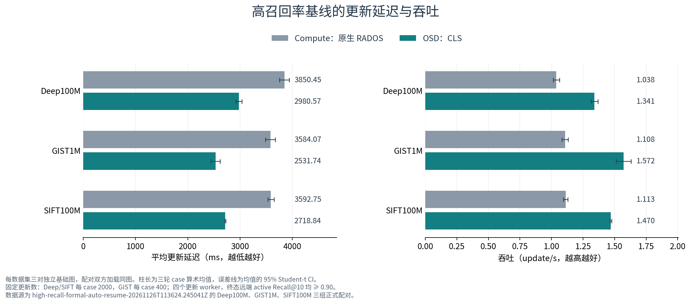
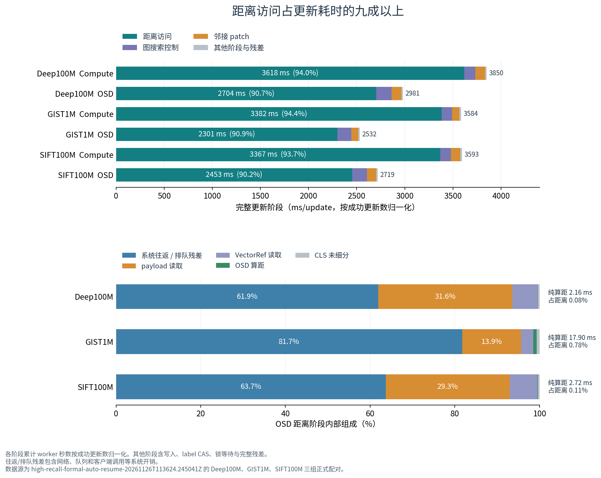
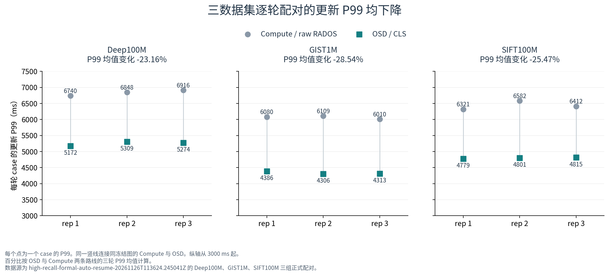

# Deep100M、GIST1M、SIFT100M 高召回基线三轮结果与瓶颈分析

本报告汇总截至 2026-11-26 15:08:13 UTC 已完成的三数据集配对结果，整理于
2026-11-27。证据入口为
`results/high-recall-formal-auto-resume-20261126T113624.245041Z/`，状态为 `completed`。
该目录汇集多次恢复过程中保留的完整 case，实际运行顺序由每个 case 的原始
开始和结束时间确定。

**三个数据集各完成三组 Compute / OSD 配对，共 18 个合格 case、26,400 次成功更新。
OSD 平均更新延迟降低 22.59%–29.36%，吞吐提高 29.13%–41.95%，每轮终态
Recall@10 均达到 0.90。距离阶段仍占 OSD 更新耗时的 90.22%–90.88%。主要问题是
数千次对象级距离调用及其取数、往返与等待，纯距离算术只占距离阶段的 0.08%–0.78%。**

本报告覆盖 Deep100M 的完整三轮以及 GIST/SIFT，衔接
[11-24 Deep100M 两轮阶段性分析](high-recall-deep100m-bottleneck-analysis-2026-11-24.md)。
Text2Image10M 在这批运行中三组质量资格均未通过，单独保留为质量诊断证据。
下面的高召回性能统计范围为 Deep100M、GIST1M 和 SIFT100M。

## 1. 实验身份、参数与验收范围

本批冻结的性能二进制源码提交为 `f38821dc8b295644e4e744f655b898b33bbe4a52`，
已部署 CLS SHA-256 为 `1721ad9ba8fc633f34b9e2a4aed3a8f0060cb9e0cdba2baecbb74d2eab4f6106`。
最新恢复控制器的提交记录为 `5849fc546c34232e59dd7dd488fcb96374ce94ec`。控制器版本
和被测二进制身份分别记录，分析使用 manifest 中的实际运行身份。

manifest 记录运行中的 Ceph daemon 为 Quincy **17.2.8**。故障 osd.1 已排除，
四个逻辑 owner 对应物理 osd.0、osd.2、osd.3、osd.4，global meta 与 owner 0
落在 osd.0，实验池单 PG、单副本。旧阶段 1 使用五 OSD，本批还改变了 HNSW
参数和质量负载。两批结果应各自在对应环境与同期控制组内比较。

两路在同一 repetition 使用 SHA-256 相同的冻结基础图，分别全量导入，再执行相同
数量的覆盖更新和终态查询。rep 1、3 为 Compute→OSD，rep 2 为 OSD→Compute。
三次 repetition 使用各自独立构建的基础图。新节点先写入和完成邻接，再 finalize、
CAS label，最后标旧节点 stale。两路共享这套更新语义。

| 数据集 | base 规模 | 向量类型 / 维度 | 距离 | 每对象点数 | 每 case 更新 | 每 case 终态查询 |
| --- | ---: | ---: | ---: | ---: | ---: | ---: |
| Deep100M | 100,000,000 | F32 / 96 | L2 | 160,000 | 2,000 | 1,000 |
| GIST1M | 1,000,000 | F32 / 960 | L2 | 16,000 | 400 | 400 |
| SIFT100M | 100,000,000 | U8 / 128 | L2 | 250,000 | 2,000 | 1,000 |

三个数据集共同使用 `M=16`、`efConstruction=200`、`efUpdate=efQuery=256`、
4 个更新 worker、`frontier_window=1`。自适应 frontier、只读异步执行器、跨更新
距离微批和 target cap 均未启用，Noop 拆分探针和逐 RPC trace 关闭，逐 update trace
开启。观测开销尚未单独校准。因此本文描述的是这套同步高召回基线。

导入采用冻结的 round-robin importer。向量按 owner 轮转，邻接仍按 owner-major
写入，`import_workers=1`、OMAP 每批 2048 条、payload 每批 64 MiB。冻结 cache
避免了每个 case 重建图，但仍需重写全部远端向量和邻接。导入后会预热缓存，本批
没有实施受控冷缓存策略。

18 个 case 均为零失败、零 RADOS exec retry、零 label/meta CAS 冲突，完整阶段
闭合标志为 true。18 份 checker 全部 pass、0 error、0 warning，图边语义胜率为
0.999001–1.000000。终态共评估 14,400 条查询，使用更新后的 active-label 真值。

| 数据集 | rep 1 Recall@10 | rep 2 Recall@10 | rep 3 Recall@10 | 每对 OSD−Compute |
| --- | ---: | ---: | ---: | ---: |
| Deep100M | 96.070% | 95.870% | 96.020% | 0.000 pp |
| GIST1M | 93.225% | 93.050% | 93.075% | 0.000 pp |
| SIFT100M | 97.060% | 96.920% | 96.910% | 0.000 pp |

上表每个值在同轮两路相同，表示聚合命中数一致。逐 query 返回集合、插入层数和
搜索轨迹还可分别比较。完整 checker 与终态质量覆盖本批已检查状态，长期连续
替换、故障恢复和多 Coordinator 一致性需要各自的验证。

## 2. 更新延迟、吞吐与 P99

下表均为三轮 case 指标的算术平均，± 后为均值的 95% Student-t CI 半宽
（n=3，df=2），用于描述三轮均值估计的不确定性。

| 数据集 / 路线 | 平均延迟 ms | P95 ms | P99 ms | 吞吐 update/s |
| --- | ---: | ---: | ---: | ---: |
| Deep100M / compute | 3850.45 ± 93.02 | 5349.03 ± 499.86 | 6834.34 ± 220.45 | 1.0381 ± 0.0246 |
| Deep100M / osd | 2980.57 ± 58.08 | 4095.31 ± 278.14 | 5251.75 ± 176.43 | 1.3406 ± 0.0273 |
| GIST1M / compute | 3584.07 ± 94.07 | 4890.41 ± 213.75 | 6066.41 ± 126.83 | 1.1076 ± 0.0250 |
| GIST1M / osd | 2531.74 ± 89.90 | 3516.93 ± 25.09 | 4335.15 ± 110.41 | 1.5722 ± 0.0593 |
| SIFT100M / compute | 3592.75 ± 58.60 | 5110.59 ± 637.21 | 6438.28 ± 328.91 | 1.1125 ± 0.0179 |
| SIFT100M / osd | 2718.84 ± 11.10 | 3766.32 ± 310.48 | 4798.31 ± 45.04 | 1.4699 ± 0.0067 |

| 数据集 | OSD 平均延迟变化 | OSD P99 变化 | OSD 吞吐变化 |
| --- | ---: | ---: | ---: |
| Deep100M | -22.59% | -23.16% | +29.13% |
| GIST1M | -29.36% | -28.54% | +41.95% |
| SIFT100M | -24.32% | -25.47% | +32.12% |

变化率按两组均值之比计算。三个数据集在三轮中的平均延迟和 P99 都支持 OSD 路径的
改善方向。运行环境与并发调度仍有差异，三次重复对稳定性提供的证据有限。

各数据集本次固定更新数不同，性能按数据集分别比较。更新 worker 同时执行，
吞吐由成功数除更新阶段墙钟 `graph_seconds` 得到。平均延迟描述每个更新的响应
时间，吞吐描述四个 worker 的整体完成速率，计时范围限于正式更新阶段。

## 3. 在线更新的阶段组成

每条路线把三轮阶段秒数相加，再除成功更新数。完整累计更新时间使用顶层
`complete_update_seconds`，并把新增的 label CAS、label 锁等待和完整残差一起
纳入。这些新字段支持完整阶段闭合，旧 `other_update_seconds` 与按墙钟计算的
`*_pct` 保留各自的历史口径。

| 数据集 / 路线 | 总计 ms | 距离 ms / 占比 | 搜索控制 ms | 邻接 patch ms | 写向量及新邻接 ms | 全局 meta ms | label CAS ms | 其他 ms |
| --- | ---: | ---: | ---: | ---: | ---: | ---: | ---: | ---: |
| Deep100M / compute | 3850.45 | 3618.44 (93.97%) | 112.98 | 101.86 | 6.86 | 2.91 | 3.07 | 4.32 |
| Deep100M / osd | 2980.57 | 2704.33 (90.73%) | 159.48 | 100.74 | 6.44 | 2.28 | 3.07 | 4.25 |
| GIST1M / compute | 3584.07 | 3382.47 (94.37%) | 107.87 | 76.20 | 7.77 | 2.98 | 2.95 | 3.84 |
| GIST1M / osd | 2531.74 | 2300.94 (90.88%) | 143.92 | 71.06 | 7.05 | 2.37 | 2.75 | 3.65 |
| SIFT100M / compute | 3592.75 | 3367.03 (93.72%) | 111.04 | 97.87 | 6.71 | 2.88 | 3.04 | 4.17 |
| SIFT100M / osd | 2718.84 | 2453.05 (90.22%) | 154.61 | 95.72 | 6.20 | 2.25 | 2.94 | 4.07 |

距离阶段是三者共同的主要开销。Compute 中远程取向量耗时占距离阶段
98.78%–99.82%，本地纯算距为 Deep 5.10、GIST 40.22、SIFT 6.65 ms/update。
GIST 有 960 个 F32 维度，算术量相对更高，但取数仍占绝大多数。

OSD 路径每次更新的距离阶段分别缩短 **914.11 / 1081.53 / 913.98 ms**
（Deep/GIST/SIFT），完整更新缩短 **869.88 / 1052.33 / 873.90 ms**。
图搜索中排除距离后的计时分别增加约 46.49 / 36.05 / 43.57 ms，抵消部分收益。
现有数据定位到了这部分客户端搜索开销，更具体的容器操作、线程调度等来源需要进一步打点。
两条完整访问路径还同时改变了对象读取、邻接和元数据操作，收益应按整条路径解释。

邻接 patch 在本批为 OSD 71.06–100.74 ms/update，占完整更新约 2.81%–3.52%。
在旧 M8/ef32 基线中它的相对占比更大。本批扩展搜索深度后，距离阶段变长。
判断 patch 自身的变化还要比较对应配置下的绝对耗时。

### 3.1 OSD 距离阶段内部

| 数据集 | 距离总计 ms | CLS 外残差 ms | VectorRef ms | payload ms | 纯算距 ms | CLS 其他 ms |
| --- | ---: | ---: | ---: | ---: | ---: | ---: |
| Deep100M | 2704.33 | 1674.30 | 161.93 | 855.44 | 2.16 | 10.50 |
| GIST1M | 2300.94 | 1880.10 | 66.53 | 320.07 | 17.90 | 16.34 |
| SIFT100M | 2453.05 | 1562.04 | 159.38 | 718.42 | 2.72 | 10.48 |

| 数据集 | CLS 外残差 / 距离 | payload / 距离 | VectorRef / 距离 | 纯算距 / 距离 |
| --- | ---: | ---: | ---: | ---: |
| Deep100M | 61.912% | 31.632% | 5.988% | 0.080% |
| GIST1M | 81.710% | 13.910% | 2.891% | 0.778% |
| SIFT100M | 63.678% | 29.287% | 6.497% | 0.111% |

CLS 外残差由客户端距离计时减去 CLS 内部总时间得到，包含网络、librados、OSD
进入算子之前的排队和线程调度等。**当前指标测量的是这些因素的合计。**
本批关闭了逐 RPC trace 和 Noop 探针。若要拆分网络与 OSD 排队、比较各个 OSD，
需要增加两端调用时间和目标对象的关联观测。

payload 指 CLS 发起对象读取所花的时间，覆盖缓存与设备路径。各层缓存和设备
服务时间需要进一步拆分。Deep/SIFT 该项每次更新仍有 855/718 ms。向量留在 OSD 内，取数成本仍然
存在。纯算距占比低于 0.8%，即使理想化地去掉全部算术，也只直接节省表中数毫秒至
约 18 ms，无法解释当前两三秒级更新成本。

## 4. 元数据应该按位置和访问频率区分

“元数据”至少包含对象本地 `VectorRef`、邻接 OMAP、label 映射和全局 ID/入口状态。
最后一类集中在所有更新都会访问的全局对象，其余分别位于数据对象或 label 分片。
下面按位置和调用频率分别解释这些计时。

| 数据集（OSD） | 距离内 VectorRef 读取 ms | 全局 meta ms / 完整更新 | label CAS ms | 每更新全局修改调用 / label CAS |
| --- | ---: | ---: | ---: | ---: |
| Deep100M | 161.93 | 2.277 / 0.076% | 3.066 | 2 / 1 |
| GIST1M | 66.53 | 2.368 / 0.094% | 2.747 | 2 / 1 |
| SIFT100M | 159.38 | 2.247 / 0.083% | 2.938 | 2 / 1 |

全局阶段约 2.25–2.37 ms/update，包含 ID reservation、读回预留记录和 finalize。
`global_meta_cas_calls=2/update` 这个历史字段名覆盖 reserve/finalize 两次全局修改。
冲突另由 retry/conflict 字段记录，本批均为零。OSD 路径另外每次更新有一次原生
RADOS 读取 reservation，计入相应 raw 操作记录。

同一更新会执行数千批距离请求，对象本地 VectorRef 因而反复读取，累计 66.53–161.93 ms。
它比单次全局元数据协议更值得在当前距离链上细分。现有零冲突与低全局
耗时覆盖单 Coordinator、4 worker。更高并发或多进程下的热点、恢复和事务性质
需要独立验证。位置与协议详见[元数据管理报告](metadata-management-and-crush-placement-2026-11-23.md)。

## 5. 调用粒度与重复对象访问

| 数据集 | 记录调用/update C / O | 距离批次/update C / O | OSD 候选/批次 | OSD 单候选批次 | OSD 唯一距离对象/update | OSD 候选/唯一对象 |
| --- | ---: | ---: | ---: | ---: | ---: | ---: |
| Deep100M | 10386.1 / 5335.6 | 5007.6 / 5005.0 | 1.017 | 98.28% | 624.54 | 8.15 |
| GIST1M | 8294.0 / 4284.8 | 3970.8 / 3966.1 | 1.187 | 83.99% | 64.00 | 73.55 |
| SIFT100M | 10383.9 / 5334.3 | 5007.7 / 5005.1 | 1.028 | 97.25% | 399.73 | 12.88 |

总调用约减半，与对象局部 CLS 合并引用读取、payload 读取及算距的机制一致。
两路距离批次数几乎一样，Deep/SIFT 每次约 5,005 批，GIST 约 3,966 批。
GIST 每批平均 1.187 个候选，Deep/SIFT 仅 1.017/1.028。

整次更新触及同一对象多次，说明有重复目标。进一步合批需要确认请求何时就绪。
`frontier_window=1` 下，当前距离结果会影响下一步候选队列。跨越依赖合并可能改变
访问轨迹、候选工作量和召回。约 5,005 批与约 625 个唯一对象之比描述整次更新的
目标重复程度。后续需记录候选就绪时刻，或在固定轨迹下评估真正可并发的请求。

### 5.1 应用层字节的变化也不同

以下 MB 为十进制 1,000,000 字节，来自已记录的原生 RADOS 与 CLS 请求、响应之和。

| 数据集 / 路线 | 请求 MB/update | 响应 MB/update | 合计 MB/update |
| --- | ---: | ---: | ---: |
| Deep100M / compute | 0.158 | 2.327 | 2.485 |
| Deep100M / osd | 2.303 | 0.573 | 2.876 |
| GIST1M / compute | 0.140 | 18.426 | 18.566 |
| GIST1M / osd | 15.544 | 0.472 | 16.016 |
| SIFT100M / compute | 0.159 | 1.032 | 1.192 |
| SIFT100M / osd | 1.022 | 0.573 | 1.595 |

合计变化为 Deep **+15.74%**、GIST **−13.73%**、SIFT **+33.87%**。
OSD 减少了完整候选向量回传，同时为每个目标对象重复携带 query。Deep 的 384 字节
query 乘约 5,005 批约为 1.92 MB/update，GIST 为 15.23 MB，SIFT 为 0.64 MB。
这些量已经计入表中的请求字节。

请求数、往返次数、消息方向及对象局部访问方式一起改变，因而 OSD 在 Deep/SIFT
中以更高的应用层字节量获得了更低延迟。应用层计数覆盖操作记录中的请求和回复，
网卡及协议栈总流量还需要网络测量。raw API 与 CLS 的单次调用成本也各不相同。

## 6. 尾延迟中的距离工作量与单批耗时

| 数据集 / 重复 | Compute P99 ms | OSD P99 ms | OSD 变化 |
| --- | ---: | ---: | ---: |
| Deep100M / rep 1 | 6739.70 | 5172.35 | -23.26% |
| Deep100M / rep 2 | 6847.64 | 5309.21 | -22.47% |
| Deep100M / rep 3 | 6915.67 | 5273.68 | -23.74% |
| GIST1M / rep 1 | 6080.21 | 4386.34 | -27.86% |
| GIST1M / rep 2 | 6109.15 | 4306.46 | -29.51% |
| GIST1M / rep 3 | 6009.88 | 4312.64 | -28.24% |
| SIFT100M / rep 1 | 6320.87 | 4779.12 | -24.39% |
| SIFT100M / rep 2 | 6581.77 | 4800.66 | -27.06% |
| SIFT100M / rep 3 | 6412.19 | 4815.15 | -24.91% |

进一步对每个 case 的 `updates.jsonl` 按延迟降序取最慢 1%。Deep/SIFT 每 case
20 条，GIST 每 case 4 条，与该 case 的其他更新比较。“单批均时”先对每条更新取
距离耗时/距离批次数，再在组内求均值。“额外延迟的距离占比”是两组距离均时之差
除以两组完整延迟均值之差。下表给出该数据集六个 case 分组统计的最小值和最大值。

| 数据集 | 最慢组批次数/其余 | 最慢组单批均时变化 | 距离占额外延迟 | 最慢组中插入 level>0 |
| --- | ---: | ---: | ---: | ---: |
| Deep100M | 1.90–1.97× | +0.42% 至 +2.23% | 91.31%–95.33% | 120/120 |
| GIST1M | 1.66–1.92× | +5.50% 至 +16.44% | 90.16%–95.61% | 24/24 |
| SIFT100M | 1.85–1.95× | +0.84% 至 +26.39% | 91.08%–95.11% | 115/120 |

Deep 的最慢组几乎是“做了约两倍的距离批次”，单批均时只小幅上升。其 120 条
最慢更新全部涉及高于第 0 层的插入，支持分层搜索带来更多工作这一机制。

**GIST 和 SIFT 还出现了更明显的单批耗时变化。** GIST 的最慢组单批均时增加
5.50%–16.44%。SIFT rep 2 Compute 的单批均时增加 **26.39%**，最慢 20 条中有
4 条插入 level 0。该 case 除工作量增加外，还包含明显的单位批次耗时变化。
网络、设备或调度的具体贡献还需要更细的观测。GIST 最慢组每 case 只有
4 条，这一分组对个别样本尤其敏感，适合作为后续测量线索。

并发 worker 分别抽样层数，同一 repetition 两路按 update sequence 配对时，插入
层数不一致比例为 Deep 12.15%–12.70%、GIST 11.25%–12.25%、SIFT 11.45%–11.85%。
因此这里的尾部比较在各 case 内进行。跨路径的单更新因果比较还需要固定层数和
搜索轨迹。trace 中逐更新唯一对象字段存在零值，尾部对象扇出仍需补充有效打点。
上节唯一对象指标使用 case 级 `observability`。

## 7. 导入、验收与实验周转时间

本节单位为分钟，按每条路线三轮完整 case 的各阶段墙钟取平均。时间由原始
launcher 的 START/DONE 配对，包含子程序启动与收尾，所以与程序内部
`graph_seconds` 或 `import.json.total_seconds` 会有少量差异。

| 数据集 / 路线 | 导入 | 正式更新 | active GT | 终态查询 | checker | case 总墙钟 |
| --- | ---: | ---: | ---: | ---: | ---: | ---: |
| Deep100M / compute | 113.52 | 32.13 | 0.16 | 54.99 | 57.27 | 317.67 |
| Deep100M / osd | 98.35 | 24.87 | 0.16 | 39.93 | 58.09 | 221.58 |
| GIST1M / compute | 2.69 | 6.02 | 0.77 | 18.42 | 0.42 | 28.50 |
| GIST1M / osd | 2.59 | 4.24 | 0.77 | 13.08 | 0.41 | 21.27 |
| SIFT100M / compute | 85.90 | 29.96 | 2.36 | 50.05 | 59.46 | 227.92 |
| SIFT100M / osd | 86.50 | 22.68 | 3.46 | 37.58 | 59.81 | 210.21 |

case 总墙钟还包括未单列的质量计分、阶段间检查和等待。Deep rep 1 Compute
在导入后额外等待后台构图 **10,696.498 秒（2 小时 58 分 16.5 秒）**，使该路线
总墙钟均值抬高。该轮导入也用了 138.73 分钟。后续 Deep 正常导入约 95.5–102.5
分钟。导入使用共用实现，上述差异还同时包含后台构图和运行环境的影响。

同样，SIFT rep 1 Compute 的 active GT 使用 NumPy backend，墙钟约 14.36 秒。
其余五个 SIFT case 使用 stdlib backend，约 203.54–209.96 秒。该阶段位于正式
更新计时之外，其均值差包含 backend 变化的影响。各 case 使用相同 active-label
真值定义。比较 backend 的实现一致性与速度需要另设专门验证。

### 7.1 不同数据集的周转重点

- **Deep100M** 无额外构图等待的正常 case 约 3.6–4.14 小时。以 rep 2 为例，导入
  约占导入/更新/查询/checker 四项和的 40%–45%，查询与 checker 占 44%–47%，
  正式更新只占 11%–13%。
- **GIST1M** 每 case 平均 Compute 28.50 分钟、OSD 21.27 分钟。导入约 2.6–2.7
  分钟，checker 约 25 秒。400 条串行终态查询花 13.08–18.42 分钟。更新用
  4 worker，终态质量查询按串行方式执行。二者的并发度和测量目标分别记录。
- **SIFT100M** 每 case 平均 Compute 227.92 分钟、OSD 210.21 分钟。导入约
  85.9–86.5 分钟，checker 约 59.5–59.8 分钟。这两项已构成大量固定周转成本。

导入内部的向量/邻接持久化均值如下。Deep Compute 52.55/57.84 分钟（包含
异常偏长的第一轮），OSD 44.86/50.69 分钟。GIST 约 2.24–2.35/0.22–0.23 分钟。
SIFT 约 32.67–32.90/50.79–51.26 分钟。cache load 省去本地重建图，远端仍需执行
上述全量写入。当前正式导入固定为单 worker。此前资格实验的并行导入收益属于另
一组配置，应在复测后再评估用于正式周转的效果。

### 7.2 中断和恢复耗时单独记账

本批恢复链记录到 6 次 Deep 导入停止，对应 6 个慢事务、12 条成对的
`aio_wait/committed_kv` 日志，事务延迟约 6.542–12.554 秒。这些失败 case 的驻留
墙钟合计约 **4.44 小时**。另有 5 次 SIFT reset admission 受慢操作影响，35 条
`submit_transact` 日志延迟约 5.017–5.720 秒。已核对的慢事件停止都发生在导入或
reset/准入阶段，没有出现在保留的正式计时 update 中。

从最初启动到最终完成共约 96.90 小时。24 个成功 case 自身墙钟合计约 58.15 小时，
其中本报告 18 个约 51.36 小时。两者之外约 38.75 小时混合池重建、失败尝试、恢复
检查和等待，属于整条四数据集实验链的周转时间。
成功 case 指标并不会自动包含这些被排除的失败尝试成本。

## 8. 这些证据支持怎样的优化顺序

| 目标 | 本批证据 | 下一项可验证工作 |
| --- | --- | --- |
| 降低在线平均延迟 | OSD 距离仍约占 90%，每更新数千批 | 按 target 采样调用边界，区分客户端与 OSD 等待。记录候选就绪与对象重复访问，验证可重叠或合并的比例 |
| 降低 P99 | 尾部既有工作量增加，也有单批变慢，SIFT rep 2 Compute 尤其明显 | 按插入层数、候选批次和单批耗时分层，并增加固定轨迹对照 |
| 减少对象本地元数据读取 | VectorRef 累计 66–162 ms/update，全局 meta 约 2.3 ms | 分别测量 VectorRef 与 payload 读取，评估每对象复用，并单独记录全局对象竞争 |
| 缩短实验周转 | 大数据集导入和 checker 各几十分钟，GIST 主要耗时在质量查询 | 导入、精确 GT、查询、checker 分别计时，独立验证快照复用或验收并行对一致性与质量的影响 |
| 扩展并发和恢复能力 | 现有证据覆盖单进程 4 worker，未发生冲突 | 先建立持久更新意图与恢复。更高并发下单独观察 global meta 竞争，再评估修改型跨更新批处理 |

以前阶段 3 的负面结论与阶段 5A/6 的尾延迟限制仍然有效。frontier、AIMD 和
修改型微批等候选方案，应在本批同步路径之外分别完成质量与性能门禁。[优化实施方案](../optimization-implementation-plan.md)

## 9. 复核方法、工件与限制

- 主入口为 `results/high-recall-formal-auto-resume-20261126T113624.245041Z/formal-summary.json`、
  同目录 `manifest.json` 和 `status.json`。原始 case 路径为
  `pilot/cases/{deep100m,gist1m,sift100m}/rep-{1,2,3}/{compute,osd}/`，部分由之前恢复
  目录链接而来。以 `case.json` 的原始开始/结束时间解释实际运行顺序。
- 资格来自 `case.json`、`update.json`、`checker.json`、`final-score.json`，每个样本
  完成规定数量、路径正确、零失败/retry/冲突、完整阶段闭合且终态 Recall 达标。
- 主性能按三轮等权平均，CI 半宽为 `4.303 × sample_stdev / sqrt(3)`。本文变化率
  是均值之比。`formal-summary.json` 的变化率汇总先算每对百分比再平均，二者可有
  末位差异，例如 SIFT P99 本文 −25.47%，原汇总逐对均值 −25.45%。
- 阶段表的 ms/update 按累计秒数除成功数，成功数在同数据集各 case 相等。阶段占比
  的分母为 worker 累计完整更新时间。吞吐另按更新墙钟计算。源码 JSON 保留精度使阶段和总量可能有
  毫秒末位误差，表中保留了这些舍入差异。
- P99 表是三轮各自 P99 的均值，图 3 显示每轮。不同 case 的原始更新分布分别保留。
  最慢 1% 分析使用每条 `updates.jsonl` 记录的耗时与批次，
  等值时按 update sequence 排序。
- 周转耗时来自原始 launcher 的 START/DONE 及 `case.json`，导入内部拆分来自
  `import.json`。GT backend 来自 `active-snapshot.json`。恢复日志中的历史健康
  状态不代表整理本文时的实时集群状态。

图表另存同名 SVG，便于复用。
[图 1](../figures/high-recall-baseline-three-datasets/01-paired-performance.svg)、
[图 2](../figures/high-recall-baseline-three-datasets/02-stage-costs.svg)、
[图 3](../figures/high-recall-baseline-three-datasets/03-p99-repetitions.svg)。

解释范围限于本批已通过的三数据集、每数据集三个独立基础图、四 OSD 单副本布局、单
Coordinator 和固定更新/查询量。初始本地 HNSW 筛选与更新后远端 active-label 查询
分别描述初始本地图和更新后的远端索引。中间状态和长期稳态质量需要连续观测。
n=3、缓存状态、系统后台活动、观测开销未校准和并行轨迹差异仍是因果解释的边界。
