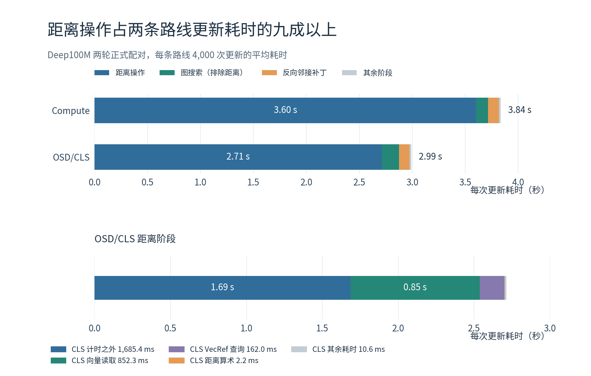
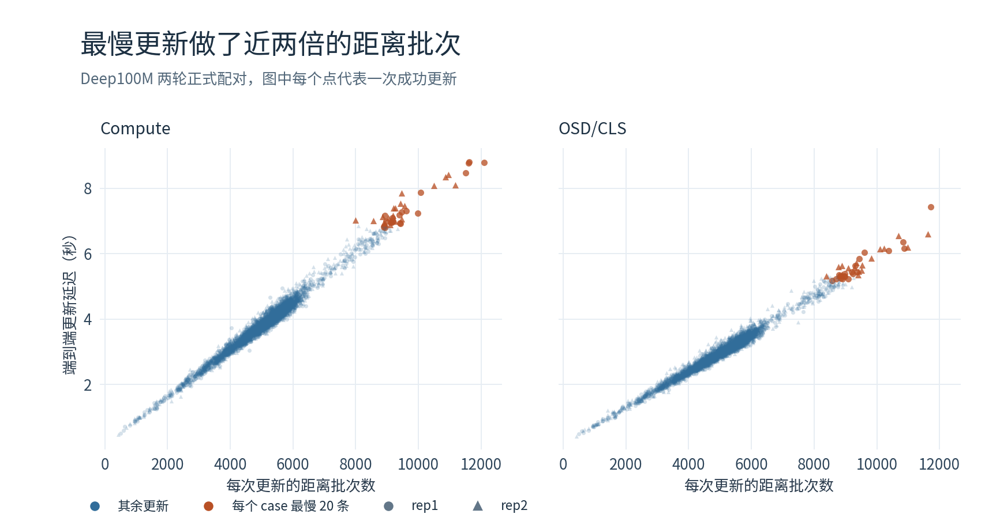
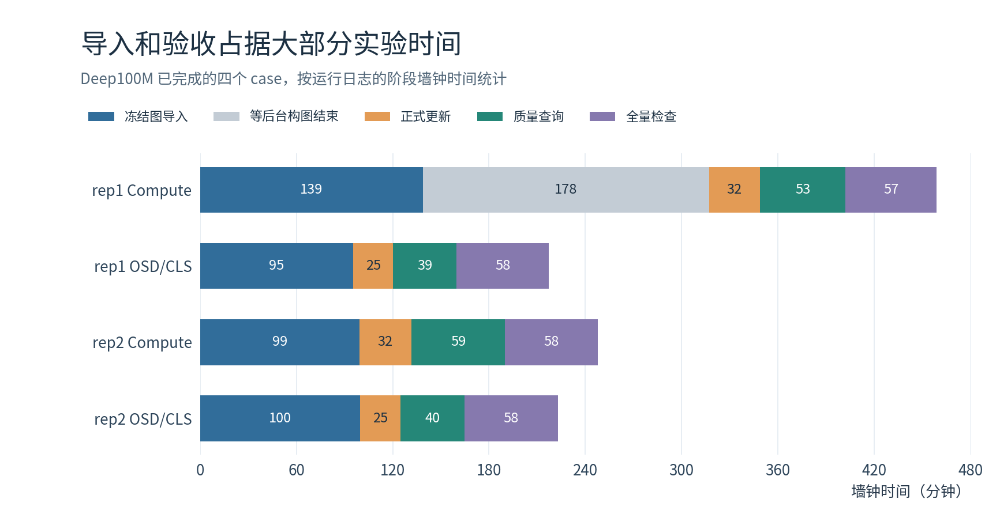

# Deep100M 高召回基线阶段性瓶颈分析

统计截至 2026-11-24 06:21 UTC。正式计划共 24 个 case，已有 Deep100M rep1 和 rep2 各一组通过验收，每组含 Compute 与 OSD/CLS 两条路线，对应总进度 4/24 和 Deep100M 进度 4/6。本报告覆盖这四个 case 的 8,000 条成功更新，并引用另行记录的失败导入日志解释实验为何停跑。rep3 和其余三个数据集留待完成配对后汇总。

- **在线更新主要耗在远程距离阶段。** OSD/CLS 在两轮中保持相同的 Recall@10，把平均更新延迟降低约 22%，吞吐提升约 28%。迁移后距离阶段仍占更新耗时约 91%，其中约 62% 落在 CLS 计时之外。
- **慢更新主要多做了距离批次。** 各 case 最慢 20 条更新的距离批次数是其余更新的 1.90–1.97 倍，单批平均耗时只增加 0.42%–2.23%。全局元数据阶段在当前并发下占累计更新耗时约 0.08%。
- **实验跑通的耗时主要在导入和验收。** 三个无额外构图等待的完整 case 用时 3.6–4.1 小时，其中全量导入占约 40%–45%，质量查询加结构检查占约 44%–47%。另有五次导入触发慢事务停跑。

## 1. 对照条件和验收结果

两条路线在每轮从 SHA-256 相同的冻结基础图独立导入，使用相同的更新输入、查询和精确有效标签真值。rep1 先跑 Compute，rep2 先跑 OSD/CLS。两轮使用各自的冻结基础图。四个 case 均使用 HNSW `M=16`、`efConstruction=200`、`efUpdate=efQuery=256`、`frontier_window=1` 和 4 个更新 worker。数据分为四个 owner，分别放置在 osd.0、osd.2、osd.3、osd.4，四个数据池采用单 PG、单副本。异步只读执行器、跨请求微批、按目标限流、自适应 frontier 和 Noop 探针均关闭。Compute 使用原生 RADOS，OSD 路线用 CLS 在数据对象上执行距离操作。两条路线共享索引布局和覆盖更新协议。[两条路线的实现对照](compute-osd-baseline-architecture-2026-11-23.md) · [对象布局和 CRUSH 放置](metadata-management-and-crush-placement-2026-11-23.md)

正式清单记录性能二进制源码提交为 `f38821dc8b295644e4e744f655b898b33bbe4a52`，Ceph OSD 为 Quincy `17.2.8`，部署的 CLS SHA-256 为 `1721ad9ba8fc633f34b9e2a4aed3a8f0060cb9e0cdba2baecbb74d2eab4f6106`。各 case 从本地冻结图全量导入后开始更新。本次对照没有单独控制或测量 BlueStore 缓存冷热。环境记录见 `results/high-recall-formal-20261122T135707Z/manifest.json`。

| 重复 | 路线 | 平均更新延迟 | P95 | P99 | 更新/秒 | Recall@10 |
| --- | --- | ---: | ---: | ---: | ---: | ---: |
| rep1 | Compute | 3,808.36 ms | 5,166.69 ms | 6,739.70 ms | 1.0493 | 96.07% |
| rep1 | OSD/CLS | 2,973.31 ms | 3,966.06 ms | 5,172.35 ms | 1.3440 | 96.07% |
| rep2 | Compute | 3,862.91 ms | 5,564.89 ms | 6,847.64 ms | 1.0346 | 95.87% |
| rep2 | OSD/CLS | 3,006.72 ms | 4,157.88 ms | 5,309.21 ms | 1.3283 | 95.87% |

各 case 均成功完成 2,000 次覆盖更新，更新记录中的失败和 RADOS exec 重试均为 0。全量 checker 均通过，核对 100,002,000 个物理节点、100,000,000 个有效节点和 2,000 个旧失效节点。两轮的 1,000 条质量查询均超过 90% 召回率门槛。OSD/CLS 的 P95 分别降低 23.24% 和 25.28%，P99 分别降低 23.26% 和 22.47%。上表分位值按 case 单独统计。两轮每条路线共 4,000 条更新，合并均值为 3,835.64 → 2,990.02 ms，合并吞吐按两轮更新墙钟求得 1.0419 → 1.3361 更新/秒。数据取自每组 `update.json`、`final-score.json` 和 `checker.json`。

## 2. 在线更新的主瓶颈

### 2.1 把候选向量留在 OSD 后，每次更新仍耗约 2.71 秒做距离操作

下表对每条路线将两轮的阶段累计秒数相加，再除以 4,000 次更新。占比的分母是所有 worker 累计的更新耗时，吞吐的分母则是并行运行的墙钟时间。图搜索（排除距离）和反向邻接补丁采用互斥阶段口径。逐 case 的 `graph_search_distance_seconds` 与 `remote_distance_seconds` 相等，补丁准备的距离计时为零，因此这四个 case 的距离时间均出现在 HNSW 搜索内。[阶段口径](../stage-profiling.md) · [协调器阶段统计](../../src/coordinator/update_coordinator.cc#L4580)

| 平均每次更新 | Compute | OSD/CLS |
| --- | ---: | ---: |
| 远程距离阶段 | 3,603.32 ms（93.95%） | 2,712.50 ms（90.72%） |
| 图搜索（排除距离） | 113.25 ms | 160.57 ms |
| 反向邻接补丁 | 101.90 ms | 100.85 ms |
| 全局元数据更新 | 2.92 ms | 2.29 ms |
| label CAS | 3.07 ms | 3.11 ms |

Compute 在同一对象上先通过原生 RADOS 取候选 `VecRef`，再读向量字节并在计算端算距离。距离阶段每次更新约 3,596.92 ms 记在取数 RPC 上，占该阶段 99.82%，在计算端做距离算术只用约 5.10 ms。OSD/CLS 将查 `VecRef`、读 payload、算距离合并到同一次距离调用内，向协调器回传距离。距离阶段少了 890.82 ms，而端到端少了 845.62 ms。图搜索中排除距离后的计时增加 47.32 ms，抵消了部分收益。现有阶段计时只能定位到这部分搜索，无法进一步解释两条路线在该项的差异。[原生 RADOS 读取](../../src/coordinator/update_coordinator.cc#L1890) · [CLS 距离实现](../../src/cls/hnsw_cls.cc#L524)

| OSD/CLS 距离阶段拆分 | 每次更新 | 占距离阶段 |
| --- | ---: | ---: |
| 协调器侧距离计时减去 CLS 内部总计时 | 1,685.39 ms | 62.13% |
| CLS 读取向量 payload | 852.34 ms | 31.42% |
| CLS 查 `VecRef` | 162.04 ms | 5.97% |
| CLS 距离算术 | 2.16 ms | 0.08% |
| CLS 其余计时 | 10.57 ms | 0.39% |

首项约占整次更新的 56.37%。代码字段名为 `distance_roundtrip_queue_seconds`，按协调器计时与 CLS 内部计时的差值计算。当前关闭 `distance_split_probe` 和逐 RPC 跟踪，只能看到这个合计，无法量化其中客户端开销、网络往返和 OSD 执行前排队各占多少，也无法据此给各 OSD 排名。CLS 计时内，向量 payload 读取占约 83%，现有数据也无法继续划分缓存命中和物理读盘。[距离计时的计算](../../src/coordinator/update_coordinator.cc#L4596)

### 2.2 OSD 减少了 RPC，应用层字节总量反而上升

| 两轮合并，平均每次更新 | Compute | OSD/CLS |
| --- | ---: | ---: |
| 距离批次 | 5,008.69 | 5,004.01 |
| 全部原生 RADOS 与 CLS 调用 | 约 10,388 | 约 5,335 |
| 应用层请求 | 0.158 MB | 2.303 MB |
| 应用层响应 | 2.328 MB | 0.573 MB |
| 应用层请求与响应合计 | 2.486 MB | 2.876 MB |

距离批次数持平，全部调用少了约 48.6%。OSD 免去了每次更新向 Compute 返回约 1.96 MB 的候选向量，但每个 CLS 距离批次都要携带一份 96 维 F32 查询向量。384 字节乘以约 5,004 批，相当于每次更新约 1.92 MB 的查询向量发送量，已包含在表中的应用层请求。两条路线的请求和响应合计上升约 15.7%。字节来自应用层的操作计数，网卡流量和消息头未在此测量。数据取自 `update.json` 的 `operation_profile`、`raw_operation_profile` 和 `observability`。

两条路线都有约 98.3% 的距离批次只含一个候选，平均每批约 1.017 个候选。一次更新平均触达约 625 个不同距离对象，四个 case 记录的单次最大值均为 628。当前 `frontier_window=1` 每一步只展开一个候选，下一步需要使用当前得分重排候选队列。在保证搜索语义的前提下，整次更新的同对象访问次数只给出了潜在聚合空间，当前日志还无法确定可同时提交的比例。[协调器候选扩展](../../src/coordinator/update_coordinator.cc#L4018)

### 2.3 全局元数据与对象本地元数据

在单协调器、4 个 worker 条件下，四个 case 的全局元数据阶段均约 2.29–2.93 ms，占更新累计耗时 0.075%–0.077%。OSD 路线的 `VecRef` 查询约 162 ms，属于距离计算中对数据对象本地 OMAP 的重复读取。全局元数据写入和对象本地元数据读取分别计时。逐更新 trace 显示，最慢 20 条和其余更新的全局元数据阶段均值之差的绝对值小于 0.19 ms。在这组样本和并发配置下，距离阶段是可见瓶颈。更高并发或多协调器的全局对象竞争需要独立观测。[元数据与对象放置](metadata-management-and-crush-placement-2026-11-23.md)

## 3. 尾延迟来自哪里

每个 case 各取延迟最大的 20 条更新，与其余 1,980 条分别计算均值。表中的「距离占额外延迟」等于两组的距离阶段均值之差除以两组的整次更新均值之差。单批耗时先对每条更新求「距离耗时 ÷ 距离批次数」，再在组内取平均。通过对同一 case 的不同更新比较，可以查看尾部更新自身的工作量。[逐更新计时](../../src/coordinator/update_coordinator.cc#L3414)

| Case | 平均延迟，其余 → 最慢 20 条 | 平均批次，其余 → 最慢 20 条 | 单批耗时增幅 | 距离占额外延迟 |
| --- | ---: | ---: | ---: | ---: |
| rep1 Compute | 3.77 → 7.41 s | 4,955 → 9,770 | 0.42% | 95.14% |
| rep1 OSD/CLS | 2.95 → 5.63 s | 4,955 → 9,433 | 0.85% | 91.46% |
| rep2 Compute | 3.83 → 7.39 s | 4,970 → 9,440 | 2.23% | 94.64% |
| rep2 OSD/CLS | 2.98 → 5.71 s | 4,963 → 9,525 | 0.42% | 91.38% |

四个 case 的最慢组共 80 条更新，全部插入了 HNSW 第 1 层或更高层。每组第 0 层的平均距离批次数约为 4,808–4,825，第 1 层约为 7,335–7,659，第 2 层约为 8,768–10,074。代码对插入的新节点涉及的每一层向下执行完整的 `SearchLayer`，因此更高层插入通常带来更多距离工作。四个 case 的分组结果均支持这一机制。线程按运行时进度领取更新任务，每个线程独立抽样层数，同轮两条路线约有 12%–13% 的更新在不同层插入，因此路线对比以整轮分布为单位，单条更新层数和搜索路径的因果归因仍需固定轨迹验证。[并行分发与随机种子](../../src/coordinator/update_coordinator.cc#L3635) · [分层搜索](../../src/coordinator/update_coordinator.cc#L4153)

## 4. 实验周转与导入中断

### 4.1 导入和验收约占正常 case 的九成时间

| Case | 冻结图导入 | 2,000 次更新 | 1,000 条质量查询 | 全量 checker | 从 case 开始到完成 |
| --- | ---: | ---: | ---: | ---: | ---: |
| rep1 Compute | 138.73 min | 31.77 min | 53.30 min | 56.78 min | 7 h 39 min |
| rep1 OSD/CLS | 95.49 min | 24.80 min | 39.35 min | 57.62 min | 3 h 38 min |
| rep2 Compute | 99.30 min | 32.22 min | 58.54 min | 57.74 min | 4 h 08 min |
| rep2 OSD/CLS | 99.68 min | 25.10 min | 39.87 min | 58.30 min | 3 h 43 min |

表中各阶段用日志的 START/DONE 计算，case 总墙钟还包括未展开的 GT 准备、Recall 计分和阶段间开销。rep1 Compute 在导入后额外等了约 2 小时 58 分钟，启动器的 `wait_for_offline_builds` 在同机后台构图结束后才放行更新。该轮 Compute 的导入本身也比另外三个 case 长。两条路线使用相同的导入流程，rep2 两条路线仅相差约 23 秒，因此 rep1 的导入差异缺乏可归因的路线对照。无构图等待的三个 case 中，正式更新约占 11%–13%。来源为两个 launcher 日志及首次运行冻结的 `run.py`。

各 case 导入约 38.40 GB 向量文件内容和 29.44–29.45 GB 邻接 OMAP 应用层数据。rep2 两次导入内部，向量持久化约 45–46 分钟，邻接持久化约 51–52 分钟。恢复经过校验的快照若能减少重复全量写入，影响的是导入阶段。当前 case 的质量验收还需要约 97–116 分钟，这部分由串行 Recall 查询与全量结构 checker 共同占用。来源为 `import.json`、`query.json` 和启动日志。

### 4.2 BlueStore 慢事务触发五次导入停止

下表汇总 11 月 23 日已核对的失败尝试。每行对应同一慢事务的 `aio_wait` 和 `committed_kv` 两条日志。阶段进度来自中断前最后一次写入的导入进度文件。

| 停止位置 | 告警时间 UTC | OSD | `aio_wait` / `committed_kv` | 最后保存进度 |
| --- | --- | ---: | ---: | --- |
| rep2 OSD/CLS 初次 | 02:22:40 | 2 | 8.162 / 8.267 s | 向量 99.14% |
| rep2 OSD/CLS 恢复 | 04:49:30 | 2 | 6.801 / 6.885 s | 邻接 2.03% |
| rep3 Compute 自动恢复第 1 次 | 16:24:14 | 2 | 8.814 / 8.982 s | 向量 99.73% |
| rep3 Compute 自动恢复第 2 次 | 17:05:48 | 2 | 12.061 / 12.554 s | 向量 78.02% |
| rep3 Compute 自动恢复第 3 次 | 17:54:24 | 3 | 11.289 / 11.519 s | 向量 92.55% |

五次失败尝试累计占用约 3 小时 47 分钟，另有池重建、恢复检查和停止后的等待。慢事务出现在正式计时更新之前，两条路线都经历过；因此它们解释了实验停跑及周转时间。日志可定位到 osd.2 和 osd.3 的 BlueStore 事务延迟，物理盘、主机争用和 BlueStore 内部 I/O 的贡献仍需各自的观测才能定因。

## 5. 基于这组数据的诊断顺序

| 要解决的问题 | 现有证据支持的测量 |
| --- | --- |
| 降低在线更新平均延迟 | 先分解 CLS 之外的用时，按目标采样客户端调用、OSD 接收与进入 CLS 的时间，并记录批大小，定位约 1.69 s/更新的合计开销。CLS 内部优先细分 payload 读取的缓存与设备读。 |
| 降低更新 P99 | 按插入层数和距离批次数分层报告尾延迟。若验证减少批次或合并对象访问，使用固定基础图、固定插入层与搜索轨迹，对照结果及 Recall，再进行并行重复。 |
| 缩短每个正式 case 周转 | 对导入与验收分别计时。若验证快照，单独记录恢复和一致性校验的墙钟，跟踪向量和 OMAP 写入的慢事务次数、阶段与 OSD。 |
| 判断全局元数据是否会在扩展后成为瓶颈 | 在更高并发或多协调器下同时跟踪全局对象请求量、CAS 等待及冲突重试。当前单协调器配置的全局元数据计时只占约 0.08%。 |

## 6. 数据位置与复核口径

- 正式配对状态见 `results/high-recall-formal-auto-resume-20261124T024847.436675Z/formal-summary.json`。四组原始记录位于同目录下的 `pilot/cases/deep100m/rep-{1,2}/{compute,osd}/`。
- `case.json`、`checker.json` 和 `final-score.json` 用于核对基础图、验收和召回率。图 1 使用 `update.json` 的 `stage_profile` 和 `complete_update_seconds`。图 2 使用全部 8,000 条 `updates.jsonl` 的 `latency_ms` 和 `counts.distance_batches`。最慢组按延迟降序，等值时按更新序号升序。
- 图 3 与中断定位使用 `results/high-recall-formal-20261122T135707Z/launcher.log`、同目录的 `graph-build-status.json` 和 `run.py`，以及 `results/high-recall-formal-auto-resume-20261123.launcher.log` 与对应中断尝试的 Ceph 保护日志、导入进度。
- 本轮性能证据来自两组 Deep100M 配对重复。不同数据集、对象布局、并发度和读写混合负载下的结果需由各自的实验验证。
