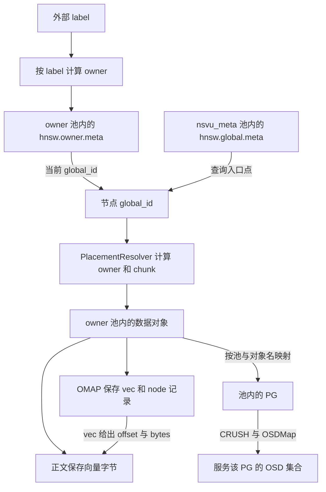

# HNSW 元数据管理与 Ceph CRUSH 对象放置报告

源码基准为 `f38821d`。集群实例采用 2026-11-23 04:34 UTC、OSDMap epoch `15046` 的 Deep100M 四 owner 布局，OSD 运行 Ceph Quincy `17.2.8`。

当前项目把**节点级元数据和向量字节写进同一个 RADOS 对象**。向量放在对象正文，向量引用 `vec/<global_id>` 和 HNSW 邻接表 `node/<global_id>` 放在该对象的 OMAP。对象由项目按节点 ID 选定，Ceph 再把**整个对象**映射到 PG（Placement Group，放置组），由 CRUSH 和 OSDMap 决定负责该 PG 的 OSD。外部 label 的版本映射另存为每个 owner 的对象，全局入口点和 ID 分配仍集中在一个全局对象。 [对象命名与键定义](../../include/nsvu/protocol.hpp#L742) · [导入写入路径](../../src/importer/base_index_importer.cc#L851) · [Ceph 架构](https://docs.ceph.com/en/quincy/architecture/)

## 1. 三类持久化元数据

`owner` 指项目定义的逻辑分片。一个 owner 对应一个 RADOS 池，池中可有多个 `chunk` 数据对象。OMAP 是附在某个 RADOS 对象上的键值表，可以用键读取元数据，再用字节偏移从同一对象正文读取向量。 [分片计算](../../include/nsvu/placement.hpp#L39) · [池连接](../../src/coordinator/update_coordinator.cc#L962) · [CLS 引用读取](../../src/cls/hnsw_cls.cc#L125)

| 元数据 | 保存在哪里 | 内容与用途 |
|---|---|---|
| 节点级，随向量分片 | `nsvu_owner_<owner>/hnsw.owner.data.<chunk>` 的 OMAP | `vec/<g>` 是 `VectorRef`，保存全局节点 ID、外部 label、正文偏移、字节长度、维度、向量类型、active/stale 标志和 HNSW 层级。`node/<g>` 是 `AdjacencyBlob`，保存节点各层的邻居全局 ID。`patch/<update_id>` 记录针对这个对象的反向边修补已应用。 |
| 外部 label 映射，按 label 分片 | `nsvu_owner_<label_owner>/hnsw.owner.meta` 的 OMAP | `label/<external_label>` 的值是当前节点的 `global_id`。同一个外部 label 被覆盖后，键所在池和对象固定，值切换到新版本节点。 |
| 全局元数据，集中保存 | `nsvu_meta/hnsw.global.meta` 的 OMAP | `meta/*` 保存入口点、最高层、图节点计数、下一个 ID、版本、`M`、`ef`、维度、向量类型和距离度量。`reservation/<update_id>` 和 `finalized/<update_id>` 分别记录 ID 预留和插入收尾。 |

三类记录的作用不同。`VectorRef` 回答“这个图节点的数据在哪”，邻接表回答“可以沿哪些边继续搜索”，label 映射回答“这个业务标识当前指向哪一版”。`cur_element_count` 随已收尾的插入累加，旧节点置 stale 时仍计入图节点总数。活动版本由 label 的当前指向与节点 active 标志共同确定。 [结构体定义](../../include/nsvu/protocol.hpp#L151) · [全局元数据初始化](../../src/importer/base_index_importer.cc#L935) · [全局收尾](../../src/cls/hnsw_cls.cc#L947) · [结果筛选](../../include/nsvu/baseline_observation.hpp#L20)

## 2. 导入怎样把节点和向量写到同一个对象

给定节点全局 ID `g`、owner 数 `S`、每对象规划点数 `P`，`PlacementResolver` 计算下面的地址。这里的除法取整数商。新插入节点使用同一公式，label 路由只使用 `external_label % S`。代码里的 `group_id` 返回 `0`，`placement_epoch` 默认 `0`，这两个字段服务于项目路由协议。Ceph 的 OSDMap epoch 则随集群映射变化。 [PlacementResolver](../../include/nsvu/placement.hpp#L24)

```text
owner    = g % S
local_id = g / S
chunk    = local_id / P
pool     = nsvu_owner_<owner>
oid      = hnsw.owner.data.<chunk，十进制至少补足 6 位>
```

导入时，导入器对每个 chunk 从偏移 0 开始拼接原始向量，通过 `ioctx.write(oid, ..., offset)` 写正文，同时按同一池和对象名调用 `omap_set` 写 `vec/<g>`，引用里的 `offset` 就是拼接前的正文长度。初始导入用 `external_label = global_id`，并在对应的 `hnsw.owner.meta` 写 `label/<g> → g`。向量、引用和 label 批次完成后，导入器按同一公式再算一遍 owner、chunk，把 `node/<g>` 写进原数据对象的 OMAP。所有邻接批次完成后才发布 `meta/*`。这些导入阶段通过批次和阶段边界衔接。 [正文和 OMAP 批写](../../src/importer/base_index_importer.cc#L398) · [向量与引用](../../src/importer/base_index_importer.cc#L835) · [邻接写入与全局发布](../../src/importer/base_index_importer.cc#L896)



邻接表保存的是邻居的全局 ID。遍历一条跨 owner 边时，Coordinator 用邻居 ID 重新计算其目标池和对象。同对象共置的范围是**同一节点的向量、引用和它自己的邻接表**。 [邻接解码](../../include/nsvu/protocol.hpp#L184) · [按对象读取邻接表](../../src/coordinator/update_coordinator.cc#L1240) · [跨 owner 边计数](../../src/coordinator/update_coordinator.cc#L4202)

## 3. CRUSH 怎样把这个对象放到 OSD

1. **项目选 `(pool, oid)`。** 导入器、Coordinator 和检查器共享 `PlacementResolver`。Coordinator 按 owner 池名创建 `librados::IoCtx`，以对象名发起原生 RADOS I/O 或 CLS 调用。 [池连接](../../src/coordinator/update_coordinator.cc#L962) · [CLS 调用](../../src/coordinator/update_coordinator.cc#L1006) · [检查器校验节点位置](../../src/tools/index_checker.cc#L347)
2. **Ceph 将对象映射到池内的 PG。** 当前请求以对象名参与哈希，池 ID 限定 PG 所在池。Ceph 根据池的 `pg_num` 把原始哈希归约为实际 PG。同名对象位于不同池时属于各自的对象和 PG。`vec/` 和 `node/` 键在目标对象的 OMAP 内解析。 [Ceph 对象与 PG 映射](https://docs.ceph.com/en/quincy/architecture/#mapping-pgs-to-osds) · [Ceph 17.2.8 OSDMap 源码](https://github.com/ceph/ceph/blob/v17.2.8/src/osd/OSDMap.cc)
3. **Ceph 为 PG 选 OSD。** CRUSH 根据池的规则、放置种子、拓扑、权重和池副本数生成初始 OSD 列表。OSDMap 可用 `pg_upmap_items` 调整某个 PG 的候选 OSD。`up` 表示计算出的目标集合，`acting` 表示当前负责服务的集合，实际请求通常送到 acting primary。在 PG 迁移或恢复时，对象正文与该对象的 OMAP 作为同一个 RADOS 对象归属迁移。 [Ceph PG 概念](https://docs.ceph.com/en/quincy/rados/operations/pg-concepts/) · [Ceph pg-upmap](https://docs.ceph.com/en/quincy/rados/operations/upmap/)

### Deep100M 的实际对象映射

Deep100M 使用四个 owner，每个 chunk 规划 `160000` 点，向量为 96 维 `float32`，每条 `384` 字节。取基础图节点 `g = 640006`，`640006 % 4 = 2`，`640006 / 4 = 160001`，再整除 `160000` 得到 chunk `1`。它是 owner 2 的第二个 chunk 中第二条向量。基础导入按顺序拼接向量，因此它的正文偏移为 `384`。 [Deep100M 参数](../../scripts/baseline-quality.py#L33) · [导入偏移计算](../../src/importer/base_index_importer.cc#L851)

现场以 `rados stat` 确认 `nsvu_owner_2/hnsw.owner.data.000001` 的正文大小为 `61,440,000` 字节。以 `rados getomapval` 读取该对象的 `vec/640006`，解码得到 `offset=384, bytes=384, dim=96`。在同一池的 `hnsw.owner.meta` 上读取 `label/640006`，值为 `640006`。抽查时该轮导入仍在进行，邻接表的归属依据导入器邻接写入路径。 [向量引用编码](../../include/nsvu/protocol.hpp#L151) · [邻接对象选择](../../src/importer/base_index_importer.cc#L903)

集群只读命令返回了该对象的实际 PG 和 OSD。`1790.f778473c` 是带池 ID 的原始哈希结果，`1790.0` 是实际 PG。owner 2 的 `hnsw.owner.meta` 哈希不同，但同池只有一个 PG，两个对象都由 `osd.3` 服务。这个池的 `replicated_rule` 从 `default` 根按 `host` 故障域选 OSD，epoch `15046` 的 `pg_upmap_items` 再将 `1790.0` 的 `osd.0` 替换为 `osd.3`。 [池布局初始化脚本](../../scripts/initialize-experiment-pools.sh#L96) · [PG 映射覆盖](../../scripts/initialize-experiment-pools.sh#L118)

```text
ceph osd map nsvu_owner_2 hnsw.owner.data.000001
  e15046 → raw 1790.f778473c → PG 1790.0 → up [3], acting [3], primary 3

ceph osd map nsvu_owner_2 hnsw.owner.meta
  e15046 → raw 1790.856b711f → PG 1790.0 → up [3], acting [3], primary 3
```

五个实验池均设置 `pg_num=1`、`pgp_num=1`、`pg_autoscale_mode=off`、`size=1`、`min_size=1`。这个实验布局让各 owner 池内所有对象落在同一 PG，表中的 OSD 编号属于这次 OSDMap 快照。 [池配置与映射](../../scripts/initialize-experiment-pools.sh#L96)

| 池 | 实际 PG | acting primary | `pg_upmap_items` |
|---|---|---|---|
| `nsvu_meta` | `1787.0` | `osd.0` | `4 → 0` |
| `nsvu_owner_0` | `1788.0` | `osd.0` | `4 → 0` |
| `nsvu_owner_1` | `1789.0` | `osd.2` | 沿用 CRUSH 结果 |
| `nsvu_owner_2` | `1790.0` | `osd.3` | `0 → 3` |
| `nsvu_owner_3` | `1791.0` | `osd.4` | `0 → 4` |

### 同一对象在 BlueStore 内怎样落盘

RADOS 对象共置是逻辑地址和 OSD 放置层面的属性。BlueStore 分别管理对象正文的数据 extent 和 RocksDB 中的 OMAP 键值。配置独立 `block.db` 的 OSD 可把 RocksDB 元数据放到独立设备。从 `ceph osd metadata 3` 读取到，本例 `osd.3` 使用 BlueStore，`bluefs_single_shared_device=1`，正文和 BlueFS 共用底层设备，但仍走各自的存储路径。 [BlueStore 源码中的 `_do_write` 和 `_omap_setkeys`](https://github.com/ceph/ceph/blob/v17.2.8/src/os/bluestore/BlueStore.cc) · [BlueStore 设备配置](https://docs.ceph.com/en/quincy/rados/configuration/bluestore-config-ref/#devices)

## 4. 两条 baseline 路线怎样读元数据

Compute 和 OSD/CLS 按同样的 `(owner, chunk)` 分组访问候选。两者的差异是向量字节到哪里计算距离、以及读取元数据所用的接口。 [邻接和距离分组](../../src/coordinator/update_coordinator.cc#L1240)

| 路线 | 邻接和距离读取 |
|---|---|
| Compute | 通过原生 RADOS 读 `node/<g>` 得到邻接表。计算候选距离时先取 OMAP `vec/<g>`，再以引用的偏移和长度读同一对象的正文，将向量取回 Coordinator 计算。 |
| OSD/CLS | Coordinator 在目标数据对象上调用 CLS。距离函数在 OSD 侧逐个读取同对象的 `vec/<g>`，再用 `cls_cxx_read2` 读正文并计算，返回候选 ID 和距离以及计时等信息。邻接批次使用独立的 CLS 读操作。 |

查询从全局入口点遍历。生成最终结果时，两路均通过原生 OMAP 重读候选 `VectorRef`，再按各自接口去 label 对象查当前映射。候选必须同时为 active 且是该 label 当前指向的节点，才能出现在结果中。已 stale 的节点和它的边仍可以参与图遍历。只读查询程序结束时复查全局 `version`、`next_global_id` 和 `enterpoint`，以检测运行期间的索引变化。 [Compute 引用与正文读](../../src/coordinator/update_coordinator.cc#L1890) · [CLS 距离计算](../../src/cls/hnsw_cls.cc#L524) · [候选引用重读](../../src/coordinator/update_coordinator.cc#L1065) · [查询结果筛选与变化检查](../../src/coordinator/update_coordinator.cc#L3469)

## 5. 覆盖更新怎样发布一个新版本

1. Coordinator 按外部 label 加进程内锁，读取旧节点 ID，去全局对象预留一个新 `global_id`。预留推进 `next_global_id` 和 `version`，同时记录 `reservation/<update_id>`。 [覆盖更新入口](../../src/coordinator/update_coordinator.cc#L3666) · [ID 预留](../../src/cls/hnsw_cls.cc#L903)
2. 按新 ID 路由，在新数据对象正文末尾追加向量，并在该对象 OMAP 写 active 的 `vec/<新 ID>`。Compute 用一次 `ObjectWriteOperation` 组合正文写和 OMAP 写，OSD 用目标对象上的 `store_vector` CLS。此时 label 仍指向旧版本。 [插入执行顺序](../../src/coordinator/update_coordinator.cc#L4142) · [Compute 向量写入](../../src/coordinator/update_coordinator.cc#L2058) · [CLS 向量写入](../../src/cls/hnsw_cls.cc#L295)
3. 搜索邻居并写入新 `node/<新 ID>`，再按目标数据对象修补邻居的反向边。每个被修补对象的 `patch/<update_id>` 记录该批写入，覆盖了目标分布在多个 owner 的情况。之后在全局对象执行 finalize，递增图节点计数和版本，必要时替换入口点，并记录 `finalized/<update_id>`。 [邻接写入和全局收尾顺序](../../src/coordinator/update_coordinator.cc#L4218) · [按对象合批](../../src/coordinator/update_coordinator.cc#L1490) · [CLS 修补](../../src/cls/hnsw_cls.cc#L745) · [CLS finalize](../../src/cls/hnsw_cls.cc#L923)
4. 比较并交换（CAS）`label/<external_label>`，仅在旧值符合预期时把它切换到新 ID，然后将此前的 `VectorRef` 标记为 stale。若 CAS 冲突，代码把新节点标记为 stale 并报错，此前的邻接修补和全局收尾已经执行。 [label 切换和 stale 顺序](../../src/coordinator/update_coordinator.cc#L3679) · [CLS label CAS](../../src/cls/hnsw_cls.cc#L380) · [CLS stale 标记](../../src/cls/hnsw_cls.cc#L832)

用上面的 `label=640006` 作一个假设例子。若它是基础导入后的第一条覆盖更新，预留的新 ID 为 `100000000`，落在 owner 0 的 `hnsw.owner.data.000156`。`label/640006` 仍保存在 owner 2 的 `hnsw.owner.meta`，只把值从 `640006` 改成 `100000000`。旧节点的正文和邻接表继续留在 owner 2 的数据对象，`vec/640006` 改为 stale。 [初始 ID](../../src/importer/base_index_importer.cc#L944) · [节点与 label 路由](../../include/nsvu/placement.hpp#L39) · [版本切换](../../src/coordinator/update_coordinator.cc#L3679)

一次覆盖更新包含多条跨对象请求，即使两个对象恰好同在一个 PG，也按各自请求推进。Compute 的全局元数据变更、label CAS 和邻接读改写使用进程内互斥，OSD 路线通过各目标对象上的 CLS 方法执行。预留、修补和收尾记录能帮助识别重复步骤。完整的跨对象更新意图和故障后的自动续做属于阶段 4 的 Saga 设计。 [Compute 全局预留](../../src/coordinator/update_coordinator.cc#L2440) · [Compute label CAS](../../src/coordinator/update_coordinator.cc#L2127) · [Compute 邻接修补](../../src/coordinator/update_coordinator.cc#L2305) · [阶段 4 状态机](../optimization-implementation-plan.md#72-saga-状态机)

## 6. 分片的范围与本轮 baseline 的元数据开销

现有分片覆盖的是**节点引用、邻接表、每对象 patch 记录和外部 label 映射**。阶段 4 文档中的 `Shard Meta` 是另一种状态，计划显式保存 `local_epoch`、活跃和过期节点计数、提交计数与已用空间，并配合 ID 租约和跨对象恢复。当前每次更新仍到同一个全局对象做 ID 预留与收尾，四个 owner 的并行更新会在这里汇合。 [持久化键](../../include/nsvu/protocol.hpp#L742) · [全局对象调用点](../../src/coordinator/update_coordinator.cc#L1573) · [阶段 4 状态拆分](../optimization-implementation-plan.md#71-状态拆分)

判断元数据瓶颈时，可以按具体读写阶段看。已完成的 Deep100M 正式重测第 1 轮 OSD case 有 2000 次成功更新，累计 `distance_vector_ref_seconds = 322.377 s`，即 **161.189 ms/更新**，对应搜索距离计算期间的分片 `VectorRef` 读取。全局元数据阶段累计 `4.56217 s`，即 **2.281 ms/更新**，包含预留、读回预留记录和收尾。label CAS 累计 `6.03108 s`，即 **3.016 ms/更新**。这些是单个 case 中的累计阶段耗时按更新数归一化，能区分高频的节点元数据读取和低频的全局、label 写入。 [阶段指标定义](../stage-profiling.md) · [全局元数据计时代码](../../src/coordinator/update_coordinator.cc#L1573)

上述数字取自本机 `results/high-recall-formal-20261122T135707Z/pilot/cases/deep100m/rep-1/osd/update.json`。本轮观察对应当时的并发与单副本配置。全局对象的并发扩展上限、以及 `VectorRef` 计时中 RocksDB 缓存与设备读各自所占的时间，需要不同的观测数据才能归因。
