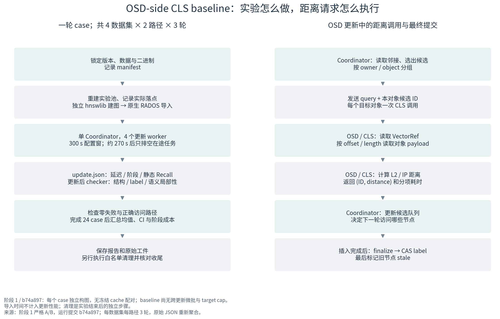
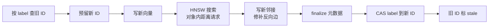
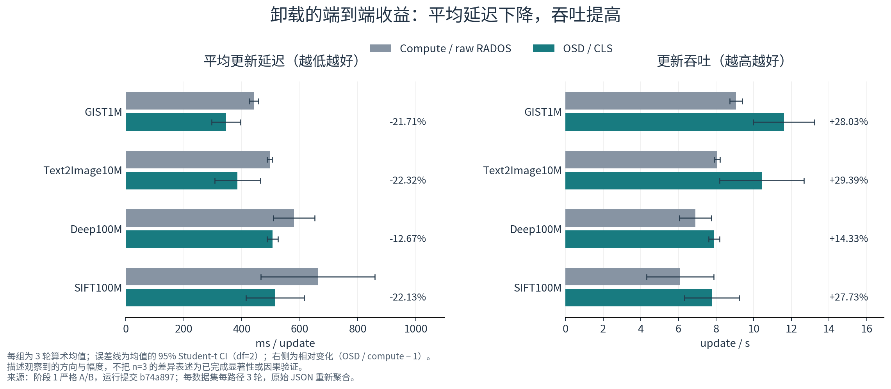
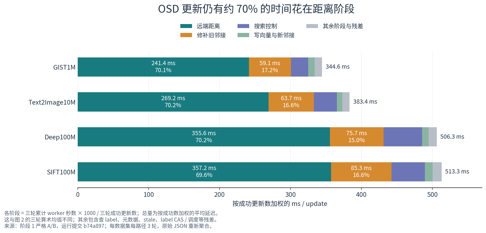
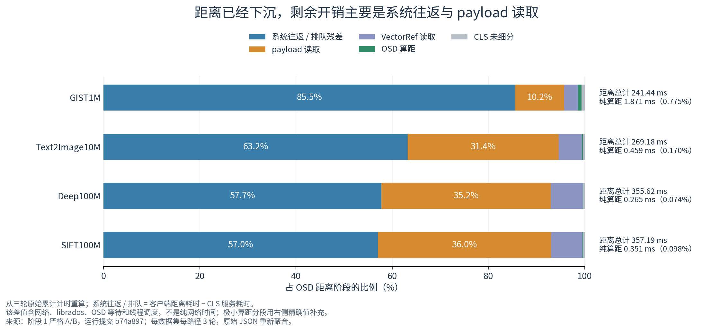
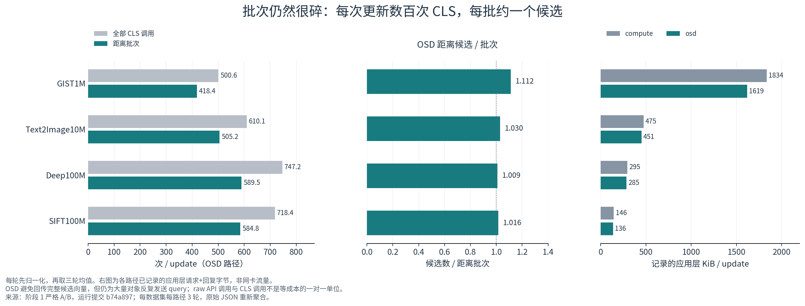
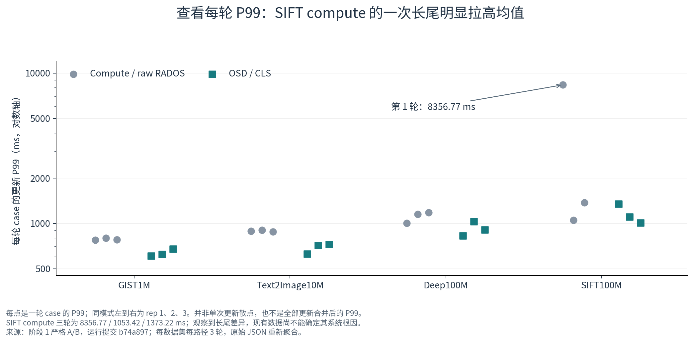

# OSD-side CLS baseline：实验流程与数据图解

整理日期：2026-11-16。本文重新核对已有工件并生成图表，没有重新运行实验。

**主要结论：OSD/CLS 在四个数据集上的三轮平均更新延迟比严格原生 RADOS compute
低 12.67%–22.32%，吞吐高 14.33%–29.39%。但 OSD 更新仍有约 70% 的耗时在距离阶段；
这一阶段中，真正算距仅占约 0.074%–0.775%，主要成本来自系统往返、排队和对象 payload 读取。**

这说明把对象局部操作放到存储侧有实际收益，同时也说明后续优化要关注远程调用的
数量、粒度和执行依赖。仅加快距离算术，难以改变当前端到端表现。

## 1. 归纳的是哪一组实验

主图统一使用[阶段 1 Strict Raw-RADOS/OSD 正式报告](phase1-strict-raw-vs-osd-report-2026-09-30.md)
对应的数据，不混入早期混合 compute、阶段 2 或阶段 5A/6 的性能数字。

| 项目 | 本文使用的证据 |
| --- | --- |
| 被测源码提交 | `b74a89792725c874069cfd59d8bf58e15f4ec32e` |
| 原始实验目录 | `results/phase1-raw-vs-osd-20260928T063622Z/`，本机保留，不纳入 Git |
| 基础工件 | `manifest.txt`、每 case 的 `update.json`、`index-check.json`、`placement.txt`，以及 `summary.json` |
| 实验规模 | 4 个数据集 × 2 条路径 × 3 次独立重复 = 24 case |
| 全部成功更新 | 55,023 次；compute 24,437 次，OSD 30,586 次 |
| 正确性结果 | 24/24 case 零更新失败、零操作 retry；24/24 checker pass，0 error、0 warning |
| OSD 子集 | 12 case、30,586 次成功更新；不要把全部 24 case 算作 OSD 单路径 |

本文是对既有实验的解释性补充，正式运行身份和历史收尾仍以原报告、manifest 为准。
图中数据直接从原始 JSON 重算；少数末位与原报告四舍五入差 0.01 ms，不影响结论。
例如 Deep100M 的 OSD 纯算距重算为 0.264806 ms/update，本文显示 0.265 ms，原报告
两位小数表写为 0.27 ms。

## 2. OSD-side CLS baseline 做了什么

两条路径使用相同的更新语义：通过 external label 找旧节点，为新向量分配新 global ID，
把新节点插入图，发布新 label 映射，最后标旧节点 stale。

| 分工 | 严格 compute / Raw RADOS | OSD-side CLS |
| --- | --- | --- |
| 全局 HNSW 搜索控制 | Coordinator | Coordinator |
| 候选向量读取 | 客户端先读引用，再从 OSD 获取完整候选向量 | CLS 在目标对象内部读取引用和 payload |
| 距离计算 | Coordinator 本地计算 | CLS 在 OSD 内计算 |
| 距离阶段传输 | 候选 ID 等请求；回复带候选向量字节 | 请求带 query 和候选 ID；回复带 ID/距离 |
| label、邻接 patch、元数据 | 原生 librados 读写与客户端协调 | Coordinator 编排对象局部 CLS 操作 |
| 路径资格 | CLS 调用数必须为 0，原生 RADOS 调用数大于 0 | 必须实际产生 CLS 调用 |

**全图搜索仍在 Coordinator。** CLS 回答“这些本对象的向量离 query 多远”，
Coordinator 根据结果决定“接下来访问谁”。同一 OSD 上的不同对象仍要分别调用。

因此，端到端对比衡量的是两条完整更新路径的差异。label、邻接和元数据访问方式也
发生了变化，不能把全部收益解释为单个 L2/IP 函数下沉的独立净收益。

## 3. 实验如何进行



每轮先重建实验池，使用 importer 在本机通过 hnswlib 构建 base 图，完成编号转换后，
通过原生 RADOS 批量导入。导入结束后开始更新，停止更新后再运行离线 checker，最后
核对访问路径和失败数。所有 case 完成后汇总统计；确认工件保存后，另行执行池清理。

### 3.1 固定配置与控制条件

| 条件 | 历史实验实际设置 |
| --- | --- |
| 存储环境 | Ceph 17.2.9 Quincy，5 个 OSD；5 个 owner pool 和 1 个 meta pool |
| 池配置 | 每池 1 PG，`size=1`、`min_size=1`；owner 0–4 分别固定到 OSD 0–4，meta 在 OSD0 |
| 图参数 | importer 与 Coordinator 均为 `M=8`、`ef=32` |
| 更新并发 | 单 Coordinator，4 个 update worker |
| 时间设置 | 配置窗口 300 s；约 270 s 后停止发起新 update，继续完成在途任务 |
| 超时与重试 | 单操作超时 45 s，重试上限 3；不等于整次 update 重跑 |
| 距离观测 | 开启 split probe，按目标对象以 1000 ms 间隔低频采样 noop |
| 模式顺序 | rep 1、3 为 compute→OSD；rep 2 为 OSD→compute，对每个数据集如此执行 |
| 缓存口径 | `fresh-pool-after-import`；导入会预热，不是受控冷缓存 |
| 检查 | 全量结构/label 检查；语义局部性抽样 256 节点，胜率阈值 0.60；记录静态 Recall@10 |

“5 个 OSD”不能直接写成“5 台物理服务器”。当前运行工件也不足以补全 CPU、磁盘和
网络的完整硬件规格；若用于论文方法章节，需要另行补录可追溯的硬件信息。

### 3.2 四个数据集

| 数据集 | base 规模 | 维度 / 类型 | 距离 | 本地构图线程 | 每对象点数 |
| --- | ---: | --- | --- | ---: | ---: |
| GIST1M | 1,000,000 | 960 / F32 | L2 | 32 | 16,000 |
| Text2Image10M | 10,000,000 | 200 / F32 | IP | 48 | 60,000 |
| Deep100M | 100,000,000 | 96 / F32 | L2 | 64 | 160,000 |
| SIFT100M | 100,000,000 | 128 / U8 | L2 | 64 | 250,000 |

GIST 的更新向量池为 1,000 条，其余三个实验配置为 10,000 条。时间窗内按逻辑序号
循环选择 query 和待替换 label，实际成功次数取决于吞吐；这些数不是每个 case 固定
完成的更新次数。吞吐使用成功数除实际 `graph_seconds`，不能直接除名义 300 s。

### 3.3 历史实验中没有做的控制

阶段 1 每个 case 都独立构建基础图，相同数据与图参数并不保证并行构图结果逐字节
相同；**当时没有使用阶段 5A 后来的冻结 HNSW cache 配对**。

历史 runner 也没有共同 query 前缀的 Recall 比较或差值门禁，原始 JSON 没有
`paired_query_samples`。当前 runner 已有这些能力，不能追溯成阶段 1 已执行的保证。
本次专门核对了 `b74a897` 的 runner 和 Coordinator 来确认这个边界。

### 3.4 一次在线替换的真实顺序



新节点先建立，旧节点最后标 stale。多步操作跨越多个对象，所以这条执行顺序本身
不构成跨对象原子事务；零失败和 checker pass 不等于完成了崩溃恢复验证。

## 4. 快了多少：平均延迟与吞吐



下表每项为三轮 case 的算术均值。图中误差棒为三轮均值的 95% Student-t
置信区间，不是 95% 的单次更新落入的区间。

| 数据集 | compute 延迟 ms | OSD 延迟 ms | 延迟变化 | compute 吞吐 update/s | OSD 吞吐 update/s | 吞吐变化 |
| --- | ---: | ---: | ---: | ---: | ---: | ---: |
| GIST1M | 441.180 | 345.387 | −21.71% | 9.061 | 11.601 | +28.03% |
| Text2Image10M | 495.994 | 385.269 | −22.32% | 8.059 | 10.427 | +29.39% |
| Deep100M | 579.801 | 506.332 | −12.67% | 6.905 | 7.894 | +14.33% |
| SIFT100M | 661.780 | 515.311 | −22.13% | 6.097 | 7.788 | +27.73% |

四个数据集的均值方向一致，说明该环境下 OSD 路径有可见的端到端收益。Deep100M 的
降幅较小，不能仅凭这张图归因于维度或存储规模：各数据集同时改变了图、类型、
维度、对象大小与访问轨迹。只有三轮重复，也不能用误差棒是否重叠代替正式的
显著性判断或因果实验。

收益主要体现为距离阶段缩短。compute 距离阶段中，拉取候选向量的 RPC 占
98.79%–99.84%，本地算距只占很小比例。切到 OSD 路径后，按成功更新数加权的距离
耗时在四数据集分别减少约 **96.20、113.43、106.84、154.25 ms/update**。
这与减少候选向量回传及客户端操作的机制一致，但不是对单一因素的独立消融证明。

## 5. 整次 OSD 更新把时间花在哪里



本节按成功更新数加权，单位均为 ms/update。图中将较小阶段合并以便阅读，下面保留
完整拆分。总量是同口径的加权平均延迟，与上一节“三轮等权平均”略有不同。

| 数据集 | 查 label | 写向量 | 搜索控制 | 距离 | 写新邻接 | 修补旧邻接 | meta | stale | 其他 | 加权总延迟 |
| --- | ---: | ---: | ---: | ---: | ---: | ---: | ---: | ---: | ---: | ---: |
| GIST1M | 0.366 | 5.381 | 24.607 | 241.440 | 3.753 | 59.112 | 1.713 | 3.910 | 4.348 | 344.629 |
| Text2Image10M | 0.429 | 3.994 | 32.706 | 269.176 | 3.540 | 63.687 | 1.745 | 4.217 | 3.946 | 383.442 |
| Deep100M | 0.503 | 4.672 | 54.313 | 355.616 | 4.376 | 75.686 | 1.768 | 4.525 | 4.799 | 506.258 |
| SIFT100M | 0.504 | 5.590 | 47.140 | 357.190 | 5.327 | 85.293 | 1.769 | 4.814 | 5.640 | 513.267 |

可以直接读出三层优先级：

1. **距离阶段最大，约占 69.59%–70.24%。** 距离下沉后，远程距离访问仍在关键路径上。
2. **邻接 patch 第二，约 59–85 ms/update，占 14.95%–17.15%。** 插入一个新节点不仅
   要写自己的邻接，还要修改已有节点的反向边，这会继续产生对象访问与写操作。
3. **global meta 在当前负载下较小，约 1.7–1.8 ms/update，占 0.35%–0.50%。**
   元数据协议仍有正确性和扩展价值，但不能从这批数据把它称为首要平均延迟瓶颈。

以 Deep100M 为例，一次 OSD 更新约 506.26 ms：距离占 355.62 ms，邻接 patch
占 75.69 ms，搜索控制占 54.31 ms。这个例子适合用来说明“把距离函数放进 OSD”之后，
仍需要一整套跨对象图更新流程。

## 6. 距离已经卸载，为什么仍然慢



OSD 距离阶段拆成以下部分，单位为加权 ms/update：

| 数据集 | 距离总计 | 系统往返 / 排队 | VectorRef | payload | 纯算距 | CLS 未细分 |
| --- | ---: | ---: | ---: | ---: | ---: | ---: |
| GIST1M | 241.440 | 206.550 | 6.868 | 24.624 | 1.871 | 1.526 |
| Text2Image10M | 269.176 | 170.103 | 13.008 | 84.507 | 0.459 | 1.100 |
| Deep100M | 355.616 | 205.317 | 23.639 | 125.232 | 0.265 | 1.163 |
| SIFT100M | 357.190 | 203.640 | 23.428 | 128.607 | 0.351 | 1.163 |

- **系统往返 / 排队占 57.01%–85.55%。** 请求从客户端发出，经过 librados、网络、
  OSD 调度，再返回客户端。大量细粒度请求会反复承担这些固定成本。
- **payload 读取占 10.20%–36.01%。** 向量留在 OSD 内也仍然需要读出；卸载没有
  消除对象数据访问。本指标是 CLS 发起读取的耗时，不是单独测出的物理磁盘服务时间。
- **真正算距仅占 0.074%–0.775%。** Deep100M 每次更新的距离阶段约 355.62 ms，
  纯算距只约 0.265 ms。即使理想化地把这部分算术时间全部消除，按当前平均耗时
  构成也只直接省下约 0.265 ms，不能据此期待数十或上百毫秒的端到端改善。

这里“系统往返 / 排队”按客户端距离耗时减去 CLS 服务耗时得到，是包含多种系统
因素的残差；**不能直接标成“网络时间”**。当前数据也不能进一步确定是哪一个
网络、磁盘或调度组件造成了具体慢请求。

## 7. 从调用粒度解释剩余成本



| 数据集 | CLS 调用 / update | 距离批次 / update | 候选 / 距离批次 | compute KiB/update | OSD KiB/update |
| --- | ---: | ---: | ---: | ---: | ---: |
| GIST1M | 500.597 | 418.399 | 1.112 | 1834.011 | 1618.546 |
| Text2Image10M | 610.068 | 505.159 | 1.030 | 474.625 | 450.795 |
| Deep100M | 747.216 | 589.504 | 1.009 | 294.833 | 285.245 |
| SIFT100M | 718.449 | 584.767 | 1.016 | 145.924 | 136.368 |

**接口支持 batch，不代表实际形成了大批次。** Deep100M 的平均候选/批次约为
1.009，基本仍是一个距离请求处理一个候选。一次更新需要约 590 个距离批次，
再叠加邻接、label、写入和元数据操作，总 CLS 调用达到约 747 次。

原因与 HNSW 的依赖结构一致：当前候选决定下一步访问，候选又分布在很多对象中。
Coordinator 往往只能发送当前已知的少量候选，取得结果后再推进搜索。即便同一
OSD 上有多个候选，只要落在不同对象中，当前对象局部 CLS 接口也不能把它们当作
一次对象调用处理。这解释了为什么“减少物理请求数”和“重叠等待”值得研究。

图左的距离批次属于全部 CLS 调用的一部分，两者不能相加。图右是各路径计数器记录的
应用层请求加回复字节，不是网卡总流量；raw API 调用与 CLS 调用也不是等成本单位。

卸载避免完整候选向量回传，但 query 会随每个目标对象请求反复发送。因此记录的
应用层总字节只下降约 **3.25%–11.75%**，并没有接近清零。这也是为什么应同时看
调用粒度、时间和字节，而不能只画“数据搬运消失”的概念示意。

## 8. P99 与质量证据应怎样理解



每个点表示一轮 case 的 P99。图中保留全部重复，不删除异常轮；纵轴使用对数尺度。

| 数据集 | compute 三轮 P99 均值 ms | OSD 三轮 P99 均值 ms | 均值变化 |
| --- | ---: | ---: | ---: |
| GIST1M | 784.516 | 636.381 | −18.88% |
| Text2Image10M | 891.461 | 689.812 | −22.62% |
| Deep100M | 1112.553 | 921.402 | −17.18% |
| SIFT100M | 3594.470 | 1155.647 | −67.85% |

SIFT compute 的三轮 P99 为 **8356.77 / 1053.42 / 1373.22 ms**，OSD 为
**1348.29 / 1106.85 / 1011.80 ms**。第一轮 compute 的异常长尾明显抬高了均值；
第二轮 OSD P99 实际高于 compute。因此不能把 −67.85% 讲成每轮都稳定减少三分之二，
也不能只凭这批数据断言该异常一定由 compute 路径造成。

正确性方面，所有运行零失败、检查器全部通过，语义局部性胜率为
0.991346–1.000000。这证明了本批正常运行中的结构、映射和所检查条件。

| 数据集 | compute 静态 Recall@10 | OSD 静态 Recall@10 | 差值（百分点） |
| --- | ---: | ---: | ---: |
| GIST1M | 0.3736 | 0.3686 | −0.491 |
| Text2Image10M | 0.4272 | 0.4230 | −0.416 |
| Deep100M | 0.4934 | 0.4893 | −0.406 |
| SIFT100M | 0.4949 | 0.5017 | +0.681 |

差值从未四舍五入的均值计算。Recall 使用插入搜索阶段采集的 level-0 候选与原始 base GT
比较；采集时新向量已写入，新邻接、patch 和 label 尚未提交。两条路径处理的 query
前缀长度不同，阶段 1 又没有共同前缀配对工件。
因此这些结果应称为静态质量观测，不能证明路径完全等价，也不能证明长期在线
替换后对当前 active 集合的独立查询质量。

## 9. 这组 baseline 如何连接后续工作

后续阶段可以帮助理解研究方向，但不是本次主图中的额外样本：

| 阶段 | 已有结果 | 对 baseline 的启示 |
| --- | --- | --- |
| [阶段 2](phase2-osd-full-regression-report-2026-10-10.md) | 路由/协议重构后，平均延迟变化 −2.06% 至 +4.68%，吞吐变化在 5% 容差内 | 建立优化所需的接口和观测基础；不能称为稳定加速，也不代表 P99 全部在 5% 内 |
| [阶段 3](phase3-frontier-feasibility-report-2026-10-10.md) | frontier 扩展未形成稳定收益，已关闭 | 不能仅凭“批次很碎”就认定扩大窗口一定有效 |
| [阶段 5A](phase5a-four-dataset-formal-ab-report-2026-10-27.md) | 只读执行器已实现；Deep 平均延迟改善 6.25%，P99 回退 23.58%，总体性能门禁失败 | 重叠等待有潜力，但必须同时约束尾延迟；微批默认关闭 |
| [阶段 6](phase6-deep100m-inflight-scan-report-2026-11-12.md) | cap=1 的均值改善受异常轮主导，2/3 轮回退；完整退出未通过 | 目前只保留复测候选，默认 cap=0，AIMD 暂缓 |

当前有证据支持的是继续定位逐 update 的长尾与请求形态，复核调度收益，并评估对象
扇出。邻接修改型的跨更新批处理仍需要先建立阶段 4 的持久更新意图与恢复协议。
不能把历史阶段 1 当时提出的扩窗设想，直接当成今天已经被验证的优化方案。

## 10. 图表统计口径与复用方法

### 10.1 三种统计单位

```text
主性能均值 = (case 1 指标 + case 2 指标 + case 3 指标) / 3
95% CI 半宽 = 4.303 × 三轮样本标准差 / sqrt(3)

阶段 ms/update = 1000 × 三轮阶段累计秒数之和 / 三轮成功更新数之和
阶段堆叠总量 = sum(case 平均延迟 × case 成功数) / sum(case 成功数)
其他阶段 = 上述加权总量 − 八个已观测阶段

调用或字节 = 先对每个 case 按尝试数/成功数归一化，再对三轮取均值
P99 表 = 三个 case 各自 P99 的均值；不是合并所有 update 后重算 P99
```

这批数据零失败，尝试数与成功数一致。阶段时间是多个 worker 累计的工作时间，不能
直接把原始 JSON 的 `*_pct` 当作严格闭合的墙钟比例。原始 `other_update_seconds`
在并发下可能被截成 0，本图按上面公式重新计算残差。

例如 GIST OSD 的阶段堆叠总量为 344.629 ms，而主性能表三轮等权均值为
345.387 ms，两者并不矛盾。各分项显示值四舍五入后也可能产生微小求和差异。

### 10.2 可直接复用的图

| 图 | 适合说明的问题 | 矢量文件 |
| --- | --- | --- |
| 1 | 实验步骤及 Coordinator/OSD 分工 | [SVG](../figures/osd-cls-baseline/01-experiment-flow.svg) |
| 2 | 平均更新延迟与吞吐收益 | [SVG](../figures/osd-cls-baseline/02-latency-throughput.svg) |
| 3 | 完整 OSD 更新阶段组成 | [SVG](../figures/osd-cls-baseline/03-osd-update-stages.svg) |
| 4 | 距离阶段内部瓶颈 | [SVG](../figures/osd-cls-baseline/04-distance-breakdown.svg) |
| 5 | 请求粒度及应用层数据量 | [SVG](../figures/osd-cls-baseline/05-request-granularity.svg) |
| 6 | 逐轮 P99 与异常值影响 | [SVG](../figures/osd-cls-baseline/06-p99-repetitions.svg) |

正文使用 PNG，旁边保存同名 SVG，适合插入 PPT 或进一步排版。图注保留了统计口径
和实验出处。若压缩成一次简短汇报，可选图 1、2、3、4 作为主线，图 5、6 用于解释
剩余瓶颈和长尾证据。

绘图程序：[scripts/plot-osd-baseline.py](../../scripts/plot-osd-baseline.py)。它只读取本机
历史 JSON，不连接 Ceph。需要 Python、Matplotlib 和可显示中文的字体；可在项目外的
虚拟环境安装绘图依赖。字体未安装到系统时用 `--font` 指定现有字体文件：

```bash
python scripts/plot-osd-baseline.py \
  --results-root results/phase1-raw-vs-osd-20260928T063622Z \
  --output-dir docs/figures/osd-cls-baseline \
  --font /path/to/NotoSansCJKsc-Regular.otf
```

脚本检查运行提交身份和 case 基本资格后，生成 6 张 PNG 与 6 张 SVG；不会自动
下载字体或原始数据。原始结果、字体、虚拟环境不提交仓库。重算主指标与原
`summary.json` 一致，并已对照独立聚合结果核对阶段耗时、请求次数和字节。

### 10.3 适合口头汇报的一段话

> 我们在四个数据集上比较了全链路原生 RADOS compute 与 OSD-side CLS 两条更新路径，
> 每条路径独立重复三次。OSD 路径平均延迟下降约 13%–22%，吞吐提高约 14%–29%。
> 但进一步拆分发现，距离阶段仍占更新耗时约 70%，其内部真正算距不足 1%；主要时间
> 花在系统往返、排队和对象 payload 读取。每次更新仍需约 500–750 次 CLS 调用，
> 每个距离批次基本只有一个候选。因此 baseline 既验证了近存储执行的价值，也把
> 后续问题明确为请求粒度、对象访问和等待，而非单纯加速浮点算距。尾延迟和动态质量
> 仍需要独立、严格的验证。

本报告的数字范围限于单 Coordinator、多 worker、单副本实验池和导入后预热环境。
已有 BlueStore slow-op 等历史环境告警也是长尾解释中的不确定因素；这些历史状态
不等同于整理本文时的集群实时状态。
