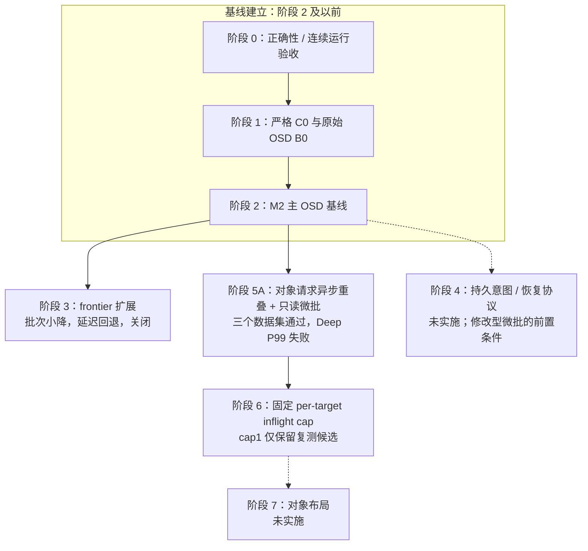
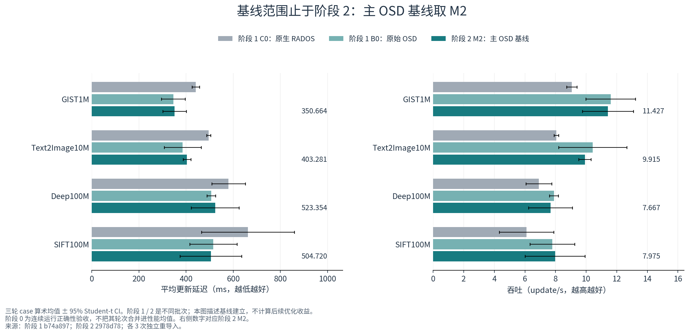
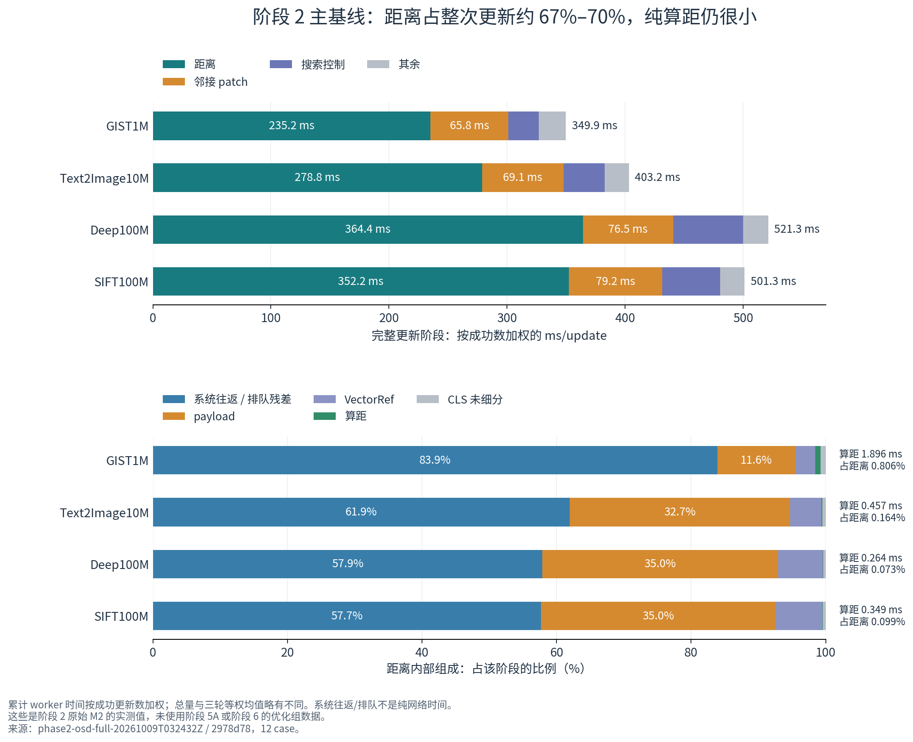
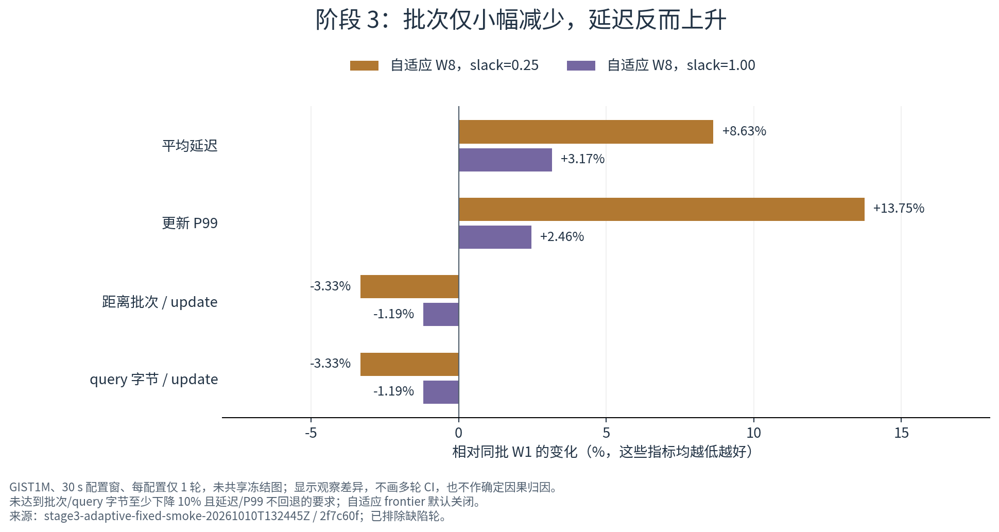
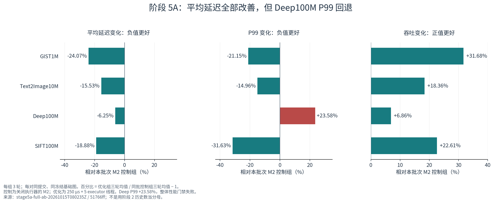
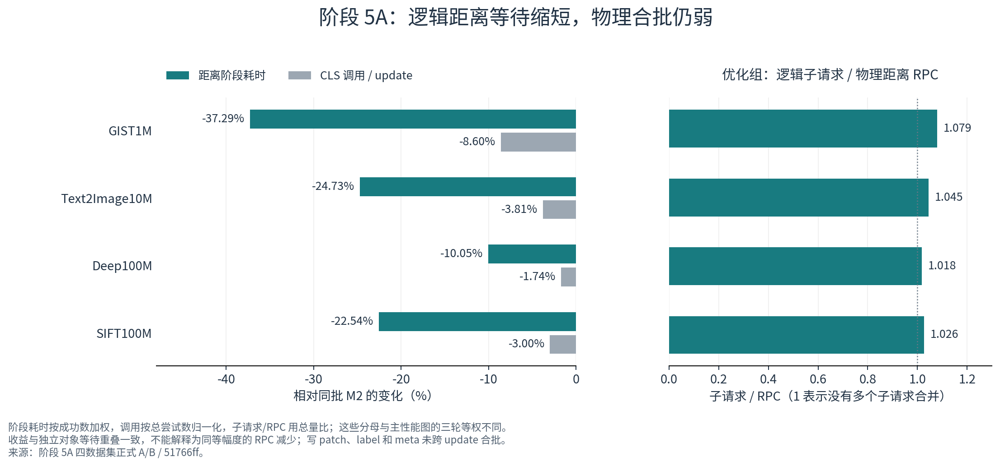
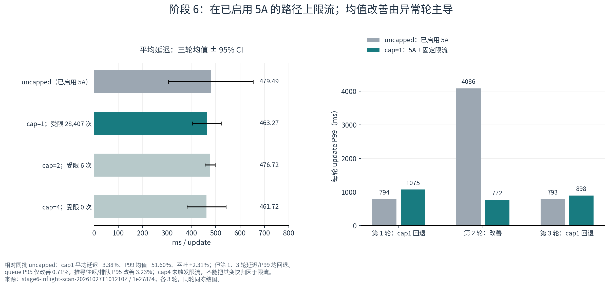

# OSD/CLS：阶段 2 及以前的基线，与后续优化措施及效果

修订日期：2026-11-16。本次只重新核对历史源码、报告与原始 JSON，并更新图表，没有重新运行实验。

**本报告把阶段 0、1、2 归入基线建立阶段，以阶段 2 M2 作为主 OSD 基线；阶段 3 及以后
全部归入优化研究。优化收益使用各自实验中的直接控制组计算，并同时展示收益、回退与门禁结果。**

上一版六张图全部来自阶段 1 `phase1-raw-vs-osd-20260928T063622Z`，并没有混入阶段 3
以后的优化组数据，但只讲了阶段 1，把阶段 2 放在背景中，未完整覆盖“阶段 2 及以前”的
基线范围。本次补正主基线数据、阶段划分与优化效果展示。原阶段 1 图仍保留为来源明确的
历史明细，见文末；本文主图改用下列六张新图。

## 1. 先分清基线、优化和每项优化的控制组

| 阶段 | 本报告中的角色 | 证据与结果范围 |
| --- | --- | --- |
| 阶段 0 | 基线正确性与连续运行验收 | 12 轮、47,900 次更新，全部检查通过；同一索引连续更新，不能当独立性能重复 |
| 阶段 1 C0/B0 | 严格 compute / 原始 OSD 基线对照 | 24 case、55,023 次更新；C0 为全链路 raw RADOS，B0 为原始 OSD/CLS |
| **阶段 2 M2** | **主 OSD 基线：性能优化前的最终基线状态** | 12 case、29,992 次更新；完成路由、协议和观测整理，尚未开启 frontier 扩展或只读执行器 |
| 阶段 3 | 同步 frontier 聚合优化尝试 | 修复后 GIST1M 单轮可行性，未达到性能门槛，默认关闭 |
| 阶段 4 | 恢复与元数据优化计划 | 尚未实施，没有可报告的性能收益 |
| 阶段 5A | 只读异步执行器与跨更新距离微批优化 | 四数据集正式配对 A/B，3/4 数据集性能通过，Deep P99 失败，总体未通过 |
| 阶段 6 | 在 5A 基础上增加固定 inflight 限制 | Deep100M 三轮 cap 扫描；cap=1 仅为复测候选，完整退出未通过 |
| 阶段 7 | 图结构感知对象布局计划 | 尚未实施，没有可报告的性能收益 |

“基线版本”与“某次优化的控制组”需要区分。阶段 5A 中重新运行了关闭执行器的 M2，
它属于**基线实现的同期重测**，用于控制当时环境与基础图；其测量日期虽晚于阶段 2，
也不能误称为优化组。同样，这次测得的数值不能冒充阶段 2 的原始数据。
阶段 6 的控制组则已经开启 5A，只是没有 inflight cap，因此它是**已优化路径的对照**。



阶段 0 以前的历史原型、失败诊断轮，以及 compute 仍调用 CLS 的混合路径，仅用于追溯。
它们不能替代阶段 1 的严格 C0，也不与阶段 2 正式数据合并求均值。

## 2. 数据出处与比较关系

| 图表 / 研究 | 原始目录（均位于本机 results/） | 运行提交 | 应使用的直接控制 |
| --- | --- | --- | --- |
| 阶段 0 验收 | `phase0-validation-20260922T083635Z` | `c0d9c25` | 连续运行验收，不做独立 A/B 性能归因 |
| 阶段 1 C0/B0 | `phase1-raw-vs-osd-20260928T063622Z` | `b74a897` | 本批 compute 与 OSD；各 case 独立建图 |
| **阶段 2 M2** | **`phase2-osd-full-20261009T032432Z`** | **`2978d78`** | 历史阶段 1 OSD 用于回归比较，非同批配对 |
| 阶段 3 修复后可行性 | `stage3-adaptive-fixed-smoke-20261010T132445Z` | `2f7c60f` | 本批 W1；每配置一次独立建图运行 |
| 阶段 5A 四数据集正式结果 | `stage5a-full-ab-20261015T080235Z` | `51766ff` | **本批重跑的 M2 control**；每对同冻结图 |
| 阶段 6 固定 cap 扫描 | `stage6-inflight-scan-20261027T101210Z` | `1e27874` | **本批 uncapped（已启用 5A）**；同轮同冻结图 |

每个目录中的 manifest、update JSON、checker、summary 和配对质量文件共同构成证据。
阶段 2 首次只完成 7/12 case 的尝试不纳入正式数据；阶段 3 错误终止规则造成的
915.45 ms 缺陷轮也不纳入有效优化对照。

## 3. 基线实验怎么做，阶段 2 的基线值是多少

### 3.1 执行分工与实验流程

Coordinator 控制全局 HNSW 搜索，按 owner/object 分组候选；CLS 在当前对象内读取
VectorRef 与 payload，计算 L2/IP，返回 ID/距离。邻接 patch、label 和元数据操作也由
Coordinator 编排对象局部调用。整次更新未完全下沉到 OSD。

每个正式 case 的流程为：核验环境与固定版本 → 重建实验池并记录实际落点 → 本地
hnswlib 构建 base 图、转换编号并导入 → 在线替换 → 保存指标 → 停止更新后执行
离线 checker → 核对路径与失败数。完成全部 case 后汇总，工件保存后另行清理实验池。

一次替换的实际顺序为：查 label 找旧 ID → 预留新 ID → 写新向量 → 搜索并写新邻接、
修补反向边 → finalize 元数据 → CAS label → 标旧节点 stale。

| 固定条件 | 阶段 2 正式配置 |
| --- | --- |
| 环境 | Ceph 17.2.9 Quincy，5 个 OSD；5 个 owner pool + 1 个 meta pool，单副本实验池 |
| 图参数 | M=8、ef=32；frontier window=1 |
| 运行并发 | 单 Coordinator、4 个更新 worker；没有阶段 5A 只读执行器和阶段 6 cap |
| 时间 | 300 s 配置窗口；约 270 s 后停止启动新 update，再完成在途任务；吞吐用实际 graph_seconds |
| 重复与导入 | 四个数据集各三次独立重建与导入，没有冻结 cache 配对 |
| 观测 | 操作超时 45 s、重试上限 3；split probe 间隔 1000 ms；静态 Recall@10 与结构/label/语义检查 |
| 缓存口径 | fresh-pool-after-import；导入有预热，不是受控冷缓存 |

| 数据集 | base 向量数 | 维度 / 类型 | 距离 | 本地构图线程 | 每对象点数 |
| --- | ---: | --- | --- | ---: | ---: |
| GIST1M | 1,000,000 | 960 / F32 | L2 | 32 | 16,000 |
| Text2Image10M | 10,000,000 | 200 / F32 | IP | 48 | 60,000 |
| Deep100M | 100,000,000 | 96 / F32 | L2 | 64 | 160,000 |
| SIFT100M | 100,000,000 | 128 / U8 | L2 | 64 | 250,000 |

### 3.2 基线建立过程与主基线数值



阶段 1 的 C0/B0 严格对照显示，OSD 相对 compute 的三轮平均延迟降低
12.67%–22.32%、吞吐提高 14.33%–29.39%。这是**基线建立中的执行路径对照结果**，
不计作阶段 3 以后某项优化的收益。

阶段 2 经过统一路由、schema v1 和观测整理后，作为本报告主 OSD 基线，数据如下。
误差为三轮 case 算术均值的 95% Student-t CI 半宽。

| 数据集 | 成功更新 | 平均延迟 ms | 吞吐 update/s | 每轮 P99 的三轮均值 ms | 静态 Recall@10 |
| --- | ---: | ---: | ---: | ---: | ---: |
| GIST1M | 9,263 | 350.664 ± 49.663 | 11.427 ± 1.669 | 648.084 | 0.3697 |
| Text2Image10M | 8,041 | 403.281 ± 16.331 | 9.915 ± 0.407 | 728.553 | 0.4273 |
| Deep100M | 6,220 | 523.354 ± 101.563 | 7.667 ± 1.426 | 1274.760 | 0.4836 |
| SIFT100M | 6,468 | 504.720 ± 130.688 | 7.975 ± 1.957 | 1109.040 | 0.4943 |

12 case 共 **29,992 次成功更新，零失败、零操作重试；12 份 checker 全部 pass，
0 error、0 warning**。语义局部性胜率为 0.994480–1.000000。

相对阶段 1 B0，阶段 2 平均延迟变化为 GIST +1.53%、Text +4.68%、Deep +3.36%、
SIFT −2.06%。这满足当时平均延迟/吞吐 5% 回归容差，不能写成所有指标均无回退：
Text 与 Deep 的 P99 均值分别增加 5.62% 和 38.35%。

阶段 2 自己的逐轮 P99（ms）为：

| 数据集 | rep 1 | rep 2 | rep 3 |
| --- | ---: | ---: | ---: |
| GIST1M | 599.429 | 660.144 | 684.680 |
| Text2Image10M | 727.483 | 742.255 | 715.922 |
| Deep100M | 813.026 | 847.464 | 2163.790 |
| SIFT100M | 824.154 | 866.657 | 1636.310 |

Deep/SIFT 的第三轮有明显长尾，不能把阶段 2 的 P99 当作稳定不变的常数。
阶段 2 虽保存了 query 级样本，但本次只有 OSD 路径，没有与历史阶段 1 的共同前缀
配对工件；静态 Recall 差值不构成严格路径等价或动态语料质量的证明。

## 4. 主基线瓶颈：使用阶段 2 数据重新拆分



这里各阶段按成功更新数加权，单位为 ms/update，与上一节三轮等权均值不同。

| 数据集 | 加权总延迟 | 距离 | 邻接 patch | 搜索控制 | global meta | CLS 调用/update | 距离批次/update | 候选/批次 |
| --- | ---: | ---: | ---: | ---: | ---: | ---: | ---: | ---: |
| GIST1M | 349.877 | 235.201 | 65.755 | 25.930 | 1.809 | 500.839 | 418.494 | 1.114 |
| Text2Image10M | 403.209 | 278.833 | 69.076 | 35.021 | 1.814 | 608.241 | 502.911 | 1.030 |
| Deep100M | 521.327 | 364.369 | 76.520 | 59.314 | 1.874 | 746.738 | 587.693 | 1.009 |
| SIFT100M | 501.269 | 352.241 | 79.208 | 49.027 | 1.874 | 715.492 | 582.589 | 1.017 |

调用/批次/候选密度沿用每 case 归一化后取三轮均值的口径；不要用阶段表的加权总量
来反推这些均值。总延迟还包含查 label、写向量/新邻接、stale 与其他客户端成本。

主基线的**距离阶段占完整更新 67.22%–70.27%**，邻接 patch 次之；global meta
约 1.8–1.9 ms/update，仍不是当前平均延迟的首要瓶颈。每个距离批次只有约一个候选，
说明 batch 接口并没有自动形成有效的大批次。

| 数据集 | 往返/排队 ms | VectorRef ms | payload ms | 纯算距 ms | CLS 其他 ms |
| --- | ---: | ---: | ---: | ---: | ---: |
| GIST1M | 197.304 | 6.928 | 27.354 | 1.896 | 1.718 |
| Text2Image10M | 172.717 | 13.012 | 91.301 | 0.457 | 1.347 |
| Deep100M | 210.876 | 24.195 | 127.608 | 0.264 | 1.426 |
| SIFT100M | 203.117 | 24.178 | 123.132 | 0.349 | 1.465 |

阶段 2 距离内部，往返/排队占 **57.66%–83.89%**，payload 占 **11.63%–35.02%**，
纯算距占 **0.073%–0.806%**。这些范围已经替换上一版阶段 1 的范围。
往返/排队是客户端距离耗时减 CLS 服务时间的残差，含网络、librados、OSD 等待和
线程调度，不能只称为网络时间；payload 读取也不是单独测得的磁盘服务时间。

## 5. 优化一：阶段 3 扩展 frontier，减少同一次搜索的请求

措施是在第 0 层预取多个 frontier 节点的邻接，预测对象复用收益，再在额外候选预算
20% 内选择扩展前缀。目标是在一次同步搜索中把同对象候选合并；高层仍保持 W1。
固定 W4/W8 的早期尝试没有形成有效收益，随后进入修复后的自适应 W8 可行性实验。



下面是 GIST1M、30 s 配置窗、每配置一轮的修复后实测值。对照为**同批 W1**，
不使用历史阶段 2 的 350.664 ms 作为分母。

| 配置 | 平均延迟 ms | P99 ms | 吞吐 update/s | 距离批次/update | query KiB/update | 相对 W1 延迟 |
| --- | ---: | ---: | ---: | ---: | ---: | ---: |
| W1 控制 | 446.880 | 761.701 | 8.891 | 458.943 | 1721.035 | — |
| W8 adaptive，slack=0.25 | 485.456 | 866.449 | 8.183 | 443.665 | 1663.744 | +8.63% |
| W8 adaptive，slack=1.00 | 461.036 | 780.440 | 8.633 | 453.483 | 1700.561 | +3.17% |

两种配置的距离批次分别仅减少 **3.33% / 1.19%**，P99 却增加 **13.75% / 2.46%**，
吞吐下降 **7.96% / 2.89%**。slack=0.25 的邻接调用由 58.639 增至 64.879 次/update，
slack=1.0 增至 81.492。预取和额外候选成本会抵消少量距离批次节省。

三组均零失败、checker pass，但未达到“批次与 query 字节至少降 10%，延迟/P99
不回退”的门槛。**该优化尝试失败，默认关闭，没有四数据集正式优化收益。**

这组单轮还有两项工件边界：slack=0.25 的 PG 去重观测约 15.964，而另外两组为 5，
现存 placement 只记录各池 .0，无法判定实际 PG 状态或计数原因；原配对 JSON 的允许
Recall 退化阈值为 0.02，而报告写 0.005。两组实际 Recall 差值均为正，按 0.005
重新判断仍通过，但不能称原自动比较器执行了该更严格门槛。因此这里报告观察差异和
未达门禁结果，不把全部延迟差解释成代码改动的确定因果效果。

## 6. 优化二：阶段 5A 异步重叠独立对象请求，并尝试跨更新只读微批

### 6.1 具体改变了什么

M2 基线按搜索依赖推进，距离对象请求在同步路径中逐组等待。5A 新增共享
DistanceReadExecutor：先把同一轮搜索的多个对象请求提交，再由后台 executor 线程
执行，更新 worker 通过 future 等待；来自不同 update、目标相同对象的只读请求可以
在短窗口内合批。CLS multi-query 方法在一次对象调用内复用候选向量读取，再分别算距。


这是后台线程封装同步 IoCtx::exec，没有使用 librados AIO。只改变只读距离路径，
没有跨 update 批量修改邻接、label 或元数据。正式参数是更新并发 4、executor 5、
等待 250 μs、256 KiB / 256 candidates / 32 subrequests，frontier 仍为 1。

### 6.2 四数据集正式收益：使用同期重跑的 M2 控制



本批每个 dataset/repetition 构建一份冻结 HNSW cache，同一对 control/optimized
使用同图，交替执行顺序；每组各三轮。控制组关闭只读执行器，优化组开启上述 5A 参数。

| 数据集 | 本批 M2 延迟 → 5A ms | 延迟变化 | 本批 M2 P99 → 5A ms | P99 变化 | 吞吐 control → 5A /s | 吞吐变化 |
| --- | ---: | ---: | ---: | ---: | ---: | ---: |
| GIST1M | 338.067 → 256.706 | −24.07% | 622.998 → 491.216 | −21.15% | 11.824 → 15.570 | +31.68% |
| Text2Image10M | 409.550 → 345.957 | −15.53% | 740.556 → 629.741 | −14.96% | 9.761 → 11.553 | +18.36% |
| Deep100M | 511.790 → 479.816 | −6.25% | 944.340 → 1167.051 | **+23.58%** | 7.809 → 8.345 | +6.86% |
| SIFT100M | 525.934 → 426.638 | −18.88% | 1327.163 → 907.419 | −31.63% | 7.646 → 9.375 | +22.61% |

24 case、66,413 次成功更新，全部零失败/重试、checker pass；12/12 共同前缀 Recall
通过 0.5 个百分点门槛。性能要求平均延迟至少降 5%、P99 最多回退 5%，Deep100M
不通过，因此 **3/4 数据集通过，总体性能门禁失败，执行器默认关闭**。

Deep 三轮平均延迟分别改善 8.47%、3.14%、7.26%，但 P99 分别上升
12.51%、3.08%、61.92%。不能通过删除第三轮或只展示平均延迟来称优化完成。

### 6.3 收益来自哪里：等待重叠明显，物理合批有限



下表阶段耗时按成功数加权，CLS 调用按三轮总尝试数归一化，子请求/RPC 为总量比。

| 数据集 | 距离阶段 M2 → 5A ms | CLS/update M2 → 5A | CLS 变化 | 5A 子请求/RPC | payload M2 → 5A ms | patch M2 → 5A ms |
| --- | ---: | ---: | ---: | ---: | ---: | ---: |
| GIST1M | 232.602 → 145.872 | 498.688 → 455.785 | −8.60% | 1.079 | 23.891 → 20.790 | 59.646 → 60.607 |
| Text2Image10M | 284.304 → 214.009 | 615.525 → 592.044 | −3.81% | 1.045 | 89.350 → 92.858 | 69.374 → 73.861 |
| Deep100M | 358.858 → 322.786 | 748.460 → 735.407 | −1.74% | 1.018 | 124.072 → 139.676 | 74.679 → 89.804 |
| SIFT100M | 361.676 → 280.160 | 717.526 → 696.019 | −3.00% | 1.026 | 124.487 → 122.231 | 84.208 → 83.583 |

端到端和逻辑距离阶段的改善明显大于物理调用减少，结果与“重叠独立对象等待”的
机制一致。跨 update 合批仍很弱，不能宣称 RPC 数量已经成倍减少。Deep 的 payload
读取增加 12.58%、patch 增加 20.25%，部分抵消了读路径收益。

开启执行器后，worker 的 future 等待与 executor 的物理服务计时不是同一采样层级。
因此不能把两者的聚合差值当作精确网络时间或完整因果分解，也不能把各分布 P99 相减。

### 6.4 参数选择与验证过程：作为辅助证据，不混入正式均值

| 辅助实验 | 措施 / 目的 | 实测结果与决定 |
| --- | --- | --- |
| GIST，250 μs，30 s，三轮重复 | 验证只读执行器是否有重复收益 | 452.44→358.91 ms（−20.67%），P99 −16.93%，吞吐 +25.89%；推进消融 |
| executor 1/2/5/10 线程，GIST 单轮 | 在固定更新并发 4 下选线程数 | 1/2 线程延迟 +132.04%/+35.48%；5 线程 −21.25%且质量通过；10 线程 −30.83%但 Recall −1.213 pp，不能只按速度选 10 |
| update 并发 1/2/4/8，executor 固定 5 | 区分独立对象异步与跨 update 合批 | 并发 1 的子请求/RPC=1，延迟仍 −46.84%；并发 8 合批为1.459但延迟 +3.05%、P99 +13.38%，排除 |
| GIST，同 cache，固定 200 update | 验证固定轨迹与并行质量 | 串行轨迹差异 0；并发 4 三轮延迟 −20.61%、P99 −15.97%、吞吐 +25.55%；允许进入四数据集正式测试 |

这些研究的窗口、图、并发和运行批次不同，不能画成同一条连续下降的延迟曲线。
最终结论以四数据集正式 A/B 为准，早期 GIST 通过不能覆盖后来的 Deep 失败。
辅助工件来源分别见[可行性报告](phase5a-read-executor-feasibility-report-2026-10-12.md)、
[并发消融报告](phase5a-concurrency-ablation-report-2026-10-13.md)和
[固定轨迹报告](phase5a-fixed-trace-validation-report-2026-10-15.md)。

## 7. 优化三：阶段 6 限制同一对象的在途距离请求

措施是在 5A 执行器的 `(owner, chunk)` 队列上增加固定 cap，达到上限的对象暂不分派，
优先处理其他可分派对象。它只改变只读执行器的调度，不是每个 OSD 的全部 I/O 上限，
也没有实现 AIMD。

**本节的 uncapped 已经启用 5A，所以本节衡量的是“5A 上再加 cap”的增量效果，
不是相对阶段 2 未优化基线的总收益。**



Deep100M，每 cap 三轮，同一轮共享基础图，更新并发 4、executor 5、等待 250 μs。
12 case、27,701 次更新，全部零失败/重试、checker pass，9/9 共同前缀 Recall 通过。

| cap | 平均延迟 ms | P99 三轮均值 ms | 吞吐 /s | 延迟变化 vs uncapped | P99 变化 vs uncapped | 实际受限子请求总数 |
| --- | ---: | ---: | ---: | ---: | ---: | ---: |
| uncapped：已启用5A | 479.486 | 1891.027 | 8.439 | — | — | 0 |
| 1 | 463.271 | 915.163 | 8.634 | −3.38% | −51.60% | 28,407 |
| 2 | 476.721 | 1075.131 | 8.378 | −0.58% | −43.15% | 6 |
| 4 | 461.719 | 1006.612 | 8.676 | −3.71% | −46.77% | 0 |

cap=1 吞吐均值提高 2.31%，但改善并不逐轮成立：

| 重复 | uncapped 延迟 / P99 ms | cap1 延迟 / P99 ms | 延迟变化 | P99 变化 |
| --- | ---: | ---: | ---: | ---: |
| 1 | 439.403 / 794.330 | 487.609 / 1075.330 | +10.97% | +35.38% |
| 2 | 560.147 / 4085.520 | 440.225 / 772.496 | −21.41% | −81.09% |
| 3 | 438.908 / 793.230 | 461.978 / 897.664 | +5.26% | +13.17% |

总体均值改善由第二轮的长尾差异抵消了另外两轮回退。cap=1 有真实触发，但不能仅凭
这些结果确认其消除了同对象拥塞；cap=2 几乎不触发，cap=4 完全不触发，更不能将其
均值变快归因于限流。各配置 CLS 调用约 731–734 次/update、距离 RPC 约569次，
子请求/RPC 仍约 1.018，没有解决调用碎片化。

| cap1 的调度指标 | uncapped | cap1 | 相对同批 uncapped 变化 |
| --- | ---: | ---: | ---: |
| executor queue P95 | 5.670 ms | 5.630 ms | −0.71% |
| 推导往返/排队 P95 | 1.650 ms | 1.597 ms | −3.23% |

固定扫描的自动 pass 不代表完整阶段退出。历史阶段 5A 没有保存上述 queue 分位数，
这些 queue 改善只能相对当轮 uncapped 计算，不能声称直接复核了历史 queue 的20%门槛。
当前默认 cap=0，cap1 仅保留复测候选，AIMD 暂缓。

## 8. 修正容易混淆的 Deep100M 对照身份

| 身份 | 平均延迟 ms | P99 ms | 可用于什么比较 |
| --- | ---: | ---: | --- |
| **阶段 2 原始 M2 主基线** | **523.354** | **1274.760** | 描述优化前正式基线；跨批次只作背景 |
| 阶段 5A 当轮重跑 M2 control，执行器关闭 | 511.790 | 944.340 | 计算阶段 5A 正式优化收益的分母 |
| 阶段 5A 当轮 optimized | 479.816 | 1167.051 | 阶段 5A 优化结果 |
| 阶段 6 当轮 uncapped，已启用5A | 479.486 | 1891.027 | 计算阶段 6 cap 增量收益的分母 |
| 阶段 6 cap1 | 463.271 | 915.163 | 目前只作复测候选 |

原阶段 6 报告把 511.790 / 944.340 ms 一行标成“阶段 2 M2”，实际是阶段 5A
当轮控制组。本次已更正该来源标签；数值本身保留。不能用这几个不同批次的绝对值
相减，或把阶段 5A 的 −6.25% 与阶段 6 的 −3.38% 相加/相乘，得出严格累计加速。

若要给出“最终优化相对阶段 2 实现”的直接总收益，需要在同一批实验里复用同图，
同时运行 M2、5A uncapped、5A+cap1，并使用相同质量和 P99 门禁。当前还没有这样
三方同批的完整证据；本报告不自行启动新实验。

## 9. 统计规则、图表复用与现阶段判断

### 9.1 统计规则

- 主平均延迟、吞吐及 case-P99 的总体值：三个 case 指标的算术平均；百分比取两组均值之比减 1。
- CI：三轮均值的95% Student-t区间，半宽为4.303×样本标准差/√3。它不是95%的update分布范围。
- 阶段成本：累计 worker 秒数之和×1000/成功数之和；完整堆叠用同口径加权延迟闭合。其余项由残差重算。
- 图2里的阶段2总量与图1的三轮等权均值略有不同，不强行对齐；分项末位受JSON精度及四舍五入影响。
- 图3只有单轮观测，不画三轮CI。图5机制指标采用总量归一化，与图4主指标等权平均分开。
- 不将阶段0连续运行、阶段3短实验、5A固定更新数研究和正式300s数据合并求一个“总平均”。
- 静态Recall基于原始base GT；checker pass和配对Recall并不等于动态active语料精确质量、崩溃恢复或多Coordinator事务保证。

### 9.2 六张新图

| 图 | 内容 | 矢量文件 |
| --- | --- | --- |
| 1 | 阶段1 C0/B0与阶段2主基线 | [SVG](../figures/osd-baseline-optimizations/01-baselines-through-phase2.svg) |
| 2 | 阶段2完整阶段与距离内部成本 | [SVG](../figures/osd-baseline-optimizations/02-phase2-cost-profile.svg) |
| 3 | 阶段3 frontier减少请求但延迟回退 | [SVG](../figures/osd-baseline-optimizations/03-frontier-effects.svg) |
| 4 | 阶段5A四数据集正式收益与Deep P99失败 | [SVG](../figures/osd-baseline-optimizations/04-stage5a-formal-effects.svg) |
| 5 | 阶段5A的等待重叠与弱物理合批 | [SVG](../figures/osd-baseline-optimizations/05-stage5a-mechanism.svg) |
| 6 | 阶段6固定cap的均值和逐轮P99 | [SVG](../figures/osd-baseline-optimizations/06-stage6-inflight-effects.svg) |

正文使用PNG，各图同时保存SVG，可用于PPT。新绘图程序
[plot-osd-evolution.py](../../scripts/plot-osd-evolution.py)直接读取75个历史case
（阶段1 24 + 阶段2 12 + 阶段3 3 + 阶段5A 24 + 阶段6 12），核对来源提交与路径。
它复用[阶段1绘图工具](../../scripts/plot-osd-baseline.py)的统计/字体辅助函数，
不会读取大型HNSW cache，也不连接Ceph。

```bash
python scripts/plot-osd-evolution.py \
  --results-dir results \
  --output-dir docs/figures/osd-baseline-optimizations \
  --font /path/to/NotoSansCJKsc-Regular.otf
```

依赖Matplotlib和中文字体。原始JSON、字体、虚拟环境不提交仓库。阶段1旧六图仍可
在[原图目录](../figures/osd-cls-baseline/)查看，全部明确标注阶段1：用于严格C0/B0
历史明细，不替代这里的阶段2主基线，也不代表后续优化效果。

### 9.3 可以据此形成的结论

基线建立阶段已经验证了OSD对象局部执行的价值，并把主要成本定位到细粒度距离请求、
等待和对象读取。后续优化中，frontier扩展未达门槛；5A主要通过独立对象等待重叠降低
平均延迟，但Deep尾部失败；固定cap尚没有稳定收益证据。阶段4恢复与阶段7布局仍是
未实施方向，不能填写虚构的优化百分比。

当前结果来自单Coordinator、多worker、单副本、导入预热的实验环境。所有收益和回退
均限于对应批次与负载；本次重新归纳没有改变实验开关、重跑集群或删除cache。

## 正式出处

- [阶段0正确性验收](phase0-validation-report-2026-09-22.md)
- [阶段1严格Raw-RADOS/OSD](phase1-strict-raw-vs-osd-report-2026-09-30.md)
- [阶段2 OSD全量回归](phase2-osd-full-regression-report-2026-10-10.md)
- [阶段3 frontier可行性](phase3-frontier-feasibility-report-2026-10-10.md)
- [阶段5A四数据集正式A/B](phase5a-four-dataset-formal-ab-report-2026-10-27.md)
- [阶段6固定inflight扫描](phase6-deep100m-inflight-scan-report-2026-11-12.md)
- [优化实施方案](../optimization-implementation-plan.md)
