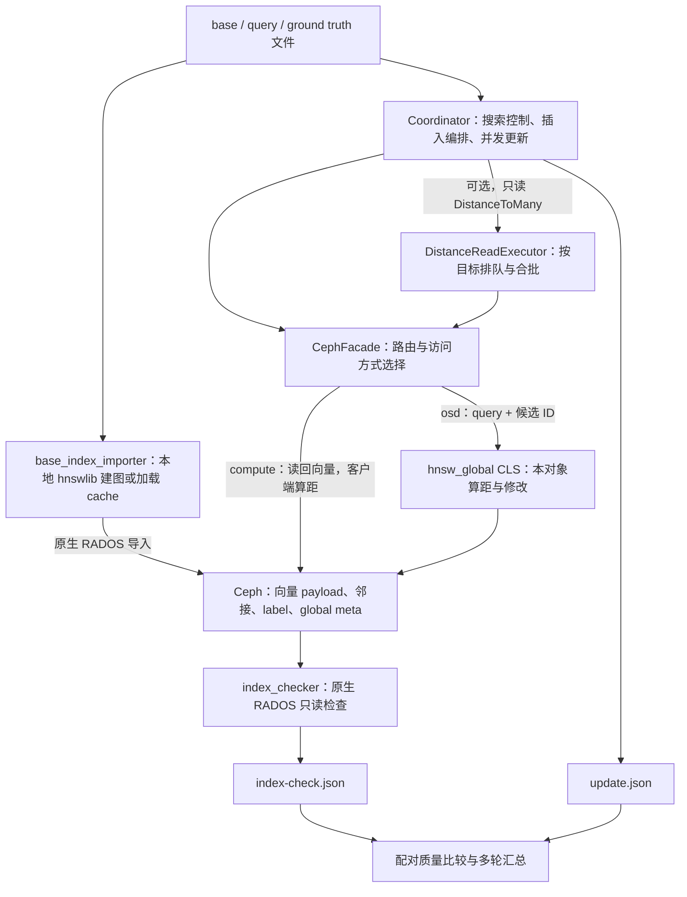
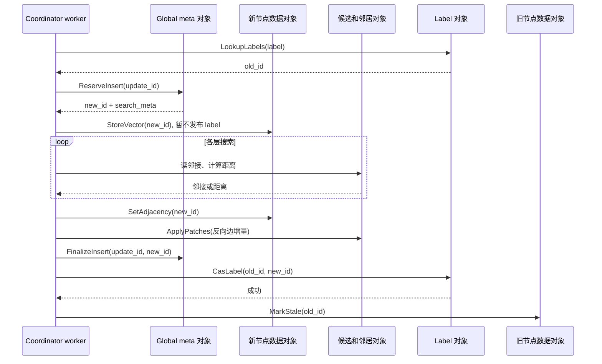

# 源码阅读指南：从向量导入到近存储在线更新

阅读基准：2026-11-13，仓库 `near-storage-vector-update`，源码快照
`e069961598d5c614dfc2923316ec1ecb0acd7441`。本文只描述该快照中已经存在的实现；
阶段 4 的恢复协议、AIMD 和图结构感知布局仍属于计划。源码链接中的行号对应此快照，
后续代码变化时应优先按函数名定位。

这份指南面向希望理解、调试和继续开发项目的读者。阅读范围包括 `include/nsvu/`
三个公共头文件、`src/` 五个 C++ 实现文件、现有测试、Makefile 和主要实验脚本。
Ceph 与 hnswlib 是外部依赖，本文解释本仓库怎样调用它们，不替代这两个项目本身的
源码手册。当前性能与能力问题另见[项目问题评估报告](reports/project-issues-assessment-2026-11-12.md)。

## 目录

1. [先建立整体认识](#section-1)
2. [文件地图与建议阅读顺序](#section-2)
3. [数据模型、路由与编码：先建立三个 ID 空间](#section-3)
4. [共享协议：一次 CLS 调用怎样被识别](#section-4)
5. [基础索引导入：先理解编号，再理解写入](#section-5)
6. [Coordinator：先按调用链读，再回头读存储细节](#section-6)
7. [CLS：对象内部完成哪些工作](#section-7)
8. [Frontier 头文件：理解“同一次搜索内聚合”的边界](#section-8)
9. [离线检查器：结构一致性与语义抽样是两层验证](#section-9)
10. [CLS 重放探针：它验证对象内幂等性，会真实修改元数据](#section-10)
11. [本地测试与构建：哪些检查不需要运行中的 Ceph](#section-11)
12. [从实验入口追到结果：脚本也是实验定义的一部分](#section-12)
13. [把一次代码修改映射到验证范围](#section-13)
14. [无需操作集群的跟读与验证](#section-14)
15. [读完后应能独立回答的问题](#section-15)

<a id="section-1"></a>

## 1. 先建立整体认识

项目解决的是：向量和 HNSW 图已经存放在 Ceph 对象中时，怎样以较少的数据搬运和
远程调用完成一次向量替换。外部 label 表示用户认知中的同一个元素；一次替换会
分配新的 global ID，插入新向量和新图节点，再把 label 指向新节点，最后将旧节点
标记为 stale。因此要同时理解“图算法怎么走”和“状态存在哪个对象、何时写入”。

先记住四个概念：

| 概念 | 在本项目中的含义 | 读代码时应问的问题 |
| --- | --- | --- |
| HNSW | 多层近邻图；高层快速接近目标，低层维护候选集合 | 哪一步必须等上一次距离结果？ |
| RADOS / IoCtx | Ceph 对象访问接口；IoCtx 绑定某个池 | 本次读写针对哪个 pool 和 object？ |
| payload / OMAP | 对象主体保存向量字节；对象附属键值表保存引用、邻接和元数据 | 现在搬运的是完整向量，还是 ID/距离/邻接？ |
| CLS | 在 OSD 内、当前对象上下文中运行的 Object Class 方法 | 这个方法只处理本对象，哪些跨对象工作还在客户端？ |



全局图搜索仍由 Coordinator 控制。OSD 没有接管整次 HNSW 更新；它负责向量读取、
局部算距和当前对象内的修改。compute/OSD 切换也不仅影响距离计算位置：
`--distance-mode compute` 会把整条存储访问路径切到原生 RADOS，包括 label、邻接和
global meta；其运行时门禁要求 CLS 调用数严格为零。

项目有两种构图入口。正式大数据集实验使用 importer 在本地通过 hnswlib 建 base 图，
再批量写入 Ceph；Coordinator 自身的 `--mode build` 则通过远程存储接口逐点构图。
在线 `--mode update` 使用 Coordinator 自己实现的搜索与插入控制，不直接调用
hnswlib 的 `addPoint` 完成在线更新。

<a id="section-2"></a>

## 2. 文件地图与建议阅读顺序

| 文件 | 职责 | 第一次阅读的重点 |
| --- | --- | --- |
| [Makefile](../Makefile) | 五个程序/库产物、三个 C++ 测试和依赖 | 哪些文件链接 librados，哪个文件需要 hnswlib |
| [protocol.hpp](../include/nsvu/protocol.hpp) | 公共结构、序列化、请求封装、对象/键命名 | `VectorRef`、`AdjacencyBlob`、`GlobalMeta`、`RequestEnvelope` |
| [placement.hpp](../include/nsvu/placement.hpp) | global ID 与 label 到存储位置的映射 | `Resolve` 与 `ResolveLabelShard` 的区别 |
| [base_index_importer.cc](../src/importer/base_index_importer.cc) | 读数据、构建/加载 base 图、转换 ID、导入对象 | `main` 的阶段划分、`BuildAdjacencyBlob` |
| [update_coordinator.cc](../src/coordinator/update_coordinator.cc) | 约 5,200 行的在线更新主实现 | 先读 `RunUpdateParallel`、`InsertOneParallel`，再向下追调用 |
| [hnsw_cls.cc](../src/cls/hnsw_cls.cc) | 16 个 CLS 方法及其对象局部实现 | 从底部 `CLS_INIT(hnsw_global)` 反查 handler |
| [frontier.hpp](../include/nsvu/frontier.hpp) | 单次搜索内 frontier 选择与候选预算 | 与跨更新微批的作用范围不同 |
| [index_checker.cc](../src/tools/index_checker.cc) | 不依赖 CLS 的离线结构与语义抽样检查 | 扫描范围、错误条件、检查范围外的性质 |
| [cls_replay_probe.cc](../src/tools/cls_replay_probe.cc) | 响应 envelope 校验与 reserve/finalize 幂等重放验证 | 它会修改对象，不能当只读诊断工具 |
| [tests/](../tests/) | 协议、路由、frontier、结果脚本的本地测试 | 哪些不变量已测试，哪些需要真实 Ceph |
| [scripts/](../scripts/) | 导入/更新/检查编排与实验门禁 | 参数来源、结果文件、比较口径 |

建议分三遍读：

1. **第一遍建立一条完整路径。** 先读本节、公共结构与 placement，再读 importer 的
   ID 转换，最后跟踪一次 `RunUpdateParallel → InsertOneParallel → CasLabel →
   MarkStale`。此时应能手写“一次替换涉及哪些对象、按什么顺序修改”。
2. **第二遍理解算法和存储代价。** 读 `GreedySearch`、`SearchLayer`、
   `DistanceToMany`、`CephFacade::Distances`，然后对照 CLS 距离 handler 与 raw 路径。
   再读邻接 patch、reservation/finalization。此时应能解释为什么局部算距很快，
   一次更新仍然会产生很多 RPC。
3. **第三遍理解优化和证据。** 读 `DistanceReadExecutor`、frontier 策略、指标合并、
   checker、Recall 比较与 runner。此时应能判断一个优化改变了搜索轨迹、排队，还是
   真正减少了对象访问，并知道应使用哪些检查验证。

不必从 Coordinator 第 1 行连续读到最后。前面的 `Metrics` 和后面的 JSON 输出很长，
第一次先把它们当作记录结果的接口；理解调用链之后，再按具体指标倒查打点。

仓库保留 `ghnsw` 命名空间和 `hnsw_global` 类名，这是当前实现中的实际名字；
`nsvu` 出现在二进制、池前缀和部分工具命名中。查找时不要只搜索一种前缀。


<a id="section-3"></a>

## 3. 数据模型、路由与编码：先建立三个 ID 空间

首先阅读 [protocol.hpp](../include/nsvu/protocol.hpp) 的 `VectorRef`（151 行）、`AdjacencyBlob`（184 行）和 `GlobalMeta`（202 行），再读 [placement.hpp](../include/nsvu/placement.hpp)。协议仍使用历史命名空间 `ghnsw`，这不是误入历史原型；当前正式仓库确实沿用该命名空间。`frontier.hpp` 则使用 `nsvu`。

| 名称 | 在当前实现中的含义 | 容易误解的地方 |
| --- | --- | --- |
| external label | 用户侧稳定标签；基础导入时为输入数据的行号，更新通过该标签寻找旧节点 | 标签不随一次替换而改变，但它指向的 `global_id` 会改变 |
| global ID | Ceph 中图节点的永久编号；邻接表保存该 ID，路由也由它计算 | 在线替换分配新 ID，不在旧 ID 上覆盖向量 |
| hnswlib internal ID | importer 构建本地图时由 hnswlib 分配的内存索引编号 | 多线程构图时不保证等于 external label；导入时必须转换 |

基础导入最终令 Ceph 的 `global_id = external_label = 输入行号`，但这只是导入结果的约定。它先建立 `external_to_internal`，用正确的内部编号读取层数和邻接，再把邻居的内部编号转换成 external label。在线更新以后，external label 与 global ID 不再相同。不能把“三种 ID 在小测试中碰巧相等”作为程序不变量。

`VectorRef` 是向量的目录项，不是向量本体：包含 ID、label、对象内字节偏移 `offset`、长度 `bytes`、维度、类型、active/stale 标志和最高层。`AdjacencyBlob.neighbors[level]` 保存该节点在一层的邻居 global ID；`level_count` 应与层数组长度一致。`GlobalMeta` 保存入口、最高层、计数、下一可分配 ID、版本与图参数。

尤其注意：`cur_element_count` 在 finalize 时增长，标 stale 时不递减。因此它不是“当前有效 external label 的数量”。`next_global_id` 则在 reserve 时就增长，某次更新中途失败时，它可以领先于已完成插入数。

### 实际存储布局

下表使用默认配置。pool 前缀、meta pool 和全局 meta 对象名可由参数改变；数据对象与 owner meta 对象名由协议里的辅助函数生成。

| pool | 对象 | 对象 payload | 主要 OMAP 内容 |
| --- | --- | --- | --- |
| `nsvu_meta` | `hnsw.global.meta` | 不承担向量数据存储 | `meta/enterpoint`、`meta/max_level`、`meta/cur_element_count`、`meta/next_global_id`、`meta/version`、`meta/M`、`meta/ef`、`meta/dim`、`meta/vector_kind`、`meta/metric`；以及 `reservation/<update_id>`、`finalized/<update_id>` |
| `nsvu_owner_<shard>` | `hnsw.owner.meta` | 不承担向量数据存储 | `label/<external_label>` → 当前 global ID |
| `nsvu_owner_<shard>` | `hnsw.owner.data.<六位补零 chunk>` | 连续拼接的向量字节 | `vec/<global_id>` → `VectorRef`；`node/<global_id>` → `AdjacencyBlob`；`patch/<update_id>` → 本对象已应用 patch 的标记 |

键名及对象名见 `protocol.hpp:742` 起的 `VecKey`、`NodeKey`、`LabelKey`、`ReservationKey`、`FinalizedKey`、`PatchKey`、`OwnerMetaOid` 和 `OwnerDataOid`。`OwnerDataOid(1)` 返回 `hnsw.owner.data.000001`；六位是最小显示宽度，不是 chunk 编号的最大范围。

代码里还保留 `Config.data_oid` 和 `--data-oid`，但当前主要数据读写路径实际调用 `OwnerDataOid(chunk)`。阅读真实落盘对象时，应追踪函数调用，不能把 `data_oid` 的默认字符串 `hnsw.owner.data` 当成完整对象名。

OMAP 是对象附带的键值集合，payload 是对象本体的字节区。一次读取向量通常先查 `vec/<id>` 得到偏移，再从同一对象 payload 读指定长度。邻接和 label 不需要搬运整个向量 payload。

结构体的 `encode/decode` 调用 Ceph 的二进制编码函数，字段顺序就是格式约定；并不是把 C++ struct 的内存直接写出去。`GlobalMeta` 在全局对象中拆成多个 `meta/*` OMAP 值，而不是只存一个序列化大结构；`reservation/*` 则保存序列化的 `ReserveInsertReply`，包括当时的搜索元数据。

### 用一个具体编号理解路由

`PlacementResolver::Resolve`（`placement.hpp:39`）当前仍是确定性的取模布局：

```text
shard_id = global_id % shard_count
local_id = global_id / shard_count       // 整数除法
chunk_id = local_id / points_per_object
```

默认 `shard_count=5`、`points_per_object=250000`。对 `global_id=1250008`：

```text
shard_id = 3
local_id = 250001
chunk_id = 1
向量与邻接位置 = nsvu_owner_3 / hnsw.owner.data.000001
```

若这个新节点对应 `external_label=17`，label 映射的位置独立由 `17 % 5 = 2` 决定，位于 `nsvu_owner_2 / hnsw.owner.meta` 的 `label/17`。因此更新一个 label 往往同时涉及 label 所属对象和新旧节点所属对象。

`Resolve` 返回的是 owner/shard 与对象信息，不直接返回 Ceph 的 OSD ID。对象最终经 pool/PG/CRUSH 落到哪个 OSD，由 Ceph 决定；实验把 owner pool 固定到 OSD 是额外部署安排。

`PhysicalLocation.group_id` 当前固定为 0，`placement_epoch` 默认 0，`SelectForInsert` 只是调用 `Resolve`。这些字段为后续布局演进留了接口，不能据此认定当前已支持图感知布局、迁移或 epoch 冲突拒绝。当前 CLS 没有据 `placement_epoch` 验证路由是否过期。


<a id="section-4"></a>

## 4. 共享协议：一次 CLS 调用怎样被识别

`protocol.hpp:24` 的 `Opcode` 列出 16 个操作；`RequestEnvelope`（43 行）放在每个请求和响应的最前面。

| 字段 | 当前用途 |
| --- | --- |
| `magic` | 固定 NSVU 标记，避免把完全不同的内容当成本协议 |
| `schema_version` | 当前只接受 1；未知版本返回 `-EPROTONOSUPPORT` |
| `opcode` | 校验 payload 应由哪个操作解析 |
| `request_id` | 必须非 0；响应回显请求 envelope |
| `update_id` | 把某些修改操作关联到一次更新，并参与 reserve/finalize/patch 的幂等记录 |
| `expected_version` | `cas_global_meta` 另校验其与 payload 中的期望版本一致 |
| `placement_epoch` | 随请求携带的布局版本预留字段，尚未形成路由版本保护 |

建议按 `ValidateRequestEnvelope → EncodeRequest/DecodeRequest → EncodeResponse/DecodeResponse` 的顺序阅读（78、94、102、122、131 行），再对照 CLS 的 `decode_msg/encode_msg`（`hnsw_cls.cc:66`、82 行）。后者用 `thread_local current_request_envelope` 在同一处理线程中保存并回显 envelope。

当前代码对错误 magic 返回 `-EBADMSG`，错误 opcode 或零 request ID 返回 `-EINVAL`；buffer 解码失败也返回 `-EINVAL`。这里的 `request_id` 不是“所有写操作自动去重”的开关。真正去重必须看具体 handler 使用了什么键，以及是否保证同一 `update_id` 的重试负载不变。

兼容逻辑有明确边界：`DistanceBatchReply::decode`（474 行起）和 `TimedNoopReply::decode`（614 行起）容忍旧 payload 缺少尾部计时字段，并把计时置零；`read_global_meta`（`hnsw_cls.cc:170`）容忍旧元数据缺少 `vector_kind/metric`，默认 U8/L2。当前公共入口不接受无 envelope 的老请求，也没有“未知 schema 自动降级”的分支。

一个阅读细节：头文件定义了 `StoreVectorReply`，但当前 `cls_store_vector` 实际返回 `StatusReply`。文档或新调用方不能仅凭类型名称推断 wire response，应以 handler 与调用方的实际使用为准。


<a id="section-5"></a>

## 5. 基础索引导入：先理解编号，再理解写入

入口是 [base_index_importer.cc](../src/importer/base_index_importer.cc#L360) 的 `main`（第 360 行）。它先在本机获得一份完整 HNSW 图，再把向量、邻接和映射转换成项目的 RADOS 布局。它不通过 CLS 逐点远程建图，也不是在线更新器的另一种调用方式。

建议按以下顺序阅读：

| 位置 | 函数或代码段 | 阅读时回答的问题 |
| --- | --- | --- |
| [29](../src/importer/base_index_importer.cc#L29) | `Config` | 向量格式、距离类型、图参数和批次参数分别控制什么？ |
| [131](../src/importer/base_index_importer.cc#L131) | `LoadVectors` | 二进制文件如何拆成逐向量字节串？ |
| [196](../src/importer/base_index_importer.cc#L196) | `MakeFloatVectorsFromKind` | 为什么 U8 输入也会变成 float？ |
| [213](../src/importer/base_index_importer.cc#L213) | `BuildAdjacencyBlob` | hnswlib 邻接 ID 如何转换成分布式索引 ID？ |
| [382](../src/importer/base_index_importer.cc#L382) | cache load/build 分支 | 冻结的是基础图，还是整个 Ceph 索引？ |
| [437](../src/importer/base_index_importer.cc#L437) | `external_to_internal` 构造 | 为什么不能用数据集行号直接访问 hnswlib 内部数组？ |
| [487](../src/importer/base_index_importer.cc#L487) | payload、`VectorRef`、label 写入 | 哪些信息在对象正文，哪些在 OMAP？ |
| [575](../src/importer/base_index_importer.cc#L575) | 邻接持久化 | 向量所在对象和邻接所在对象是否一致？ |
| [615](../src/importer/base_index_importer.cc#L615) | 全局元数据持久化 | entrypoint 为什么也必须转换编号？ |

### 输入与内存表示

`LoadVectors` 支持 `u8bin` 和 `fbin`：文件开头是两个 `uint32_t`，依次表示数量和维数，后续是连续向量。单向量字节数由 `dim × element_size` 决定；`vector_kind=u8` 使用 1 字节元素，`f32` 使用 4 字节 float。格式和 `vector_kind` 应成对配置，正式 runner 已为数据集选择相应组合；不要认为 importer 会对一切参数组合做完整校验。

读入后是 `std::vector<std::string>`，`string` 在这里承载二进制数据，不是文本。构图时，U8 被逐元素转换为 float，F32 被复制到连续 float 数组。hnswlib 的空间对象选择 `L2Space` 或 `InnerProductSpace`，随后使用 OpenMP 调用 `addPoint(data, i)`。`i` 是数据集行号，也是构建时给 hnswlib 的 external label。

因此，这个 importer 是内存构图工具：原始字节、float 构图输入和 HNSW 数据结构可能同时驻留内存，不是流式外存构图。`build_seconds` 的计时在转换前开始，包含该分支中的转换、构图及保存等时间，不能再把 `convert_seconds` 与它简单相加当作互不重叠的总耗时。

### 三种编号不能混用

并行 `addPoint` 的实际进入顺序可能不同于行号顺序，所以 hnswlib internal ID 不一定等于 external label。导入器在第 437 行建立反向表：

```text
data row / initial external label = 7
external_to_internal[7] = 4
raw payload = raw_vectors[7]
node level = index.element_levels_[4]
node adjacency = index.get_linklist...(4)
neighbor IDs in the stored adjacency = getExternalLabel(each internal neighbor)
initial distributed global_id = 7
```

这里的 `4` 只在本机 hnswlib 结构内部使用。写入 RADOS 的 `VectorRef.global_id`、邻接 `global_id` 及每个邻居 ID 都使用转换后的全局编号。导入时 external label 与 global ID 相等；在线替换后，external label 保持不变而 global ID 会变为新分配的编号。

`external_to_internal` 会检查标签范围、重复和缺失，并记录 `permuted_internal_ids`。entrypoint 同样通过 `getExternalLabel(index.enterpoint_node_)` 转换（第 620 行）。这是读源码时值得手工追踪的一个完整编号转换闭环。

### cache 究竟复用了什么

- `disabled`：本次重新构建基础图，不保存 cache。
- `build`：构建并保存 hnswlib 索引文件；若文件已存在则拒绝覆盖。
- `load`：读取已有 hnswlib 文件，跳过 float 转换和重建图，但仍读取原始向量文件，并重新把数据导入 Ceph。

加载后检查元素数量、`M` 和 float 数据维数（第 420 行）。这些检查并不验证原始向量文件内容指纹，也没有独立的 metric 一致性校验；相同形状的另一个数据集不能随意搭配此 cache。正确配对应依赖 manifest、参数和 cache 哈希。

同一 cache 让 A/B 两侧从同一基础图出发；它不是 OSD、BlueStore 或操作系统缓存的快照。重建池并导入相同基础图，也不能直接称为“受控冷缓存实验”。

### 导入写入顺序

```text
读取原始向量 → 本机构图/加载 cache → 建 external_to_internal
    → 连接 Ceph、打开 pool
    → 按 owner/chunk 写 payload + vec/ OMAP + label/ OMAP
    → 写 node/ 邻接 OMAP
    → 写 meta/* 全局状态
    → 输出 import.json 和阶段进度
```

向量正文按 owner/chunk 连续追加到缓冲区；`VectorRef.offset` 指向该向量在对象内的字节偏移。payload 默认按 64 MiB 批次刷写，OMAP 默认按 2048 条刷写。二者的缓冲和刷写阈值是独立的，所以不能把导入中间时刻当成可供在线更新使用的一致索引。

本工具会写入并重设目标对象，但它不负责把整个旧索引安全清空、回滚失败导入或迁移线上数据。正式 runner 在每个 case 前重建实验池，这个前置步骤与 importer 的写入逻辑要一起读。


<a id="section-6"></a>

## 6. Coordinator：先按调用链读，再回头读存储细节

本节对照 `e069961` 的 [update_coordinator.cc](../src/coordinator/update_coordinator.cc)。这个 5,199 行文件把参数、存储访问、线程执行器、HNSW 控制和 JSON 指标放在同一个编译单元；不要把它误认为 5,000 行都是 HNSW 算法。实际类名是 `CephFacade`、`DistanceReadExecutor` 和 `Coordinator`，代码中没有名为 `ClusterClient`、`RemoteDistanceExecutor` 或 `UpdateByLabel` 的实现。

### 先掌握文件内地图

| 阅读对象 | 入口 | 读完应回答的问题 |
| --- | --- | --- |
| 参数默认值 | [Config，第 74 行](../src/coordinator/update_coordinator.cc#L74) | 默认走哪条路径？哪些优化开关默认关闭？ |
| 指标和错误分类 | [Metrics，第 156 行](../src/coordinator/update_coordinator.cc#L156)、[record_update_failure，第 339 行](../src/coordinator/update_coordinator.cc#L339) | 哪些数代表成功更新、尝试、逻辑请求或实际调用？ |
| 存储访问门面 | [CephFacade，第 847 行](../src/coordinator/update_coordinator.cc#L847) | 同一个逻辑操作如何分别走 raw 和 CLS？ |
| 跨更新距离执行器 | [DistanceReadExecutor，第 2565 行](../src/coordinator/update_coordinator.cc#L2565) | 请求如何排队、合并、限流和回填？ |
| 输入与层数采样 | [LoadVectors，第 2967 行](../src/coordinator/update_coordinator.cc#L2967)、[SampleLevel，第 3092 行](../src/coordinator/update_coordinator.cc#L3092) | 更新向量从哪里来？HNSW 层数怎样产生？ |
| 顶层入口 | [Coordinator::Run，第 3183 行](../src/coordinator/update_coordinator.cc#L3183)、[main，第 5189 行](../src/coordinator/update_coordinator.cc#L5189) | 初始化、build/update、指标输出怎样串起来？ |
| 当前在线更新 | [RunUpdateParallel，第 3276 行](../src/coordinator/update_coordinator.cc#L3276)、[InsertOneParallel，第 3816 行](../src/coordinator/update_coordinator.cc#L3816) | 一次完整更新的持久化顺序是什么？ |
| 搜索 | [GreedySearch，第 3661 行](../src/coordinator/update_coordinator.cc#L3661)、[SearchLayer，第 3692 行](../src/coordinator/update_coordinator.cc#L3692) | 谁决定下一个候选？谁只负责距离？ |
| 旧式串行构建 | [InsertOne，第 4157 行](../src/coordinator/update_coordinator.cc#L4157) | 为什么同名搜索函数有两套重载？ |
| 结果输出 | [WriteMetrics，第 4250 行](../src/coordinator/update_coordinator.cc#L4250)、[WriteProgress，第 4940 行](../src/coordinator/update_coordinator.cc#L4940) | 指标的分母、采样层级和聚合方式是什么？ |
| 命令行解析 | [ParseArgs，第 5001 行](../src/coordinator/update_coordinator.cc#L5001) | 参数的合法组合是什么？ |

### 从 main 到一批在线更新

```text
main
└─ ParseArgs → Coordinator(cfg).Run()
   ├─ CephFacade::Connect()
   ├─ InitMetaIfNeeded()
   ├─ mode=build  → RunBuild → InsertOne
   └─ mode=update → RunUpdate
      ├─ LoadVectors / LoadGroundTruth
      └─ RunUpdateParallel
         ├─ 可选创建共享 DistanceReadExecutor
         ├─ 创建 update_parallelism 个更新 worker
         ├─ 每个 worker 独立 CephFacade + UpdateContext
         ├─ 每次任务：查 label → 插入新节点 → CAS label → 标记旧节点 stale
         └─ join worker → drain executor → 合并指标
   → WriteMetrics → 若有失败，返回错误
```

`Run()` 会先连接 Ceph，并可能初始化元数据，再进入 build/update；它不是无副作用的参数展示器。`ParseArgs()` **没有 `--help` 分支，且未识别参数不会统一报错**。不要通过 `nsvu-update-coordinator --help` 探测帮助：默认 `mode=build`，程序可能进入连接及初始化。阅读参数应直接查 `Config`、`ParseArgs` 和 runner 的调用。`config/datasets.example.json` 也不是此程序自动加载的配置文件。

所有在线更新都走 `RunUpdateParallel()`，包括 `--update-parallelism 1`。不能因为单线程就去读后半部分旧 `InsertOne()` 并把其元数据协议当作当前 update 实现；后者由 `RunBuild()` 使用。正式基础图导入又由独立的 base importer 完成。

更新 worker 用 `next_update.fetch_add()` 取得逻辑序号 `i`，以 `i % vectors.size()` 选更新向量，以 `target_start + i % num_updates` 选待替换 label。无时间限制时做至多 `num_updates` 次尝试；有时间限制时可循环使用这些向量与 label。时间窗口会提前 `min(30 秒, 窗口的 10%)` 停止启动新更新，已有更新继续收尾，因此不是到某一秒强制取消所有 RPC。

每个 worker 有自己的随机数发生器和局部指标，最终统一合并。因此“相同随机种子”不等于“不同并发调度产生完全相同的图”：任务由不同 worker 抢到，层数采样和邻接可见顺序也会不同。

### 一次更新真正执行了什么

实际操作顺序以 [第 3345 行附近](../src/coordinator/update_coordinator.cc#L3345) 与 `InsertOneParallel()` 为准：

1. 取得该 external label 的进程内条带锁，查询它当前指向的旧 global ID。
2. 生成本次 `update_id`，通过 `ReserveInsertId()` 预留新的 global ID，同时得到搜索使用的 `search_meta` 快照。
3. `StoreVector(..., update_label=false)` 写新向量及 `VectorRef`；此时并不切换 label。
4. 从快照的 entrypoint 搜索，为新节点选出各层邻居；空图路径直接建立空邻接。
5. `SetAdjacency()` 写新节点自身邻接。
6. `PatchNeighborAtomic()` 在客户端收集反向边增量，`ApplyPatches()` 按对象批量提交，修补已有节点的邻接。
7. `FinalizeInsertMeta()` 幂等增加已插入节点计数，必要时更新最高层和 entrypoint。
8. 返回更新 worker，以 `CasLabel()` 将原映射切换到新 ID。
9. CAS 成功后，若原 label 存在，再把旧 ID 标记 stale；记录质量样本与成功延迟。

**旧节点不是在开头就被标 stale。** 项目概述中的“stale + 重新插入”表达更新语义，不可据此倒置实际提交顺序。此顺序避免在新节点尚未建好时主动失效旧版本，但它仍不是跨对象原子事务：写向量、写邻接、修改全局元数据和切换 label 是多个对象上的多步操作。

以基础图含 1,000 个节点、`next_global_id=1000`、`label=7 → old_id=7` 为例：更新会分配 `new_id=1000`，建立新节点及其边，完成全局元数据记账，然后切换为 `label=7 → 1000`，最后标记节点 7 stale。`owners=5` 时节点 7 在 owner 2、新节点 1000 在 owner 0，而 label 7 的映射仍在 label shard 2；因此数据对象与 label 对象不必同属一个 owner。更新后的节点总量增加了，仍有效的 label 数量却未必增加。

`PatchNeighborAtomic()` 这个函数名也需要谨慎理解：它本身只构造 `pending_patches`，不执行存储原子操作。真正的 OSD 对象内修改在 `apply_edge_patch_batch`；raw 路径则依靠客户端进程内锁保护读改写。



上图是旧 label 已存在且各步成功的主路径；每条存储箭头只表示对应对象操作，不表示跨对象事务。CAS 冲突和中途失败见下一小节。

### 失败和并发边界

- `CasLabel()` 返回冲突时，worker 会尝试把刚插入的新节点标 stale，再记录失败；已经建立的邻接和 finalized 元数据不会整次回滚。
- 单次更新中抛出的异常会被分类计数，worker 可继续下一次任务。`Run()` 在最终写出指标后，若 `failed_updates>0` 则报错退出。连接等外围错误则可触发停止并重新抛出。
- `Exec()` 对 `-ETIMEDOUT/-ETIME` 做有限重试，默认重试上限 3，即最多 4 次执行；这不是对整个 update 自动重跑。
- 当前有 reservation/finalized/patch 等对象内幂等记录，但没有持久化完整 Update Intent、跨对象恢复扫描器或 Saga 状态机。崩溃后不能由此保证整次更新自动完成或补偿。
- label 条带锁只在一个 Coordinator 进程内共享。raw 的 `raw_meta_mutex()` 与 `raw_object_mutex()` 也只保护同进程内多个 librados client，不能外推为多进程分布式锁。

源码保留 `node_locks_`、`ScopedStripedSharedLocks` 等声明，但当前在线搜索的 `GetAdj()` 直接转发 `GetAdjNoLock()`；不要仅凭这些成员名称推断“整个图搜索有节点读锁保护”。

### HNSW 搜索如何驱动远端访问

先读带 `UpdateContext&` 参数的一组 `GreedySearch()` 和 `SearchLayer()`；后面的不带 context 重载主要服务旧式 build。

`GreedySearch()` 在高层取当前节点邻接，批量计算邻居与新向量的距离，选择更近的节点继续，直到没有改善。`SearchLayer()` 维护两种优先队列：`candidates` 的堆顶是下一步优先扩展的近节点，`top` 的堆顶是当前保留集合中最远的节点。`visited` 防止同一层重复打分，`adjacency_cache` 保存窗口预读的邻接；这一轮选定的 frontier 被展开后会从缓存移除。

每轮的大致步骤是：

```text
SelectSearchFrontier
→ GetAdjacency（必要时批量预读 frontier 节点）
→ 汇总邻接，按 visited 去重
→ DistanceToMany
→ 根据距离更新 candidates/top，保留至多 ef 个候选
→ 下一轮 frontier
```

终止边界依赖当前 `top.top().dist`；这就是远端距离不能随意跨搜索依赖提前执行的原因。`SelectNeighbors()` 直接截取按距离排序结果的前 `2M`（第 0 层）或 `M`（更高层），并非 hnswlib 完整的多样性邻居选择启发式。旧邻接 patch 超过度数上限时丢弃列表前部、保留末尾，不会再做一轮按距离挑边；比较 importer 的 hnswlib 构图和在线更新时应注意这个区别。

`SearchLayer()`、raw 向量读取和 CLS 距离路径并不按 `VectorRef.flags` 过滤 stale 节点。因此 stale 节点仍可参与距离计算和图路由；标 stale 不等于物理删除，也不等于独立检索接口已经实现“只返回当前有效版本”的过滤。

### CephFacade：compute 与 OSD 真正分开的地方

`distance_mode` 名字看起来只影响距离，实际上决定整个存储访问路径：label、向量、邻接、patch、stale 和全局元数据都会分流。`Exec()` 中另有防线：compute 路径若尝试调用 CLS，直接抛出 `ProtocolError`。

| 逻辑操作 | OSD 路径 | compute/raw 路径 |
| --- | --- | --- |
| 距离 | `Distances` → `distance_to_local_batch`；微批另用 `DistanceMultiQuery` | `Distances` → `RawFetchVectorBatch` → `compute_distance_local` |
| 读取向量 | `get_node_vector_batch` | OMAP 读 `VectorRef` 后，用一个 `ObjectReadOperation` 组织该对象多段 payload 读取 |
| 写新向量 | `store_vector` | `RawStoreVector`：读已有 ref、stat、复合 payload + OMAP 写 |
| 查/切换 label | `lookup_label_batch` / `cas_label` | `RawLookupLabels` / `RawCasLabel` |
| 读/建邻接 | `get_node_adjacency_batch` / `set_adjacency_batch` | `RawGetAdjacency` / `RawSetAdjacency` |
| 反向边 patch | `apply_edge_patch_batch` | `RawApplyPatches`：进程内锁下读、合并、裁剪，写邻接和幂等标记 |
| 标记 stale | `mark_node_stale` | `RawMarkStale`：读改写 `VectorRef.flags` |
| ID 与插入计数 | `reserve_insert_id` / `finalize_insert` | `RawReserveInsert` / `RawFinalizeInsert` |

`GroupIds()`、`GroupAdj()` 都按 `(owner, chunk)` 分组；同一 owner 上的不同 chunk 仍是不同对象，不能仅按 owner 合并成一个 CLS 调用。距离在 compute 侧为平方 L2，浮点 IP 距离用 `1-dot`；二者都采用越小越近的排序约定。

OSD 路径也不是“每个远程调用必为 CLS”：`ReserveInsert()` 在 `reserve_insert_id` 成功后，通过原生 `omap_get_vals_by_keys()` 读取持久化 reservation（[第 1474 行](../src/coordinator/update_coordinator.cc#L1474)）。这条读取没有经过 `RecordRaw()`，所以 `storage_access_mode=cls` 是路径标签，`total_raw_rados_calls` 也不是 OSD 路径全部原生访问的完整账本。

### 三种经常混淆的并行/聚合

| 机制 | 聚合什么 | 等待方式 | 代码位置 |
| --- | --- | --- | --- |
| frontier window | 同一次更新、同一层的多个待扩展节点 | 预取/选择多个候选，不是按微秒 sleep 等待 | `SelectSearchFrontier` + `include/nsvu/frontier.hpp` |
| 距离微批 | 多个并发更新访问同一 `(owner, chunk)` 的只读距离子请求 | 请求进入共享队列，等待最老请求的微批窗口到期 | `DistanceReadExecutor` |
| per-target inflight cap | 控制同一对象正在执行的 executor 批次数 | 达到 cap 的 target 暂不可分派，优先选其他可分派 target | `IsDispatchableLocked` / `BeginTargetLocked` / `FinishTarget` |

frontier 只在第 0 层使用可配置窗口；高层窗口固定为 1。自适应模式通过 slack 缩窄 lookahead 距离范围，再看合并后是否能减少对象批数、额外候选是否落在预算内，拒绝的候选放回队列。它不是阶段 6 的拥塞控制器。

微批只接管 `DistanceToMany(UpdateContext&, ...)`。该函数先对一轮候选按对象分组，把所有组提交为 future，再等待结果；不同对象因此可由多个 executor worker 重叠执行。`DistanceToOne()` 仍直接调用 `CephFacade::Distances()`，不会经过微批，也不会受 executor target cap 限制。

### 距离执行器：future 异步接口，内部同步 RPC

```text
更新 worker: DistanceToMany
  → Submit(owner, chunk, query, ids)
  → 各对象 future.get()

共享 DistanceReadExecutor
  → queues[(owner,chunk)]
  → 挑最老且可分派的 target
  → 等待 oldest.enqueued + wait_us
  → PopBatchLocked
  → BeginTargetLocked
  → ExecuteBatch
      → CephFacade::DistanceMultiQuery
      → 同步 IoCtx::exec("distance_multi_query_batch")
      → 按 subrequest_id 分派 subreply
      → promise.set_value / set_exception
  → FinishTarget，唤醒等待者
```

每个 executor worker 有独立 `CephFacade`。默认线程数 5，并不意味着线程 0 固定服务 owner 0；worker 从共享队列选择 target。这里没有 librados `aio_exec`：异步来自调用方的 future 与后台线程，后台每次仍执行同步 `IoCtx::exec`。

`PopBatchLocked()` 按子请求数、估计字节数和逻辑候选数控制同对象合并。估计字节使用 `64 + query.size() + ids.size()*8`，不是完整编码后的精确包长；首个子请求即使自身超过合批阈值仍会被取出，代码没有在此把它切片。因此这些配置不能解释成对每个单独请求都严格成立的硬大小保证，最终还要受 CLS 协议上限约束。

返回时必须按 `subrequest_id` 匹配，不能假设结果位置就是提交位置。重复 ID、缺失子回复、子回复负状态及整个 RPC 失败分别转为相应 future 的异常；更新 worker 在等待 future 时观察到错误。结束时 `Shutdown()` 会停止接收新请求、排空已有请求并 join 线程，随后才能取最终 executor 指标。

cap 的 target 是 `(owner, chunk)`，计数对象是 executor 正在处理的物理批次。它既不是“每个 OSD 的所有 I/O 上限”，也不是“每个更新最多发一个请求”；同步单点距离、邻接读写、label 和元数据操作均不由它限流。`target_limited` 表示子请求入队或等待过程中观察到 target 达到上限，不是精确测量出来的一段限流等待时长。当前是固定上限调度，没有实现 AIMD。

### 参数默认值与正式实验参数要分开读

| 参数 | 当前源码默认值 | 阅读注意事项 |
| --- | --- | --- |
| `--mode` | `build` | 需要显式选择 `update` 才跑在线更新 |
| `--distance-mode` | `osd` | 同时控制所有存储操作的 raw/CLS 分流 |
| `--update-parallelism` | `1` | 并发 1 也走当前 reservation/finalization 更新链 |
| `--frontier-window` | `1` | 相当于不扩展 frontier 窗口 |
| `--frontier-adaptive` | 关闭 | 开启要求窗口至少为 2 |
| `--distance-microbatch` | 关闭 | 仅允许 `mode=update` 且 `distance-mode=osd` |
| `--distance-microbatch-wait-us` | `100` | 正式实验中的 250 μs 是 runner 覆盖，不是源码默认值 |
| 微批 bytes / candidates / subrequests | `256 KiB / 256 / 32` | 都是合批配置；首个子请求不在此拆分 |
| `--distance-executor-threads` | `5` | 只在微批启用时创建 executor |
| `distance_target_max_inflight` | `0` | 省略 CLI 参数表示无限制；**显式传 `--distance-target-max-inflight 0` 会报错** |
| `--osd-op-timeout-seconds` / retry limit | `45 / 3` | 只重试规定超时错误，不是整次更新重试 |
| `--recall-k` | `10` | 需要 ground-truth 输入才收集质量样本 |

### 指标应怎样与调用链对应

指标有三个主要汇总来源：每个更新 worker 的 `UpdateContext::metrics`、共享 executor 的物理调用指标，以及主 `Coordinator` 的墙钟时间与最终聚合。`merge_update_metrics()` 对计数和耗时求和、对峰值取最大、对直方图加桶，不能把所有“seconds”都当作互不重叠的阶段墙钟时间。

| 指标类别 | 真实含义 | 常见误读 |
| --- | --- | --- |
| 成功延迟/P99 | 成功更新从取 label 锁前到完成的延迟样本；失败尝试不进入成功延迟数组 | 把它解释为包含失败尝试的全部请求延迟 |
| `graph_seconds` 与吞吐 | 更新执行阶段的墙钟时间；成功数除以它计算吞吐 | 用多个 worker 的耗时总和代替墙钟时间 |
| `remote_distance_seconds` | 同步路径的距离调用耗时；微批时主要是更新 worker 的 future 等待，加上仍同步的单点距离 | 把它等同于全部物理 RPC 耗时之和 |
| executor queue | 每个逻辑子请求从入队到分派的等待；含微批窗口、线程占用和 target cap 等因素 | 直接称为 OSD 排队时间 |
| executor RPC | 每个物理批次从调用 DistanceMultiQuery 到处理返回的耗时；可含重试及采样 noop | 当作只含网络传播的纯 RTT |
| CLS service | CLS 回复报告的函数内部耗时 | 当作请求从进入 OSD 到离开 OSD 的完整驻留时间 |
| roundtrip/queue | 客户端批次耗时减 CLS service 的非负差值 | 直接称为网络耗时或精确 OSD 队列时长 |
| 原始调用/字节计数 | `RecordExec` / `RecordRaw` 记录的调用和应用级请求、回复字节 | 当作网卡字节，或保证囊括全部初始化/旁路访问 |
| 数据局部性 | 每次尝试涉及的数据对象、PG、owner 去重计数 | 当作每次成功更新的指标，或所有元数据对象也已计入 |

阶段耗时可能包括失败尝试已经执行的工作，而 `*_ms_per_update` 以成功更新数作分母；存在失败时必须同时检查失败计数。更新 P50/P95/P99 由成功样本排序并插值计算；executor 的分位数由 10 μs 向上取整桶及 nearest-rank 累加得出，二者计算方式不同。per-target 表和 executor 总表是聚合结果，当前不能直接反查“P99 的那个 update 究竟在哪个 target 等了多久”。

`WriteMetrics()` 的阶段占比用累计阶段秒数除以 `graph_seconds`。并行时多个 worker 重叠运行，占比总和可以大于 100%，`other_update_seconds` 还会把负差值截为 0；这些字段不能直接画成并行运行时严格闭合的墙钟饼图。微批时逻辑等待与物理 CLS service 也可能重叠，简单相减的聚合残差不能替代逐 RPC 的 `distance_executor_roundtrip_queue_*` 分布。

`TimedNoop()` 按 target 采样，把测得非 CLS 耗时的历史低值作为基线，再用差值估算排队。字段虽含 `network_roundtrip_est`，仍是估计；不是抓包或内核时间戳得到的网络真值。

### Recall 为何叫 precommit_static

在 `InsertOneParallel()` 的第 0 层搜索中，先收集前 `recall_k` 个候选 ID；此时新节点的邻接/patch 尚未完成。`RecordRecall()` 则在 label CAS 和旧节点 stale 成功后才记录这些预先收集的候选，与输入 GT 做集合命中。**“precommit”指候选的采集时点，不是指标函数的调用时点。**

`paired_query_samples` 按更新输入的 `query_index` 保存最早逻辑序号对应的样本，附带目标 label、新 ID、层数和候选顺序哈希，供配对脚本比较。代码不会重算持续更新后的 active 集合 ground truth，也不是独立查询服务上的 Recall 测试。

<a id="section-7"></a>

## 7. CLS：对象内部完成哪些工作

正式实现文件是 [src/cls/hnsw_cls.cc](../src/cls/hnsw_cls.cc)，不是历史交接里写的 `cls_hnsw_global.cc`。它没有独立 `main()`，由文件尾的 `CLS_INIT(hnsw_global)`（1003 行）向 Ceph 注册类和方法，生成模块名为 `libcls_hnsw_global.so`。

建议先看注册表掌握接口，再看三个底层帮助函数：`read_vector_ref`（125 行）、`read_adjacency`（140 行）、`read_global_meta/write_global_meta`（170/155 行）。所有 handler 都围绕当前 `hctx` 对象执行。CLS 没有在这里替 Coordinator 遍历整个分布式 HNSW 图。

下表的“读写”对应实际注册的 `CLS_METHOD_RD` 或 `CLS_METHOD_RD | CLS_METHOD_WR`，不是凭函数名推断。

| 注册方法 / 实现起始行 | 注册属性 | 请求 → 响应 | 本地操作及阅读重点 |
| --- | --- | --- | --- |
| [`store_vector`](../src/cls/hnsw_cls.cc#L295) / 295 | 读写 | `StoreVectorRequest → StatusReply` | 新 ID 的向量字节追加到对象尾，再写 `vec/<id>`；已有引用检查元数据匹配后返回 |
| [`update_label_batch`](../src/cls/hnsw_cls.cc#L362) / 362 | 读写 | `LabelUpdateBatchRequest → StatusReply` | 批量写 label 映射；这是赋值接口，不做旧值 CAS |
| [`cas_label`](../src/cls/hnsw_cls.cc#L380) / 380 | 读写 | `CasLabelRequest → StatusReply` | 比较原 global ID 或期望不存在，再发布新 ID；已是 replacement ID 时视为重试成功 |
| [`get_node_vector_batch`](../src/cls/hnsw_cls.cc#L428) / 428 | 只读 | `IdBatchRequest → GetVectorBatchReply` | 读取本对象内引用和 payload，返回完整向量字节；缺失 ID 跳过 |
| [`lookup_label_batch`](../src/cls/hnsw_cls.cc#L459) / 459 | 只读 | `LabelBatchRequest → LookupLabelBatchReply` | 从 owner meta 对象查 label；缺失 label 跳过 |
| [`get_node_adjacency_batch`](../src/cls/hnsw_cls.cc#L490) / 490 | 只读 | `IdBatchRequest → GetAdjBatchReply` | 读取并解码 `node/<id>`；缺失 ID 跳过 |
| [`distance_to_local_batch`](../src/cls/hnsw_cls.cc#L524) / 524 | 只读 | `DistanceBatchRequest → DistanceBatchReply` | 一个 query 对本对象多个 ID 算距，返回距离及服务阶段计时 |
| [`distance_multi_query_batch`](../src/cls/hnsw_cls.cc#L588) / 588 | 只读 | `DistanceMultiQueryBatchRequest → DistanceMultiQueryBatchReply` | 多个 query 子请求共享本次调用内的候选向量读取，再按 subrequest ID 分别返回 |
| [`timed_noop`](../src/cls/hnsw_cls.cc#L701) / 701 | 只读 | `EmptyRequest → TimedNoopReply` | 只解码并返回计时，用于估计非 CLS 开销参考值 |
| [`set_adjacency_batch`](../src/cls/hnsw_cls.cc#L716) / 716 | 读写 | `SetAdjacencyBatchRequest → StatusReply` | 实现名为 `set_adjacency_common`；仅创建缺失节点的初始邻接，已有节点跳过 |
| [`apply_edge_patch_batch`](../src/cls/hnsw_cls.cc#L745) / 745 | 读写 | `EdgePatchBatchRequest → StatusReply` | 合并本对象邻接增量、去重、按度数上限裁剪，写 patch 幂等标记 |
| [`mark_node_stale`](../src/cls/hnsw_cls.cc#L832) / 832 | 读写 | `MarkNodeStaleRequest → StatusReply` | 把引用 flags 改成 stale；不删 payload、邻接或 label |
| [`get_global_meta`](../src/cls/hnsw_cls.cc#L856) / 856 | 只读 | `EmptyRequest → GetGlobalMetaReply` | 从 meta 对象读取全局状态 |
| [`reserve_insert_id`](../src/cls/hnsw_cls.cc#L872) / 872 | 读写 | `ReserveInsertRequest → ReserveInsertReply` | 分配新 ID 并保存按 update ID 索引的 reservation，返回搜索元数据快照 |
| [`finalize_insert`](../src/cls/hnsw_cls.cc#L923) / 923 | 读写 | `FinalizeInsertRequest → StatusReply` | 更新入口/最高层/插入计数，写 finalized 标记 |
| [`cas_global_meta`](../src/cls/hnsw_cls.cc#L975) / 975 | 读写 | `CasGlobalMetaRequest → StatusReply` | 检查 meta version，再写调用方给出的新 meta |

### 单 query 与多 query 距离不是同一种批次

`distance_to_local_batch` 是“一条 query，多个本对象内候选”。Coordinator 先按 `(owner, chunk)` 分组，它才可能形成较大的本地批次。若邻居分散在许多对象上，同一个 OSD 上也仍然需要多个对象调用。

`distance_multi_query_batch` 则是“同一对象的多个 query 子请求”。每个 `DistanceMultiQuerySubrequest`（`protocol.hpp:508`）有独立 `subrequest_id`、query、维度、类型、metric 和候选 ID 列表；`DistanceMultiQuerySubreply` 返回对应 ID、状态、距离和该子请求算距时间。

处理步骤如下：

1. 检查整个批次的子请求数、subrequest ID 唯一性、候选总数与 query 总字节数。
2. 对格式有效的子请求取候选 ID 并集。
3. 每个唯一 ID 只在本次 handler 中读取一次引用和 payload，放进局部 `vectors` map。
4. 按子请求验证 query/向量字节长度，计算各自的距离；一个格式无效的子请求可以单独返回 `-EINVAL`。
5. 返回整批服务时间、引用读取时间、payload 读取时间，以及各子请求的算距时间。

例如，同一对象上 A 请求候选 `[13,18]`，B 请求 `[18,23]`，是 2 个逻辑子请求、4 次逻辑距离计算、3 个唯一向量读取、1 次物理 CLS 调用。共享的是候选读取；不同 query 对 ID 18 的距离仍要分别计算。局部 map 在 handler 返回后消失，它不是跨 RPC 或跨实验持久存在的 OSD 向量缓存。

服务端硬上限为 1024 个子请求、65536 个逻辑候选、64 MiB query 字节（`hnsw_cls.cc:59`），超出返回 `-E2BIG`。它们是解码后的检查；不能解释为完整的畸形输入资源隔离。正常运行还受 Coordinator 更小的微批阈值约束。

`valid_distance_subrequest` 接受 U8/L2、F32/L2 和 F32/IP；L2 实际计算平方距离，IP 返回 `1 - dot`。单 query 路径校验比多 query 路径少，阅读或扩展新类型时不要假定两边检查完全等价。两种距离方法均不依据 active/stale 标志过滤候选。

计时使用 `steady_clock`，单位是秒。`cls_total_seconds` 覆盖从 handler 开始到记录该字段、调用 `encode_msg` 之前的服务过程，不含随后响应编码、网络传输和客户端调度。`vector_ref_seconds` 是读 OMAP 引用的时间，`payload_read_seconds` 是 CLS 发起对象字节读取的时间；它们不能直接解释为真实磁盘设备服务时间。`roundtrip - cls_total` 包含多种非 CLS 因素，也不能直接叫“网络时间”。

### 写操作的幂等边界与裁剪规则

把 `store_vector → set_adjacency_batch → apply_edge_patch_batch → finalize_insert → cas_label → mark_node_stale` 放在一起阅读，才能区分“一个对象上的操作可以重试”和“整次跨对象更新可以恢复”。这些 handler 提供的是前者所需的部分基础。

`store_vector` 对已有 global ID 检查 label、长度、维度、类型、flags、层数等元数据，匹配就成功返回，不再追加 payload。它不会逐字节比较已有向量与新请求内容。其使用契约是：相同新 ID 的重试携带相同向量，而不是允许调用方用同一个 ID 写另一条同尺寸向量。

`set_adjacency_batch` 的名字容易让人误以为可以覆盖邻接。实际实现遇到已有 `node/<id>` 就 `continue`。这样重试新节点初始化时，不会把稍后其他更新追加进来的边覆盖掉；它不是通用的邻接替换 API。`StatusReply.count` 在这里记录请求条目数，不等于真实新增记录数。

`apply_edge_patch_batch` 首先检查本对象的 `patch/<update_id>`。若已存在，整次 patch 直接返回成功；否则先合并同一节点的多条 patch，去重，然后读取该节点当前邻接并追加新邻居。已有邻接分支超过上限时，L0 保留最后 `2 * max_neighbors` 个，高层保留最后 `max_neighbors` 个。这是按列表尾部保留，不会在 OSD 内重新计算距离、执行 HNSW 启发式选邻居。邻接缺失分支直接采用合并后的 patch，因此不能把“每条路径都强制裁剪”当成实现事实。

这里有一个重要调用约定：幂等键只有“对象 + update ID”，不是“对象 + update ID + 分片编号”。同一次更新发给同一对象的 patch 必须先汇总为一个完整请求；如果以后把它拆成两个不同负载却沿用相同 update ID，第二份可能被当成重试跳过。修改写批处理协议时必须重新审视这个契约。

`reserve_insert_id` 将本次分配的 ID 和搜索 meta 快照一起保存在 `reservation/<update_id>`，同一个 update ID 重试时返回保存的结果，不重复分配。`finalize_insert` 用 `finalized/<update_id>` 避免重复增加计数；重复请求还会检查记录中的 global ID 是否一致。`cas_label` 已指向 replacement 时返回成功，否则按 expected ID 判断冲突；冲突返回 `-EAGAIN`。`cas_global_meta` 按 version 比较后写入请求提供的 meta，不在该 handler 内自动替调用者构造递增后的版本。

`mark_node_stale` 只把 `VectorRef.flags` 设为 stale。向量读取、邻接读取和距离函数仍可能读到旧节点；旧节点可以继续作为图路由的一部分。它不是物理删除接口，也不是空间回收机制。

上述对象内逻辑不能自动串成全图事务。新向量、反向邻接、全局 meta、label 可能分布在不同对象；`reservation/finalized/patch` 是局部幂等记录，不是已完成的持久 Update Intent/Saga 状态机。进程在其中某一步崩溃后的整次恢复流程仍需后续阶段实现。


<a id="section-8"></a>

## 8. Frontier 头文件：理解“同一次搜索内聚合”的边界

[frontier.hpp](../include/nsvu/frontier.hpp) 是纯计算辅助逻辑，没有 Ceph 调用，也没有线程池或定时等待。它和跨更新的 `DistanceReadExecutor` 是两种不同的聚合层。

`SelectFrontierWindow`（14 行）从搜索候选优先队列弹出最多 `max_nodes` 个节点，但遇到距离大于 `lower_bound` 的队首就停止。`FrontierHeadWithinSearchBound`（52 行）表达同一个合法搜索边界。默认窗口为 1 时退回每次展开一个 frontier 节点的方式。

`DecideAdaptiveFrontierPrefix`（56 行）接收若干 frontier 节点各自的候选列表，按已访问 ID 去重，再计算：若逐个展开会触及多少对象批次，若合并前缀会触及多少对象批次。只有预测节约比例达到门槛、额外候选预算也允许时，才把 `accepted_nodes` 扩大到相应前缀。返回值还区分“看到了合批收益”和“预算阻止了扩大”。

其中 `predicted_batches_saved` 是基于对象集合的预测，不是实际 RPC 节约；它尚未把每批最大字节数、最大候选数等拆批因素全部建模。实际收益应回到 Coordinator 指标与正式实验检查。阶段 3 的负面结论也意味着“代码保留了开关”不等于该路径应默认启用。

建议在阅读完上述函数后，依次运行或阅读 `tests/placement_resolver_test.cc`、`tests/frontier_window_test.cc` 和 `tests/protocol_roundtrip.cc`。前两者帮助理解算术和选择边界，后者检查二进制字段往返及非法 envelope；这些本地测试不证明真实 Ceph 对象事务、故障恢复或长期图质量。

<a id="section-9"></a>

## 9. 离线检查器：结构一致性与语义抽样是两层验证

[index_checker.cc](../src/tools/index_checker.cc#L688) 不调用 CLS，使用原生 librados 从存储结果反向验证。入口 `main`（第 786 行）调用 `Run`（第 688 行）。建议先读 `Run` 的扫描框架，再读下面各检查函数：

| 函数 | 行号 | 检查内容 |
| --- | --- | --- |
| `ReadGlobalMeta` | [221](../src/tools/index_checker.cc#L221) | 读取和解码 `meta/*`，必需字段缺失则报错 |
| `VerifyBatch` | [303](../src/tools/index_checker.cc#L303) | 批量读取 `vec/` 与 `node/`，检查节点结构与边 |
| `VerifyLabels` | [262](../src/tools/index_checker.cc#L262) | 每个 ACTIVE 节点是否被自己的 external label 指向 |
| `VerifyLabelTargets` | [427](../src/tools/index_checker.cc#L427) | 反向扫描 `label/`，检查路由和目标 ACTIVE 状态 |
| `ReferenceVectors` | [136](../src/tools/index_checker.cc#L136) | 按 ID 随机读取原始 base 文件的向量，带进程内缓存 |
| `VerifySemanticLocality` | [481](../src/tools/index_checker.cc#L481) | 抽样比较图边距离与伪随机对照距离 |
| `WriteReport` | [615](../src/tools/index_checker.cc#L615) | 将结构计数、语义指标、错误样本输出为 JSON |

`Run` 以 `next_global_id` 推导应有的 owner/chunk 和 ID 范围，逐对象 `stat`，随后分批读取。它分配每节点 1 字节的 `node_states` 数组，用于之后检查 label 目标；这不是只抽样几个节点的轻量检查。对于大索引，它仍会产生明显读取负载。

`VerifyBatch` 具体检查：

1. `VectorRef` 和邻接是否存在且可解码，key 中的 ID 是否与记录一致。
2. 节点路由是否与 `PlacementResolver` 一致，维数、类型和字节数是否匹配全局设置，payload 范围是否超出对象大小。
3. flags 是否为 ACTIVE 或 STALE；entrypoint 是否存在且 ACTIVE。
4. 邻接层数是否等于 `level + 1`，第 0 层度数是否不超过 `2M`，上层是否不超过 `M`。
5. 邻接内是否有重复、自环或越界 ID；同时统计跨 owner 边。
6. ACTIVE 节点的 label 映射是否指向自己。

最后 `VerifyLabelTargets` 扫描每个 owner meta 对象的全部 `label/` 键，验证标签所在 owner 正确、目标 ID 在范围内且 ACTIVE；`Run` 比较实际节点数与 `cur_element_count`，并检查全局 entrypoint。

这里的 `cur_element_count` 是已 finalize 的节点总数，不能直接解释为当前有效 external label 数量，因为替换后的旧节点仍保留为 STALE。

### 语义局部性如何发现“格式没坏但 ID 搞错”的图

单看整数范围和度数，即使把 internal ID 错当成 external label，图也可能看起来完全合法。语义检查专门增加一层证据：对参考范围内的若干 base 节点，取其第 0 层邻居；从原始文件取出源向量、邻居向量和经 `Mix64` 生成的对照向量，比较：

```text
Distance(source, graph_neighbor) < Distance(source, control)
```

统计图边胜出的比例 `edge_win_rate`。默认最低门槛是 0.60；正式 runner 会显式启用抽样与参考输入。邻居超出原始 base 的 `reference_count` 时跳过，因此这不是对当前动态有效语料重算的 Recall。

checker 的边界必须跟着实现一起理解：它检查 payload 范围而不逐字节校验所有远端向量内容；语义距离来自本地原始 base 文件；它不进行全图可达性证明，不验证每条边的双向对称，也不重算动态语料 ground truth。它没有修复功能，也不是并发运行时的一致性快照器，正式 runner 会先结束更新再运行检查。

正常完成且零 error 返回 0；发现结构/语义 error 返回 1；异常（如连接或配置错误）由 `main` 返回 2。报告中的 pass 应解读为这套具体检查通过，而非所有并发与崩溃性质已证明。


<a id="section-10"></a>

## 10. CLS 重放探针：它验证对象内幂等性，会真实修改元数据

[cls_replay_probe.cc](../src/tools/cls_replay_probe.cc#L160) 的 `main` 在第 160 行。它执行一段很窄的失败模型：假设响应丢失，再发送完全相同的请求。

```text
读取 before meta
  → reserve_insert_id
  → 从 OMAP 读 reservation marker
  → 原样重放 reserve 请求
  → 检查 next_global_id / version 未再次增长
  → finalize_insert
  → 原样重放 finalize 请求
  → 检查 cur_element_count / version 未再次增长
```

`Exec`（第 37 行）检查响应 envelope 的 request ID、update ID、placement epoch；`ReadReservation`（第 86 行）直接从 OMAP 读取保存的预留结果。用直接读取标记的方式，使探针能够丢弃第一次修改的返回数据后仍检查结果。

它**不写入实际向量和邻接**，也不完成 label/stale 更新。因此不能在要继续使用的正式索引上把它当作无害检查命令；默认对象还是全局 meta，必须使用隔离的测试对象/实验状态，并显式提供 `--confirm-mutation`。探针成功只证明这两种元数据操作在此重放情景下没有重复推进计数，不证明整次 update 跨对象可恢复，不覆盖进程崩溃重启、OSD 故障或完整 Saga。


<a id="section-11"></a>

## 11. 本地测试与构建：哪些检查不需要运行中的 Ceph

先读 [Makefile](../Makefile)，本仓库使用 C++17 的 make 构建，没有独立服务框架。`all` 生成 CLS 动态库、Coordinator、base importer、checker、replay probe；importer 还需要 hnswlib 和 OpenMP。编译依赖本机 Ceph 头文件及相应库，编译本身不会部署 CLS 或操作集群。

| 测试文件 | 验证重点 | 未覆盖的部分 |
| --- | --- | --- |
| [protocol_roundtrip.cc](../tests/protocol_roundtrip.cc) | patch、reserve/finalize、VectorRef、label CAS、versioned envelope、多 query 距离消息的序列化；非法 schema/opcode 拒绝 | 不执行 OSD 方法，不验证实际 RADOS 原子性 |
| [placement_resolver_test.cc](../tests/placement_resolver_test.cc) | ID 到 shard/chunk 的边界映射、插入位置一致性、非法零参数 | 不证明真实 Ceph CRUSH 位置 |
| [frontier_window_test.cc](../tests/frontier_window_test.cc) | 固定窗口宽度、搜索终止界、自适应对象复用判断和候选预算 | 不证明实际 HNSW Recall/性能 |
| [test_compare_paired_recall.py](../tests/test_compare_paired_recall.py) | 共同前缀、回退阈值、固定更新数、精确轨迹不一致 | 不生成 ground truth |
| [test_summarize_phase1_ab.py](../tests/test_summarize_phase1_ab.py) | run 读取、归一化、聚合及 compute/OSD 和 OSD-only 报告 | 不执行真实 A/B |

本地构建和测试命令集中列在文末。`make check` 运行三个 C++ 测试程序，Python discovery 运行两个测试模块；它们不连接运行中的 Ceph。


<a id="section-12"></a>

## 12. 从实验入口追到结果：脚本也是实验定义的一部分

建议先读 [run-phase1-ab.sh](../scripts/run-phase1-ab.sh)，再读包裹它的阶段 5A/6 runner，最后读 Python 汇总器。它们决定配置、执行顺序、质量口径和自动门槛，因此研究结论不能仅靠 C++ 主程序解释。

### 通用 case 的调用链

`run-phase1-ab.sh` 第 427 行开始的主循环：

```text
repetition / dataset / mode
  → 等待集群可用、重建实验池、记录 placement
  → base importer → import.json
  → update coordinator → update.json
  → index checker → index-check.json
  → validate_run
  → 若同时有 compute/osd，按共同 query 前缀比较 Recall
  → summarize-phase1-ab.py → summary.json / summary.md
```

另有 `manifest.txt` 记录参数、源码提交和二进制等上下文；runner 复制所用二进制到结果目录。每次阅读某个数字，都应同时找到其 `update.json`、对应检查结果、manifest 和上层 summary，确认数据属于哪个 case。

`validate_run`（第 275 行）除零失败和 checker pass 外，还验证路径确实被执行：compute 必须 `storage_access_mode=raw_rados`、CLS 次数为 0 且原生 RADOS 次数非零；OSD 必须有 CLS 调用。开启微批时还必须产生 multi-query RPC、子请求和 queue/RPC 样本。设置 cap 后检查最大在途数没有超过 cap，但这不要求真的发生限流。固定更新数时检查数量达标且没有因时间窗提前停止。

### Recall 比较为什么使用共同前缀

`compare-paired-recall.py::compare`（第 34 行）从 query index 0 开始寻找两次运行都有记录的最长连续前缀。仅对该前缀汇总 hits/denominator，检查两侧 K 和总分母一致，再比较 Recall 差值。默认 `--max-regression=0.005` 是允许下降 0.5 个百分点，不是相对下降 0.5%。

这是固定时间窗下两侧吞吐不同的必要修正：不能让快的一侧多处理后面的 query，再直接比较整个运行的平均 Recall。参数名保留 `compute`/`osd`，但阶段 5A/6 也用同一脚本比较两种 OSD 配置，读输出时应按调用者的 control/optimized 语义理解。

`--expected-queries` 验证固定前缀长度，`--require-exact-samples` 进一步比较 update sequence、target label、新 global ID、层数、candidate hash、命中数和分母。它检查已记录的轨迹字段，不能等同于最终 Ceph 对象逐字节相同；并发调度也不应被期待天然生成完全相同轨迹。

### 阶段 runner 的额外职责

| 脚本 | 关键阅读点 |
| --- | --- |
| [run-stage5a-concurrency-ablation.sh](../scripts/run-stage5a-concurrency-ablation.sh) | 区分更新并发度与 executor 线程数，构造消融 case |
| [run-stage5a-fixed-trace.sh](../scripts/run-stage5a-fixed-trace.sh) | 同一 cache、串行固定轨迹检查，以及并行质量/性能复核 |
| [run-stage5a-full-ab.sh](../scripts/run-stage5a-full-ab.sh) | 同一 repetition/dataset 配对 cache，交替 control/optimized 顺序；第 185 行按多轮均值要求平均延迟至少降 5%、P99 至多回退 5% |
| [run-stage6-inflight-scan.sh](../scripts/run-stage6-inflight-scan.sh) | 默认 Deep100M，扫描 0/1/2/4；第 318 行循环平移执行顺序并在同轮复用 cache；第 225 行的性能分支要求 P99 多轮均值不回退、平均延迟不超过历史 M2 的 95% |
| [summarize-phase1-ab.py](../scripts/summarize-phase1-ab.py) | 第 76 行读取各 run，第 164 行按 dataset/mode 聚合；第 59 行输出均值、标准差和 95% CI 半宽 |
| [summarize-stage-costs.py](../scripts/summarize-stage-costs.py) | 从已有 JSON 生成阶段成本报告，不执行实验 |

阶段 5A/6 的“P99 平均值”是先计算每轮 P99，再对这些数做算术平均，不是合并所有 update 后重新求 P99。阶段 6 的固定扫描 pass 也不等于实施方案中的完整阶段退出条件已经满足。

当前 stage6 runner 自己创建 `RUN_ROOT/cache/rep-N/...`，每轮第一个 case 使用 build，后续 load；它尚没有外部 cache 映射接口。源码导入器支持 cache load，不代表任何上层 runner 都已经支持任意复用现存 cache。

<a id="section-13"></a>

## 13. 把一次代码修改映射到验证范围

| 想修改的内容 | 先读的实现 | 至少需要一起核对 |
| --- | --- | --- |
| 向量类型、距离公式 | Coordinator 本地算距、CLS `compute_distance`、importer 空间选择、checker `VectorDistance` | 四处含义一致；协议字段与原始数据字节长度一致；质量回归 |
| 对象布局/路由 | `PlacementResolver`、对象命名、importer 写入、Coordinator 分组、checker 扫描 | external label 分片与节点位置分别正确；旧数据兼容；实际 PG 落点；迁移与恢复方案 |
| 请求结构 | `protocol.hpp` 的 encode/decode、`CephFacade` 发送处、CLS handler | schema/opcode、字段顺序、错误返回、旧格式兼容和协议往返测试 |
| 搜索/frontier | 两组 `SearchLayer`/`GreedySearch` 重载、`frontier.hpp` | 候选去重、边界条件、距离排序、固定轨迹和配对 Recall |
| 只读合批/限流 | `DistanceReadExecutor`、multi-query 协议与 CLS | 子请求映射、同对象限制、超限首请求行为、失败传递、字节/RPC/延迟/质量 |
| 邻接 patch | `PatchNeighborAtomic`、`ApplyPatches`、raw patch、CLS patch | 原子范围、幂等标记、去重与裁剪；不能把同 update 的对象 patch 拆成多个相同标记的请求 |
| 更新恢复/多 Coordinator | reservation/finalization、label CAS、失败路径、进程内锁 | 阶段 4 的持久意图和故障验证；现有局部重试不是整次更新的恢复器 |
| 性能统计 | 原始打点、`merge_update_metrics`、`WriteMetrics`、Python 汇总 | 逻辑/物理请求口径、成功/尝试数分母、worker 时间/墙钟时间和多轮 P99 |

修改一个字段时，先找“定义 → 编码 → 发送 → 解码 → 使用 → 度量 → 验证”七处位置。
例如仅修改 CLS 请求字段却不修改 raw baseline，或者只改在线路由却不改 importer 和
checker，都可能让代码能编译但实验失去可比性。

当前维护约束需要与阅读结论一起记住：frontier 扩展默认关闭；只读微批默认关闭；
target inflight 默认不限；AIMD 没有实现；持久 Update Intent/Saga、ID lease 和在线迁移
不能从现有结构名字中推定为已经存在。正式实验状态见
[优化实施方案](optimization-implementation-plan.md)及[文档索引](README.md)。

<a id="section-14"></a>

## 14. 无需操作集群的跟读与验证

以下命令在仓库根目录运行，只做源码定位、本地构建或本地测试。`make all` 构建产物，
不会将 CLS 部署到 OSD。

```bash
cd /home/hhf/study/near-storage-vector-update

# 定位在线更新骨架。
rg -n 'RunUpdateParallel|InsertOneParallel|CasLabel|MarkStale' src/coordinator/update_coordinator.cc

# 查看对象局部方法与数据布局。
rg -n 'CLS_INIT|cls_register_cxx_method' src/cls/hnsw_cls.cc
rg -n 'struct (VectorRef|AdjacencyBlob|GlobalMeta)|Key\(|Oid\(' include/nsvu/protocol.hpp

# 构建及已有本地 C++ 测试。
CEPH_SRC=/home/hhf/ceph/src \
HNSWLIB_INCLUDE=/home/hhf/motivation_test/hnsw_test/include \
make -j2 all check

# 结果分析脚本单测。
python3 -m unittest discover -s tests -p 'test_*.py'

# 对每个 shell 文件分别执行语法检查。
for script in scripts/*.sh; do
  bash -n "$script" || exit
done
```

`bash -n scripts/*.sh` 只把第一个匹配文件当作待解析脚本，其余是参数，因此需要上面的
循环。当前 Coordinator 的 `ParseArgs` 没有 `--help` 分支，未知参数也没有统一拒绝分支；
**不要运行 `nsvu-update-coordinator --help` 来获取帮助**，它可能继续进入默认 build
流程并尝试连接/初始化元数据。参数应先从源码和实验手册中阅读。

需要跟踪真实执行时，可在已获准的隔离小规模实验中把以下函数设为调试观察点：
`RunUpdateParallel` 的 label lookup、`InsertOneParallel` 的 reservation 返回、
`DistanceToMany` 的目标分组、`ExecuteBatch` 的子请求集合、`CasLabel` 的返回值。
CLS 运行在 OSD 进程中，客户端断点不能直接观察 handler 内部；首先使用请求字段和
CLS 返回的分项耗时关联两端。生产或正式计时实验中的断点会改变调度和测量结果。

真实导入、runner、CLS 部署、replay probe 和池初始化会访问或修改 Ceph，不属于上述
本地阅读验证。它们的操作顺序与清理范围应按[实验手册](experiment-runbook.md)执行。

<a id="section-15"></a>

## 15. 读完后应能独立回答的问题

1. 同一个 external label 替换两次后，会产生几个 global ID？旧 payload 为什么仍在？
2. 给定一个 global ID，如何算出 owner、chunk、对象名和 OMAP key？查 label 时为何
   不能直接使用这个 global ID 的 owner？
3. importer 为什么需要 internal-to-external 映射？邻接和入口点漏转其中一个会怎样？
4. `--distance-mode compute` 为什么不仅是换一个距离函数？哪一处保护能阻止误用 CLS？
5. `SearchLayer` 的两个堆和 visited 集合各负责什么？候选为何会分散到多个对象？
6. 一次替换何时修改 label？CAS 失败处理了哪部分状态，还有哪些状态没有回滚？
7. 两个 query 访问同一候选时，multi-query 批次复用了什么，又必须分别计算什么？
8. executor 线程数、更新 worker 数、target cap、frontier window 分别约束哪一层并发？
9. 请求重试为什么不会重复分配 ID？为什么这仍不能保证进程崩溃后的自动恢复？
10. checker pass、静态 Recall pass、固定轨迹一致和性能门禁通过，分别证明什么？

本文编写时已运行 `make check`（三个 C++ 测试）、Python 单元测试（8 项）和逐文件
shell 语法检查，均通过。文档检查另包含相对链接、源码定位、Git diff 和多人交叉复核。
本次源码阅读没有启动 Ceph 实验、运行 replay probe 或部署 CLS；对真实集群行为的
历史结论沿用对应正式报告，不由这次本地测试重新证明。
